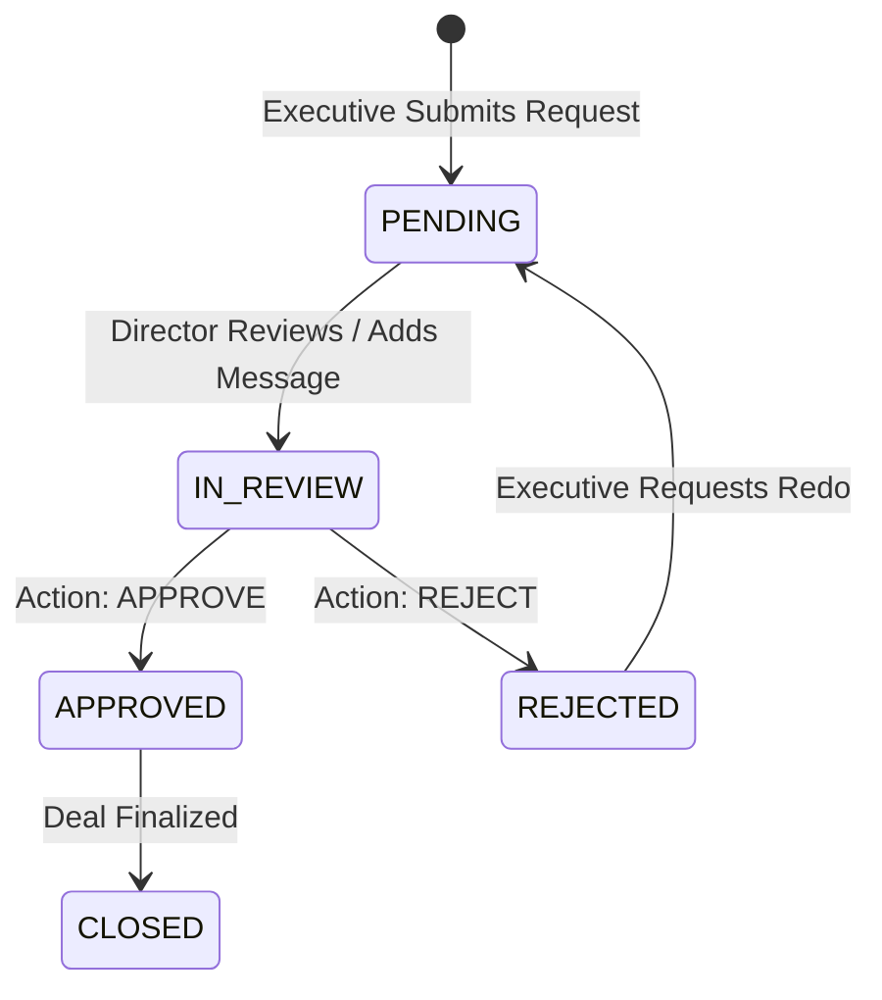

When a sales executive or closing manager negotiates pricing, payment terms, or unit hold deviations outside standard policy, an approval request is submitted to senior management (Sales Director, VP, or Business Manager). The Approvals API handles file uploads, hierarchical sign-off threads, and decision audit logs.

```http
BASE URL: /api/approvals
```

---

## Endpoints Summary

| Method | Path | Description | Access |
| :--- | :--- | :--- | :--- |
| `POST` | `/api/approvals/upload` | Upload supporting document or cost sheet to blob storage | Authenticated |
| `POST` | `/api/approvals` | Create a new discount or deviation approval request | Authenticated |
| `GET` | `/api/approvals` | List approval requests relevant to the user | Authenticated |
| `GET` | `/api/approvals/:id` | Fetch approval details, history, and message thread | Authenticated |
| `POST` | `/api/approvals/:id/messages` | Post a reply, or record `APPROVE` / `REJECT` decision | Authenticated |
| `PATCH` | `/api/approvals/:id/close` | Mark an approval ticket closed | Authenticated |
| `POST` | `/api/approvals/:id/redo` | Reopen a previously finalized approval for reconsideration | Authenticated |

---

## Approval Workflow



---

## Upload Approval Attachment

```http
POST /api/approvals/upload
Content-Type: multipart/form-data
```

Upload cost calculation sheets, competitor quotes, or customer approval letters before submitting the ticket.

### Response Example

```json
{
  "url": "https://blob.vercel-storage.com/approvals/1759300000-discount-cost-sheet.pdf"
}
```

---

## Create Approval Request

```http
POST /api/approvals
```

### Request Body

| Field | Type | Required | Description |
| :--- | :--- | :--- | :--- |
| `title` | `string` | **Yes** | Summary title (e.g. `3.5% Base Discount Request - Tower A Unit 1204`) |
| `description` | `string` | **Yes** | Detailed commercial justification and customer commitment |
| `type` | `string` | No | `DISCOUNT`, `PAYMENT_SCHEME`, `CANCELLATION_REFUND`, `UNIT_TRANSFER` |
| `fileUrl` | `string` | No | Blob URL returned from `/api/approvals/upload` |
| `bookingId` | `string` | No | Associated booking UUID if deal is already drafted |

### Request Example

```json
{
  "title": "Tower B Unit 804 - 3% Base Price Discount",
  "description": "Customer is ready to swipe full 10% booking amount (₹13.5L) today if base rate is reduced from ₹8,200/sqft to ₹7,950/sqft. Competing with Sobha project across the street.",
  "type": "DISCOUNT",
  "fileUrl": "https://blob.vercel-storage.com/approvals/1759300000-discount-cost-sheet.pdf",
  "bookingId": "cm123book001"
}
```

---

## Add Message or Decision

```http
POST /api/approvals/:id/messages
```

Used by management to ask clarifying questions or issue formal approval or rejection.

### Request Body

| Field | Type | Required | Description |
| :--- | :--- | :--- | :--- |
| `title` | `string` | **Yes** | Message title or status note |
| `description` | `string` | **Yes** | Feedback, conditions, or counter-terms |
| `action` | `string` | No | `APPROVE`, `REJECT`, or `REPLY` (defaults to `REPLY`) |
| `fileUrl` | `string` | No | Optional counter cost-sheet or revised approval letter |

### Approval Decision Example

```json
{
  "title": "Approved with Condition",
  "description": "Approved at ₹7,950/sqft strictly provided full agreement is executed within 15 calendar days.",
  "action": "APPROVE"
}
```

---

## Re-evaluate Decision (Redo)

```http
POST /api/approvals/:id/redo
```

Allows an executive to appeal a rejected request or request revised terms if a customer offers higher upfront payment after an initial rejection.
