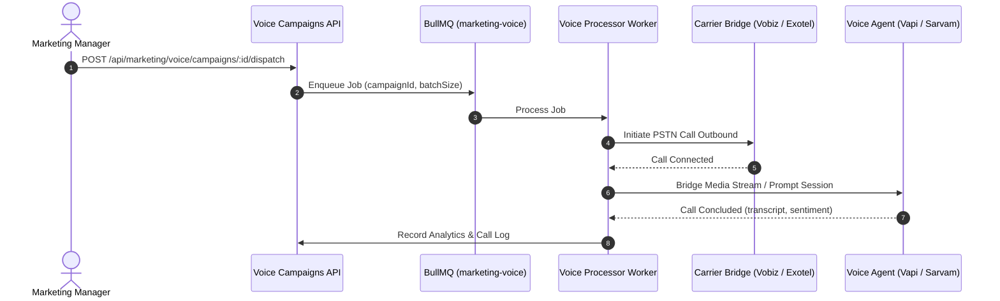

The Marketing Voice API drives automated outbound voice agent calling for lead qualification, site visit reminders, and cold outreach. It interfaces with AI voice platforms (Vapi, Retell, Sarvam) and PSTN carrier bridges (Vobiz, Exotel, Twilio).

```http
BASE URL: /api/marketing/voice/campaigns
```

---

## Endpoints Summary

| Method | Path | Description | Access |
| :--- | :--- | :--- | :--- |
| `GET` | `/api/marketing/voice/campaigns` | List all voice campaigns with filtering | Marketing / Admin |
| `POST` | `/api/marketing/voice/campaigns` | Create and configure a new voice campaign | Marketing / Admin |
| `POST` | `/api/marketing/voice/campaigns/draft` | Save an unfinished campaign configuration | Marketing / Admin |
| `POST` | `/api/marketing/voice/campaigns/estimate-audience` | Calculate matched lead count from filters or CSV | Marketing / Admin |
| `POST` | `/api/marketing/voice/campaigns/cost-estimate` | Estimate telephony and AI runtime costs | Marketing / Admin |
| `GET` | `/api/marketing/voice/campaigns/:id` | Fetch campaign configuration and agent details | Marketing / Admin |
| `POST` | `/api/marketing/voice/campaigns/:id/dispatch` | Launch campaign (enqueues BullMQ worker batch) | Marketing / Admin |
| `GET` | `/api/marketing/voice/campaigns/:id/analytics` | Get live analytics, duration, and sentiment KPIs | Marketing / Admin |
| `GET` | `/api/marketing/voice/campaigns/:id/recipients` | Paginated recipient call logs with recordings | Marketing / Admin |
| `POST` | `/api/marketing/voice/campaigns/bulk-assign` | Push interested leads directly into sales queues | Marketing / Admin |
| `POST` | `/api/marketing/voice/campaigns/recipients/:id/promote` | Promote a cold CSV recipient into a CRM Lead | Marketing / Admin |
| `DELETE` | `/api/marketing/voice/campaigns/:id` | Cancel or delete a campaign | Marketing / Admin |

---

## Campaign Execution Architecture



---

## Estimate Audience

```http
POST /api/marketing/voice/campaigns/estimate-audience
```

Returns the deduplicated, DND-scrubbed recipient count before launching calls.

### Request Body

```json
{
  "audienceSource": "CRM_LEADS",
  "projectId": "cm123proj001",
  "leadStatuses": ["NEW", "CONTACTED"],
  "leadTemperatures": ["HOT", "WARM"],
  "budgetMin": 10000000,
  "budgetMax": 20000000
}
```

### Response Example

```json
{
  "totalMatched": 1420,
  "validPhoneNumbers": 1395,
  "dndSuppressed": 115,
  "estimatedCallableAudience": 1280
}
```

---

## Calculate Cost Estimate

```http
POST /api/marketing/voice/campaigns/cost-estimate
```

Calculates expected spend based on projected call duration, AI agent tokens, and carrier PSTN rates.

### Request Body

```json
{
  "recipientCount": 1280,
  "estimatedDurationMinutes": 2.5,
  "voiceProvider": "VAPI",
  "carrierBridge": "VOBIZ"
}
```

### Response Example

```json
{
  "currency": "INR",
  "totalEstimatedCost": 4800.00,
  "breakdown": {
    "carrierPstnCost": 1600.00,
    "aiVoiceComputeCost": 3200.00,
    "costPerCompletedCall": 3.75
  }
}
```

---

## Dispatch Campaign

```http
POST /api/marketing/voice/campaigns/:id/dispatch
```

Transitions campaign status to `RUNNING` and queues asynchronous worker jobs. Telephony rate limiting (e.g. max 50 concurrent calls) is enforced automatically by BullMQ.

### Response Example

```json
{
  "success": true,
  "campaignId": "cm123vcamp001",
  "status": "RUNNING",
  "queuedJobs": 1280,
  "dispatchedAt": "2026-10-01T08:16:00.000Z"
}
```

---

## Get Campaign Analytics

```http
GET /api/marketing/voice/campaigns/:id/analytics
```

### Response Example

```json
{
  "campaignId": "cm123vcamp001",
  "totalDialed": 1280,
  "connected": 980,
  "failed": 300,
  "connectionRate": "76.5%",
  "averageCallDurationSeconds": 142,
  "sentimentBreakdown": {
    "POSITIVE": 412,
    "NEUTRAL": 390,
    "NEGATIVE": 178
  },
  "actionableOutcomes": {
    "siteVisitRequested": 88,
    "callbackRequested": 142,
    "notInterested": 310
  }
}
```

---

## Promote Recipient to CRM Lead

```http
POST /api/marketing/voice/campaigns/recipients/:id/promote
```

When a recipient from an uploaded CSV shows high purchase intent or requests a site visit during the AI call, this endpoint promotes the row into a full, actionable CRM `Lead` and assigns it to a sales executive.
