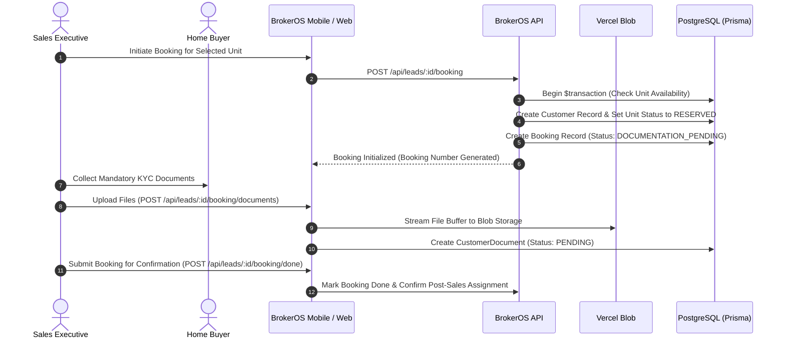

Creating a booking is the formal transition from sales negotiation to a confirmed real estate purchase. The BrokerOS Booking Engine validates agreed commercials, reserves inventory units, records token deposits, and collects mandatory KYC documents.

---

## The Booking Creation Flow

---

## Booking Application Particulars

When drafting a new booking, the sales executive inputs structured transaction details:

### Applicant Details
- **Primary Applicant**: Full legal name, contact phone number, email, and permanent residential address.
- **Co-Applicants**: Secondary buyer details for joint purchases or co-signed mortgage applications.

### Commercials & Payment Particulars
- **Agreed Purchase Consideration**: Final agreed price including base unit rate and applicable premiums.
- **Booking Token Deposit**: Initial earnest money deposit received to secure the reservation.
- **Payment Mode**: Supported payment methods including `CHEQUE`, `NEFT`, `RTGS`, `UPI`, `DEMAND_DRAFT`, or `CASH`.
- **Payment Reference**: Bank UTR number, cheque number, or transaction identifier.

### Unit & Parking Details
- **Allocated Unit**: Project, tower, floor, and unit identifier.
- **Parking Allocation**: Assigned parking slot or garage identification.
- **Financing Assistance**: Flag indicating if the buyer requires home loan facilitation from the post-sales team.

---

## Mandatory KYC Document Checklist

To comply with regulatory standards and identity verification guidelines, customer documents are categorized and tracked upon upload:

| Document Type | Format | Verification Purpose |
| :--- | :--- | :--- |
| **`PAN`** | PDF / Image | Tax identification for property registration and financial reporting. |
| **`AADHAAR`** / **`ADDRESS_PROOF`** | PDF / Image | Government-issued identity and permanent residence validation. |
| **`PASSPORT_PHOTO`** | JPG / PNG | Applicant and co-applicant identification photographs. |
| **`INCOME_DOCUMENT`** | PDF | Salary slips, tax returns, or audited financials for loan facilitation. |
| **`BANK_STATEMENT`** | PDF | Banking history verifying payment origin and mortgage eligibility. |
| **`BOOKING_FORM`** | PDF | Signed physical or digital booking agreement. |

---

## Booking Confirmation & Acknowledgement

Once initial terms and token payments are recorded:

- **Unique Booking Reference**: BrokerOS assigns a permanent booking number (such as `BKG-1727938491000`).
- **Unit Reservation**: The unit status flips from `AVAILABLE` to `RESERVED`, preventing concurrent pitches across the sales floor.
- **Transition to Post-Sales**: Calling `markBookingDone` advances the booking to `CONFIRMED`, triggers post-sales agent assignment, and locks lead progress to `BOOKING` (`DONE`).
