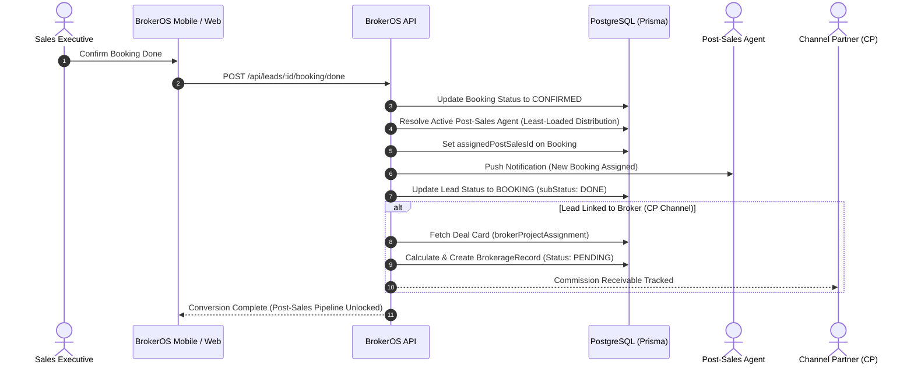

In real estate enterprise operations, a Lead and a Customer represent two distinct business stages. A Lead is an active prospect evaluating inventory; a Customer is a confirmed purchaser with legal obligations, payment schedules, and property deed rights.

Executing booking confirmation (`POST /api/leads/:id/booking/done`) seals the pre-sales sales cycle and shifts the record into post-sales processing.

---

## The Conversion Boundary

---

## Automated Conversion Operations

When a booking is marked confirmed in BrokerOS, the system executes a series of coordinated operations:

### Lead Status Finalization
- The lead status transitions to `BOOKING` with `subStatus: 'DONE'`.
- The contact is archived from active pre-sales calling queues and routine follow-up task rotations.
- Historical qualification notes, call recordings, and site visit logs are permanently preserved on the lead profile for audit and compliance.

### Post-Sales Ownership Assignment
- For direct non-CP projects, BrokerOS queries all active users with the `POST_SALES` role.
- The system identifies the executive with the lowest active booking workload (`assignedPostSalesBookings` count) and assigns them to the booking (`assignedPostSalesId`).
- An immediate in-app and push notification alerts the post-sales agent to begin processing the file.

### Customer Entity Linkage
- The permanent `Customer` record links the buyer's identity to the purchased unit and booking record.
- Customer records store verified identity proofs, communication records, and KYC documentation in one centralized profile.

### Channel Partner Brokerage Calculation
- If the booking originated from a Channel Partner (`lead.brokerId` is present):
  - BrokerOS references the project Deal Card (`brokerProjectAssignment`) for that broker.
  - The system calculates the commission using the agreed percentage or flat rate based on `agreedPrice`.
  - A `BrokerageRecord` is created with status `PENDING`, initiating the payout authorization workflow.

---

## Post-Sales Workflow Activation

Once converted, the customer record unlocks specialized post-sales operational modules:

- **Home Loan Processing**: Tracking mortgage loan applications, lender sanction letters, and tripartite documentation (`POST /api/leads/:id/booking/loan-case`).
- **Builder-Buyer Agreement (BBA)**: Managing formal legal agreement drafting, signing, and registration tracking (`POST /api/leads/:id/booking/agreement`).
- **Payment Schedules & Invoicing**: Tracking milestone-based demand letters, tax compliance, and payment receipts (`PaymentSchedule`).
- **Possession & Handover**: Managing final site inspections, key handover, and utility transfer records (`POST /api/leads/:id/booking/handover`).
