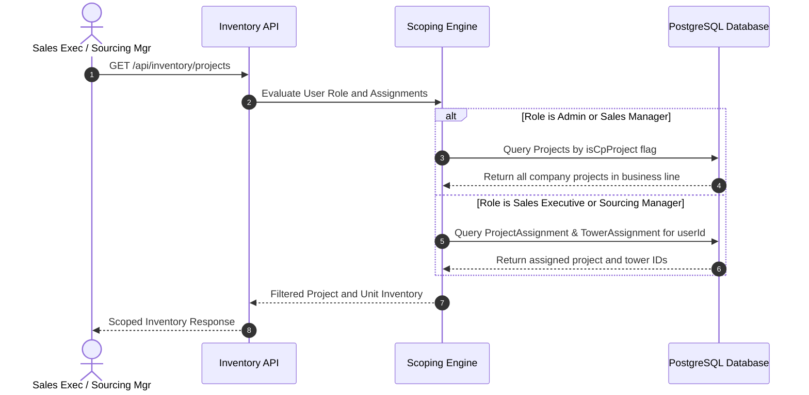
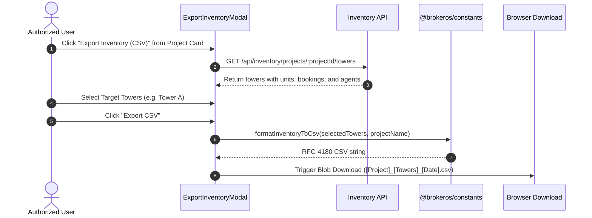

Real estate developments encompass hundreds or thousands of individual units across multiple construction towers and phases. BrokerOS organizes property inventory into a structured, four-tier hierarchy: **Projects -> Towers -> Floors -> Units**.

---

## Architectural Hierarchy

BrokerOS maps physical developments into four interconnected database layers:

```
[Project] Master Real Estate Development
  │
  └── [Tower] Building, Phase, or Villa Cluster
        │
        └── [Floor] Specific Vertical Level
              │
              └── [Unit] Salable Apartment, Penthouse, or Commercial Space
```

---

## Project Level (`Project`)

The project represents the overarching real estate development:

- **Commercial Boundary (`isCpProject`)**: 
  - `false`: Internal direct brokerage sales. Handled exclusively by internal pre-sales and sales executives.
  - `true`: External Channel Partner (CP) network. Handled by sourcing managers and closing managers with external broker commissions.
- **Project Identity**: Development name, developer or builder reference (`builderId`), master land area, and project category (`RESIDENTIAL`, `COMMERCIAL`, `MIXED`).
- **Statutory Compliance**: Registration certificate number (`reraNumber`), regulatory approval dates, and compliance portal links.
- **Geographic Location**: High-precision coordinates (`latitude`, `longitude`) and map URLs used for geofenced site visit verification.
- **Master Amenities**: Community attributes such as clubhouses, fitness centers, swimming pools, and dedicated green spaces.
- **Development Status**: Lifecycle state (`UPCOMING`, `ACTIVE`, `COMPLETED`, `ON_HOLD`), civil construction milestone, and possession timeline.

---

## Tower Level (`Tower`)

Towers represent individual buildings, development phases, or distinct clusters within a project:

- **Structural Specifications**: Tower identifier, total floor count (`totalFloors`), total unit capacity (`totalUnits`), and lift core configuration.
- **Independent Timelines**: Separate possession deadlines (`possessionTimeline`) and civil construction progress tracking per tower.
- **Phase Scoping**: Multi-tower master communities can release towers sequentially, allowing sales teams to pitch active inventory while holding future phases in reserve.

---

## Floor Level (`Floor`)

Floors provide the vertical physical grouping within each tower:

- **Floor Identity**: Floor number (`floorNumber`), label name (for example, Ground Floor, Mezzanine, 14th Floor), and total unit allocation.
- **Elevation Rules**: Floor numbers drive automated floor rise charges (FRC) in the dynamic pricing engine.
- **Matrix Grouping**: The unit matrix uses floor records to render architectural cross-sections where units sit on their actual physical level.

---

## Unit Level (`Unit`)

The individual apartment, penthouse, villa, or commercial space available for purchase:

- **Unit Identification**: Numbering identifier (for example, `TWB-1402`), linked to its parent `floorId`.
- **Typology (`UnitType`)**: Standardized configuration classifications:
  - `STUDIO`, `ONE_BHK`, `TWO_BHK`, `THREE_BHK`, `FOUR_BHK`, `PENTHOUSE`, `VILLA`, `SHOP`, `OFFICE`.
- **Area Measurements**:
  - **Carpet Area**: Net usable floor area inside internal walls.
  - **Built-Up Area**: Carpet area plus internal and external wall thickness.
  - **Super Built-Up Area**: Built-up area plus proportionate common lobby, elevator core, and amenity spaces.
- **Orientation & Features**: Main entrance facing direction, balcony counts, and dedicated parking allocations (`parkingIncluded`).
- **Commercial Brokerage**: Unit-level base price (`basePrice`), commission percentage (`commissionPercentage`), and calculated commission amount (`commissionAmount`).
- **Availability State (`UnitStatus`)**:
  - `AVAILABLE`: Open for pitching, cost sheet generation, and holds.
  - `BLOCKED`: Temporary administrative or negotiation hold active.
  - `RESERVED`: Customer token received, awaiting documentation.
  - `SOLD`: Legally booked and confirmed with an executed agreement.

---

## AI-Powered Tower Generation and Wizards

To eliminate manual data entry when onboarding large developments with hundreds of units, BrokerOS provides two rapid inventory builders:

### Natural Language AI Generator

Administrators and Sales Managers can generate complete multi-story tower structures by submitting a natural language prompt to the built-in AI engine powered by Groq:

```
Generate a 24-floor residential tower named 'Tower B' with 4 units per floor:
two 2BHK units facing East (1,150 sqft, $420,000, 2.5% commission) and
two 3BHK units facing West (1,650 sqft, $610,000, 3.0% commission).
Floor 1 features 4 commercial retail shops facing the boulevard.
```

The engine validates structural constraints, generates the complete JSON schema, and persists the entire tower, floor, and unit hierarchy inside an atomic database transaction.

### Manual Tower Wizard

For non-standard floor plans or architectural irregularities:

1. Specify tower name, basement counts, and total residential floor levels.
2. Define typical floor templates with custom unit typologies, carpet areas, and facing directions.
3. Apply templates across floor ranges (for example, Floors 2 through 18 follow Typical Plan A, while Floors 19 through 24 feature Duplex Penthouses).
4. Review preview counts and save to the database.

---

## Possession Status and Timeline Inheritance

Construction progress and delivery timelines follow an inheritance model:

1. **Project Baseline**: Master possession target set at project creation (for example, *December 2028*).
2. **Tower Specification**: Individual towers can define independent delivery dates (for example, *Tower A: Ready in 12 Months*, *Tower B: Ready in 24 Months*).
3. **Unit Overrides**: Individual units can specify custom civil readiness tags (for example, *Ready to Move* vs *Bare Shell*) using the possession override drawer.

---

## Inventory Scoping and Access Control

BrokerOS enforces strict inventory scoping so sales executives only view developments relevant to their assignments:



### Scoping Rules

- **Management Visibility**: Administrators, Sales Managers, Pre-Sales Managers, and Post-Sales Managers have broad visibility across all projects within their respective commercial line (`isCpProject: false` for direct brokerage, `true` for CP network).
- **Project Assignments (`ProjectAssignment`)**: Explicitly binds a user to a project with an assigned role (`SOURCING_MANAGER`, `CLOSING_MANAGER`, or `SALES_EXECUTIVE`).
- **Tower Assignments (`TowerAssignment`)**: Allows granular allocation where an executive is scoped to specific towers within a larger development.
- **Workspace Cleanliness**: Prevents suburban villa specialists from seeing luxury high-rise condominium inventory, keeping dashboards, follow-ups, and matrices clutter-free.

---

## Inventory CSV Data Export

BrokerOS enables sales executives, closing managers, and department heads to export complete project and tower inventory records to RFC-4180 compliant CSV spreadsheets.

### In-App Export Flow

1. **Navigate to Inventory**: Go to `Dashboard -> Inventory` to view active project cards.
2. **Open Project Actions**: On any project card, click the three-dot action menu (`...`).
3. **Select Export Inventory**: Click **Export Inventory (CSV)** to open the export selection modal.
4. **Choose Towers**:
   - Use the **Select All Towers** toggle to export the entire master community, or
   - Select individual tower checkboxes (e.g. Tower A, Tower B) to export targeted phases.
5. **Download Spreadsheet**: Click **Export CSV** to instantly compile and download the CSV file.

### Export Architecture



### Exported Data Columns

The generated CSV contains comprehensive unit specifications and occupancy records:

| Column Header | Description | Sample Output |
| :--- | :--- | :--- |
| **Project** | Development name | Grand Residency |
| **Tower** | Tower name | Tower A |
| **Floor** | Floor level index | 4 |
| **Unit Number** | Physical unit code | 402 |
| **Unit Type** | Typology label | 3 BHK |
| **Status** | Inventory status (`AVAILABLE`, `RESERVED`, `BLOCKED`, `SOLD`) | SOLD |
| **Carpet Area (sq.ft)** | Usable carpet area | 1250 |
| **Built-Up Area (sq.ft)** | Plinth / built-up area | 1480 |
| **Super Built-Up Area (sq.ft)** | Saleable area | 1720 |
| **Facing** | Orientation direction | North-East |
| **Balconies** | Count of private balconies | 2 |
| **Parking Included** | Parking allotment flag | Yes |
| **Base Price** | Base inventory rate | 12500000 |
| **Price / Sq.Ft** | Calculated rate per square foot | 7267.44 |
| **Total Price** | Unit total list price | 13200000 |
| **Construction Status** | Current civil construction phase | READY_TO_MOVE |
| **Occupant / Buyer Name** | Confirmed purchaser or reserving agent name | Rahul Sharma |
| **Customer Phone** | Primary buyer phone number | +919876543210 |
| **Customer Email** | Primary buyer email address | rahul.sharma@example.com |
| **Booking Number** | System booking reference code | BK-2026-0042 |
| **Agreed Price** | Contracted sale consideration | 13000000 |
| **Booking / Action Date** | Date booking, reservation, or hold was executed | 2026-08-12 |
| **Sales Executive / Agent** | Closing agent or assigned sales executive | Amit Verma |
| **Remarks** | Architectural or commercial notes | Corner unit with park view |
