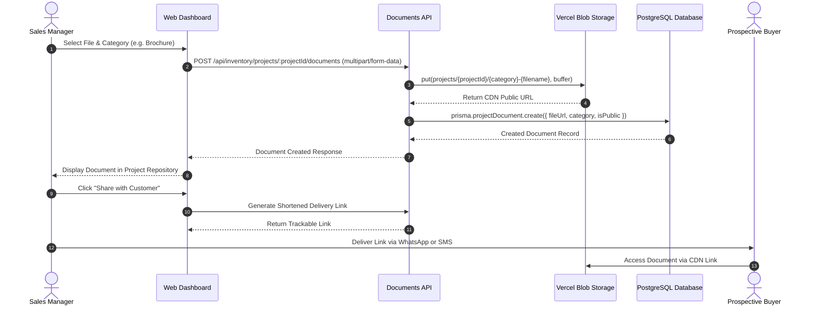

Real estate sales require extensive digital collateral: high-resolution digital brochures, architectural render walk-throughs, unit floor plans, and municipal sanction drawings. BrokerOS provides a dedicated Digital Asset Management (DAM) system backed by high-performance edge storage for instant access and customer sharing.

---

## Document and Asset Architecture

BrokerOS categorizes project assets across three dedicated data models to serve sales presentations, engineering tracking, and compliance:

| Model | Purpose | Key Attributes |
| :--- | :--- | :--- |
| `ProjectDocument` | Marketing brochures, legal approvals, master layouts, and price sheets. | `projectId`, `towerId`, `category`, `fileUrl`, `fileType`, `fileSize`, `isPublic` |
| `FloorPlan` | Architectural unit cut-sheets and floor-level layouts mapped to typologies. | `projectId`, `unitType`, `title`, `fileUrl`, `fileType`, `isActive` |
| `ConstructionUpdate` | Periodic civil milestone photos, progress reports, and stage tracking. | `projectId`, `title`, `stage`, `progressPercent`, `imageUrls`, `publishedAt` |

---

## Collateral Categories

Assets uploaded to `ProjectDocument` are grouped into standardized categories:

- **Marketing & Sales**:
  - High-resolution project brochure PDFs.
  - Interactive 3D virtual tour links and architectural renders.
  - Video walk-throughs and drone site footage.
- **Architectural & Layout Plans**:
  - Master layout blueprints and site boundary plans.
  - Tower cluster plans and floor plates.
  - Unit typology 2D and 3D architectural cut-sheets.
- **Legal & Compliance Documents**:
  - Regulatory registration certificates and approved title reports.
  - Municipal building sanction plans and environmental clearances.
  - Encumbrance certificates and draft sale agreement templates.

---

## Edge Storage and CDN Delivery

All assets are stored securely on **Vercel Blob Storage** backed by a global Content Delivery Network (CDN):

- **Structured Storage Keys**: Files are isolated by project and category using the standard path pattern:
  `projects/{projectId}/{category}-{originalFilename}`
- **High-Speed Global Delivery**: Static files and large PDFs download rapidly for domestic and international buyers.
- **Access Control (`isPublic`)**:
  - `isPublic: true`: Customer-facing brochures, floor plans, and video links accessible without authentication.
  - `isPublic: false`: Internal compliance deeds, draft contracts, and title reports restricted to authorized staff.

---

## Collateral Upload and Sharing Flow

The following sequence illustrates how marketing collateral is uploaded to edge storage and shared with prospective buyers:



---

## Sales Lounge Customer Sharing

During in-person consultations or remote follow-up calls:

1. Sales executives navigate to **Project Documents** within the web workspace or mobile app.
2. Filter collateral by tower or asset category.
3. Tap the **Share** button next to any brochure, floor plan, or construction milestone.
4. BrokerOS generates a trackable short link (for example, `https://brk.os/d/emerald-twb-brochure`).
5. When the buyer opens the link, the executive receives an instant engagement alert: *"Customer opened Tower B Master Brochure"*.

---

## Document Watermarking

To prevent unauthorized distribution of confidential pre-launch price sheets or proprietary layout plans, BrokerOS can dynamically overlay an audit watermark on exported PDFs:

```
Shared by: John Doe (+1 555-019-2831) for Alice Smith · Strictly Confidential
```

Watermarking deters unauthorized external circulation and ensures all shared materials are attributable to the originating sales representative.
