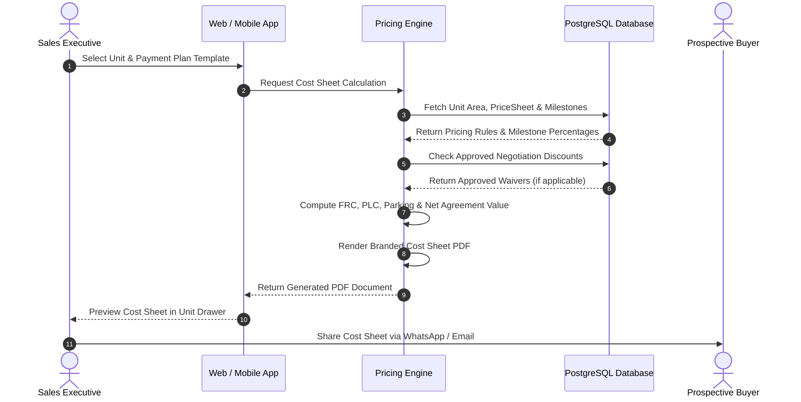

Real estate pricing is rarely a single static lump sum. Total purchase consideration comprises base rates, vertical elevation premiums, location premiums, dedicated parking allocations, and milestone payment schedules. BrokerOS automates this calculation, generating precise, branded cost sheets in real time.

---

## Price Breakdown Architecture

BrokerOS calculates the net property value by aggregating six distinct pricing components:

| Component | Calculation Basis | Example (1,850 sq.ft. Unit) |
| :--- | :--- | :--- |
| **Base Sale Price (BSP)** | Super Built-Up Area $\times$ Base Rate per sq.ft. ($400 / sq.ft.) | $740,000 |
| **Floor Rise Charges (FRC)** | Elevation premium per floor above base threshold ($2.50 / sq.ft. per floor) | $41,625 |
| **Preferential Location (PLC)** | Premium facing or unobstructed landscape view ($15 / sq.ft.) | $27,750 |
| **Dedicated Parking Slot** | Allocated covered garage or basement parking bay | $25,000 |
| **Amenities & Clubhouse Fee** | One-time resident clubhouse and recreational facilities allotment | $15,000 |
| **Infrastructure & Utility Connections** | Metering, power substation, and water connection fees | $12,000 |
| **Net Agreement Value** | **Total Developer Consideration** | **$861,375** |

Statutory duties, stamp registration fees, and local government taxes are itemized alongside the Net Agreement Value based on the governing project jurisdiction.

---

## Unit-Level Brokerage Commission

BrokerOS natively tracks brokerage commission terms directly within each unit record:

- **Commission Percentage (`commissionPercentage`)**: Contracted brokerage rate negotiated with the builder (for example, 2.5%).
- **Commission Amount (`commissionAmount`)**: Automatically computed financial consideration:
  $$\text{Commission Amount} = \frac{\text{Base Price} \times \text{Commission Percentage}}{100}$$
- **Post-Sales Reconciliation**: When a booking is created, these figures link directly to `BrokerageRecord` and `InboundCommission` ledgers for revenue tracking.

---

## Pricing and Payment Plan Models

BrokerOS structures pricing rules and payment milestones across four database models:

- **`PriceSheet`**: Defines versioned pricing matrices for a project:
  - Attributes: `projectId`, `version`, `effectiveFrom`, `effectiveTo`, `priceData` (JSON structure storing base rates, floor rise tiers, and PLC rates), `documentUrl`, `isActive`.
  - Enables developers to release scheduled price revisions without breaking existing historical quotes.
- **`PaymentPlanTemplate`**: Master payment schedules linked to a project:
  - Attributes: `projectId`, `name` (for example, Construction-Linked, 50:50 Subvention, Time-Linked), `description`, `isDefault`, `isActive`.
- **`PaymentPlanMilestone`**: Individual milestone line items inside a template:
  - Attributes: `templateId`, `name`, `percentage`, `dueDescription`, `sequenceOrder`.
  - Specifies the exact trigger condition (for example, *10% on Booking*, *15% on 5th Floor Slab Completion*, *10% on Handover*).
- **`Offer`**: Builder promotional incentives:
  - Attributes: `projectId`, `title`, `description`, `discountType` (percentage or fixed amount), `discountValue`, `validFrom`, `validTo`, `terms`, `isActive`.

---

## Cost Sheet Generation Flow

The following sequence illustrates how the BrokerOS pricing engine calculates itemized consideration and generates a branded cost sheet:

---

## Milestone Payment Schedule

When generating a cost sheet, the selected `PaymentPlanTemplate` breaks down total consideration into sequential milestone payments:

| Milestone | Stage / Trigger | Percentage | Payable Amount |
| :--- | :--- | :--- | :--- |
| **1. Booking Token** | Initial reservation deposit upon unit hold | 10% | $86,138 |
| **2. Agreement Execution** | Signing formal sale contract (within 30 days) | 10% | $86,138 |
| **3. Foundation Completion** | Completion of substructure and basement raft | 15% | $129,206 |
| **4. Structural Superstructure** | Completion of 10th floor civil slab | 25% | $215,344 |
| **5. MEP & Finishing** | External plastering, plumbing, and electrical | 25% | $215,344 |
| **6. Possession & Handover** | Notice of possession and key delivery | 15% | $129,205 |
| **Total** | **All-Inclusive Milestone Consideration** | **100%** | **$861,375** |

---

## Dynamic Adjustments and Approved Discounts

During customer negotiations, sales executives can apply approved discounts or waivers:

- **Approved Waivers**: If a Sales Manager has approved a discount via the [Negotiation & Approvals](/brokerage/sales/negotiations) workflow, the pricing engine recalculates the base rate, FRC, or amenity fees automatically.
- **Audit Consistency**: The resulting cost sheet explicitly records the approval reference, preventing discrepancies between verbal quotes and final booking contracts.
