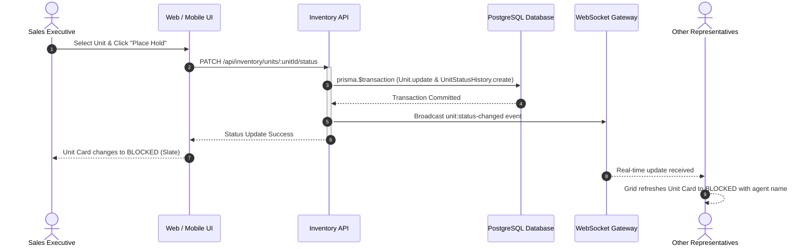

The **Unit Matrix** is the visual operational cockpit for real estate sales teams. Rather than navigating disconnected spreadsheets, sales executives and closing managers view a real-time, floor-by-floor architectural grid showing every unit's live inventory status.

---

## Visual Status States

BrokerOS maintains four explicit inventory states defined in the `UnitStatus` database enum, rendered with distinct visual badges:

| Color Badge | Unit Status | Definition | Permitted Actions |
| :--- | :--- | :--- | :--- |
| 🟢 **Emerald** | `AVAILABLE` | Uncommitted unit open for pitching, holding, or booking. | Place temporary block, reserve unit, generate cost sheet. |
| 🔘 **Slate** | `BLOCKED` | Unit placed on temporary administrative or negotiation hold. | View holding agent, inspect hold expiration, release hold. |
| 🟡 **Amber** | `RESERVED` | Customer reservation confirmed with token deposit. | Complete KYC, review payment schedule, proceed to booking. |
| 🔴 **Rose** | `SOLD` | Legally contracted, fully booked, and assigned to a customer. | View customer record, post-sales milestones, and contract. |

Typology icons rendered directly on unit cards distinguish commercial shops and offices, studios, and residential apartment layouts at a glance.

---

## Real-Time Synchronization and Status Transitions

During high-velocity sales events or project launches where multiple representatives pitch units simultaneously, BrokerOS ensures instantaneous synchronization to eliminate double-booking:

### Transactional Guarantees

- **Atomic Transactions (`prisma.$transaction`)**: All status changes execute inside database transactions. If two executives attempt to reserve the same unit simultaneously, only the first transaction commits; the second receives a conflict exception.
- **Audit Logging (`UnitStatusHistory`)**: Every transition logs the prior status, new status, timestamp, modifying user ID (`changedById`), and reason.
- **Hold Release (`clearBooking`)**: When returning a unit from `BLOCKED` or `RESERVED` to `AVAILABLE`, the system resets `blockedAt`, `blockedById`, `reservedAt`, `reservedForId`, and `soldAt`.

---

## Matrix Filtering and Discovery

Sales executives can filter the matrix in real time to match prospective buyer criteria:

<CardGroup cols={2}>
  <Card title="Typology & Layout" icon="bed">
    Filter by Studio, 1BHK, 2BHK, 3BHK, 4BHK, Penthouse, Villa, or Commercial units.
  </Card>
  <Card title="Floor Elevation Bands" icon="elevator">
    Filter by lower floors (1 to 5), mid-rise levels (6 to 15), or premium high-rise penthouse levels (16+).
  </Card>
  <Card title="Facing & Orientation" icon="compass">
    Filter by main entrance facing (East, West, North, South) or scenic views (Park Facing, Pool Facing).
  </Card>
  <Card title="Budget Caps" icon="dollar-sign">
    Filter units whose all-inclusive listed consideration falls strictly under the buyer pre-approved financial threshold.
  </Card>
</CardGroup>

---

## Interactive Unit Drawer

Clicking any unit on the matrix opens the **Unit Drawer**, presenting structural details and context-aware operational actions:

### Available Units (`AVAILABLE`)
- **Unit Specifications**: Tower, floor level, unit number, typology, carpet area, and super built-up area.
- **Financial Breakdown**: Base list price, floor rise charges, preferential location premium, and contracted brokerage terms.
- **Direct Actions**:
  - **Generate Cost Sheet**: Produces a branded, itemized PDF quote with milestone payment schedules.
  - **Place Hold / Block**: Temporarily locks the unit while the buyer reviews contract terms with family.
  - **Initiate Booking**: Opens the booking modal to attach buyer information and record token payments.

### Reserved and Sold Units (`RESERVED` / `SOLD`)
- **Customer Identity**: Full name, contact number, and email address of the buyer.
- **Assigned Representatives**: Originating Sales Executive and Sourcing Manager.
- **Financial Terms**: Agreed purchase price, token deposit amount, and brokerage commission splits.
- **Post-Sales Tracking**: Real-time status badges for loan case sanction, agreement execution, and possession handover verification via `GET /api/inventory/units/:unitId/booking`.
