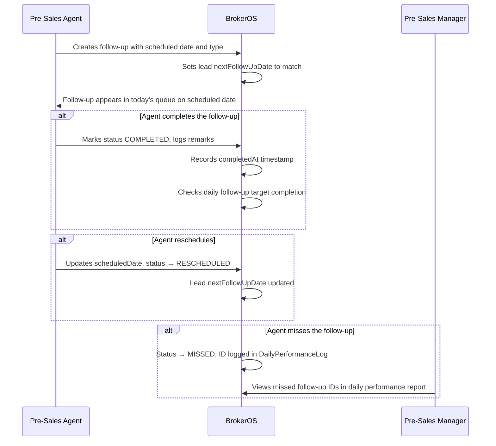

Real estate deals rarely close in one call. BrokerOS follow-ups make sure every lead has a clear next step, and that missed ones don't silently fall through the cracks.

---

## Follow-Up Lifecycle

---

## Follow-Up Statuses

These map directly to the `FollowUpStatus` enum in the database.

| Status | What It Means |
| :--- | :--- |
| `SCHEDULED` | Follow-up is set and waiting for the scheduled date |
| `COMPLETED` | Agent marked it done and logged remarks |
| `MISSED` | Scheduled date passed without completion |
| `RESCHEDULED` | Agent pushed it to a new date |
| `CANCELLED` | Follow-up was cancelled and will not be retried |

---

## How a Follow-Up Gets Created

Follow-ups can be created in three ways:

**Manually by an agent:** the agent picks a date, a type (call, WhatsApp, site visit, etc.), and adds a remark. As soon as it's saved, the lead's `nextFollowUpDate` field is updated to match.

**Automatically by the AI:** after every call, if the conversation ends positively, the AI reads the transcript and creates a follow-up automatically. It respects whatever date the lead mentioned ("call me next week"), defaults to 1–3 days otherwise, and never schedules on a Sunday.

**From a marketing campaign:** SMS, email, or voice campaign replies can trigger a follow-up to be created for the responding lead.

---

## Daily Performance Tracking

Each agent has a daily follow-up target set by their manager. BrokerOS tracks progress against this target in the `DailyPerformanceLog`:

- `followUpTarget`: the target count for the day
- `followUpsDone`: how many were marked `COMPLETED`
- `missedFollowUpIds`: an array of follow-up IDs that were not completed by end of day

When an agent marks a follow-up `COMPLETED`, BrokerOS automatically checks whether they've hit their daily target and triggers a completion notification if they have.

Managers can view the daily log per agent to see how many follow-ups were done versus missed, and which specific leads were left uncontacted.

---

## Follow-Up Types

The `type` field is a free-text label. Common values teams use:

| Type | When to Use |
| :--- | :--- |
| Call | Standard phone follow-up |
| WhatsApp | Sending brochures, floor plans, or price sheets |
| Site Visit | Coordinating a visit to the project |
| Meeting | In-person negotiation at office or client location |
| Email | Sending a formal proposal or offer letter |

