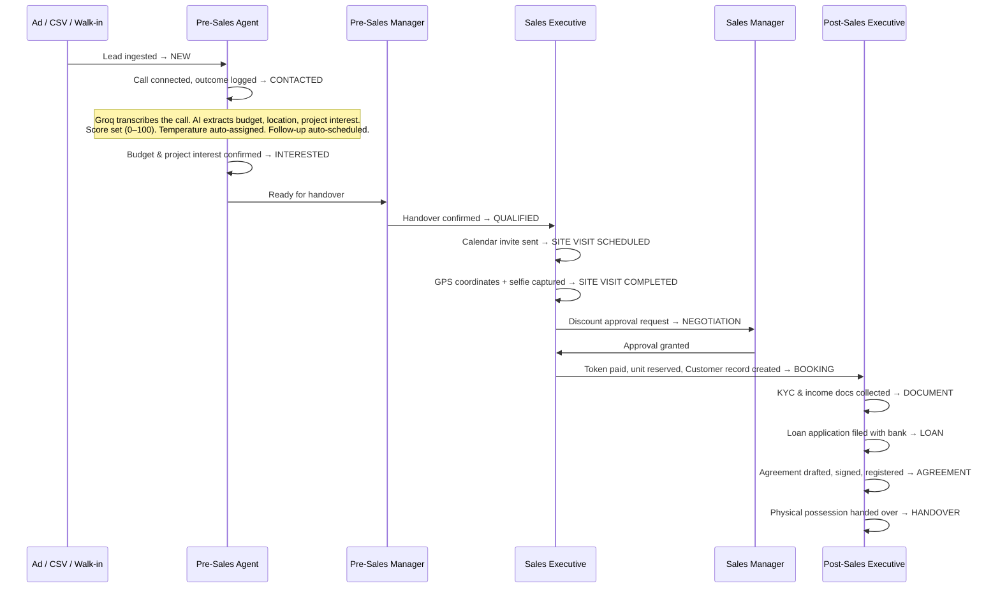

Every lead in BrokerOS travels through 13 statuses. Each stage has a clear owner and a specific trigger. For the pre-sales stages, an AI pipeline also runs in the background after every call.

---

## Status Reference

| Status | Owner | What Triggers It |
| :--- | :--- | :--- |
| `NEW` | Pre-Sales Floor | Lead created via ad webhook, CSV upload, manual entry, or walk-in |
| `CONTACTED` | Pre-Sales Agent | Outbound call connected; call recording uploaded and logged |
| `INTERESTED` | Pre-Sales Agent | Agent confirms budget and project match; AI score and temperature are set |
| `QUALIFIED` | Pre-Sales Manager | Manager reviews and approves handover to the sales team |
| `SITE_VISIT_SCHEDULED` | Sales Executive | Visit calendar invite sent to the client |
| `SITE_VISIT_COMPLETED` | Sales Executive | Visit verified on-site: live GPS coordinates and selfie captured via the mobile app |
| `NEGOTIATION` | Sales Manager | Sales exec submits a discount request; approval ticket opened |
| `BOOKING` | Sales Executive | Token payment received: unit atomically reserved, Customer record created in the same transaction |
| `DOCUMENT` | Post-Sales Executive | KYC, income proof, and property documents collected from the buyer |
| `LOAN` | Post-Sales Executive | Home loan application filed with the bank; sanction letter tracked |
| `AGREEMENT` | Post-Sales Executive | Sale agreement drafted, signed, and registered |
| `HANDOVER` | Post-Sales Executive | Physical possession handed over; unit status set to `SOLD` |
| `LOST` | Management | Lead dispositioned with a mandatory reason code |

---

## AI Pipeline: What Happens After Every Call

When a Pre-Sales Agent finishes a call and the recording is uploaded, BrokerOS runs a background pipeline automatically, requiring no manual action.

**Step 1: Transcription**

AI models transcribe the call audio. It handles Romanized Hindi and Marathi as well as English, since real estate calls often mix languages.

**Step 2: Call Summary & Data Extraction**

The transcript is passed to an LLM. It extracts:
- A 2–3 sentence call summary
- The lead's **budget** (converts "50L" → `5000000`, "1.5CR" → `15000000`)
- **Project interest** matched against active projects by name
- **Preferred location** and **property requirements**
- The **next-step suggestion** for the agent written as a single, specific action

Extracted fields are written to the lead record only if that field is currently empty. The AI never overwrites data the agent entered manually.

**Step 3: Lead Scoring**

AI scoring runs on the first 3 calls, and only if the lead's score is still 0. The LLM evaluates intent from the transcript and assigns a score on a 0–100 scale:

| Temperature | Score Range | What it means |
| :--- | :--- | :--- |
| `HOT` | 80–100 | Shared budget or location preference, agreed to a site visit |
| `WARM` | 40–79 | Listened to the pitch, asked questions, asked for WhatsApp details |
| `COLD` | 1–39 | Not interested, vague, or very early-stage exploration |
| _(no score)_ | 0 | Busy or didn't answer: score not set, retried on next call |

**Step 4: Auto Follow-Up Scheduling**

If the call ends positively, the AI creates a follow-up entry automatically. The scheduled date respects what the lead said ("call me next week", "call on Monday morning"). If nothing was specified, the AI defaults to 1–3 days out. Follow-ups are never scheduled on Sundays.

---

## After Booking: The Post-Sales Chain

Once `BOOKING` is confirmed, the lead converts into a **Customer** record and the unit is locked to `RESERVED`. The post-sales journey then tracks four sub-stages:

1. **DOCUMENT**: Post-sales exec collects KYC, income documents, and property papers from the buyer.
2. **LOAN**: Home loan application submitted to the bank. Sanction letter and disbursement tracked in the Loan Case record.
3. **AGREEMENT**: Sale agreement drafted and sent for e-signature or physical registration.
4. **HANDOVER**: Keys and possession certificate handed over. When marked done, the unit status is permanently set to `SOLD`.

