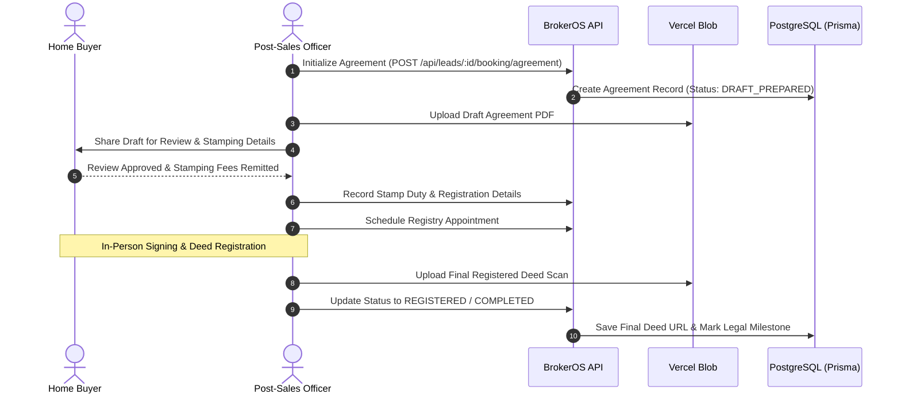

Executing and registering a formal Agreement for Sale is a vital milestone in the post-sales lifecycle. BrokerOS manages the entire legal documentation pipeline from draft preparation through statutory stamping, sub-registrar appointment, and registered deed archiving.

---

## Agreement Workflow

---

## Mandatory Agreement Particulars

BrokerOS ensures that every generated agreement captures standardized property specifications:

- **Carpet Area Certification**: Explicit living and usable carpet area stated in certified architectural dimensions.
- **Undivided Share of Property**: Proportionate ownership allocation in common land and community infrastructure.
- **Dedicated Parking Allocation**: Clearly defined covered or surface parking space identifiers matching the inventory allotment.
- **Possession Timelines**: Formal completion deadline, permitted inspection windows, and statutory grace periods.
- **Specification Schedules**: Complete schedule of interior finishes, structural standards, and builder warranties.

---

## Agreement Data Model (`Agreement`)

The legal agreement record is managed via `POST /api/leads/:id/booking/agreement`:

| Field | Type | Description |
| :--- | :--- | :--- |
| **agreementNumber** | String | Official agreement tracking number. |
| **status** | AgreementStatus | Lifecycle state: `NOT_STARTED`, `DRAFT_PREPARED`, `STAMP_DUTY_PAID`, `REGISTERED`, `COMPLETED`. |
| **draftDate** | DateTime | Date when the initial legal draft was generated. |
| **stampDutyAmount** | Decimal | Statutory stamp duty fee payable for deed execution. |
| **registrationFee** | Decimal | Official public recording fee. |
| **stampDutyPaid** | Boolean | Confirmation that statutory duties have been remitted. |
| **subRegistrarOffice** | String | Designated government recording office or registry jurisdiction. |
| **appointmentTime** | DateTime | Scheduled date and time for in-person signing and registration. |
| **registrationDone** | Boolean | Confirmation that the deed has been registered. |
| **lawyerName** | String | Name of the assigned legal counsel or conveyancing officer. |
| **lawyerContact** | String | Contact information for legal coordination. |

---

## Document Storage & File Archiving

Scanned copies of draft and registered documents are uploaded via `/api/leads/:id/booking/post-sales-file` with `type: 'agreement'`:

- **Draft Document (`draftDocumentUrl`)**: Initial unsigned agreement shared with the buyer for review.
- **Final Registered Deed (`finalDocumentUrl`)**: Complete scanned deed containing official registration stamps, signatures, and registry receipt numbers.
- **Timeline Integration**: Uploading the final agreement automatically updates the booking timeline, providing transparent legal progress tracking for both managers and buyers.
