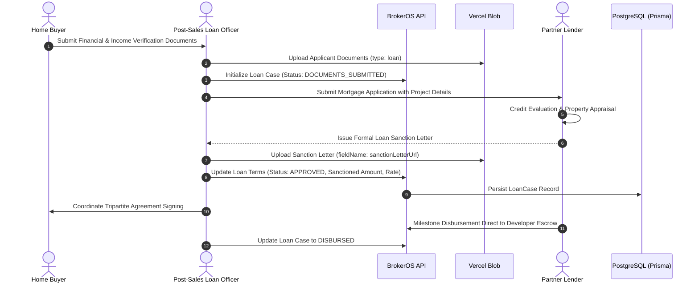

Most residential property transactions involve mortgage financing. Delays in mortgage processing directly affect project cash flow and buyer settlement schedules. The BrokerOS Home Loan Desk streamlines application tracking, monitors sanction letters, and coordinates loan disbursements.

---

## The Loan Lifecycle

---

## Loan Case Data Model (`LoanCase`)

Loan cases are created and updated via `POST /api/leads/:id/booking/loan-case`:

| Field | Type | Description |
| :--- | :--- | :--- |
| **loanApplicationNumber** | String | Official application or loan account reference from the lender. |
| **bankName** | String | Name of the primary lending financial institution. |
| **bankBranch** | String | Specific branch or underwriting office managing the file. |
| **bankContactPerson** | String | Assigned loan officer or relationship manager name. |
| **bankContactPhone** | String | Contact phone number for the lending officer. |
| **dsaName** | String | Name of the Direct Selling Agent or external loan distributor, if applicable. |
| **loanAmount** | Decimal | Original mortgage amount requested by the applicant. |
| **approvedAmount** | Decimal | Final loan principal approved by the credit committee. |
| **interestRate** | Decimal | Annual interest rate (percentage) agreed with the lender. |
| **tenure** | Int | Loan repayment duration in years or months. |
| **emiAmount** | Decimal | Estimated monthly installment payment. |
| **status** | LoanStatus | Current stage: `NOT_APPLIED`, `APPLIED`, `DOCUMENTS_SUBMITTED`, `UNDER_REVIEW`, `APPROVED`, `DISBURSED`, `REJECTED`. |
| **pendingActions** | Text | Outstanding checklist items required before next milestone. |
| **internalNotes** | Text | Internal coordination notes between the loan desk and buyer. |

---

## Document Management for Loans

Loan documents and sanction proofs are uploaded through `/api/leads/:id/booking/post-sales-file` with `type: 'loan'`:

- **Sanction Letter (`sanctionLetterUrl`)**: The official approval letter specifying the sanctioned loan amount, interest rate, and terms.
- **Supporting Documentation (`loanDocumentUrls`)**: Multiple supporting files including tax returns, payslips, bank statements, and credit reports stored securely as an array of cloud URLs.
- **Tripartite Agreements**: Agreements signed between buyer, builder, and lender governing milestone disbursements directly into designated project accounts.
