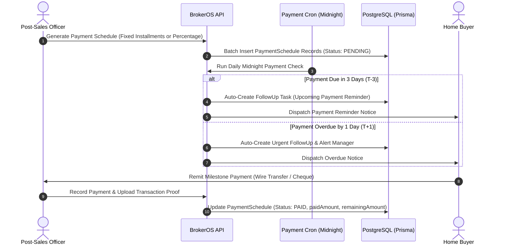

Real estate purchases span multiple months or years as development progresses. The BrokerOS Post-Sales Payment Engine structures payment milestone schedules, tracks buyer remittances, automates due-date reminders, and reconciles customer statements of account.

---

## The Payment Lifecycle

---

## Schedule Generation Modes

BrokerOS provides flexible schedule creation methods via the payments API:

### Fixed Installments Mode
- Splits the total consideration equally across a defined number of payments (`installmentsCount`).
- Supports flexible payment intervals: `MONTHLY` or `QUARTERLY`.
- Handles fractional rounding adjustments automatically on the final milestone.

### Percentage per Month Mode
- Allocates installments based on an agreed monthly percentage (`percentagePerMonth`).
- Automatically calculates the full milestone periods and schedules any remaining balance as a concluding installment.

---

## Payment Schedule Data Model (`PaymentSchedule`)

Each scheduled installment is persisted in the `PaymentSchedule` table:

| Field | Type | Description |
| :--- | :--- | :--- |
| **milestoneName** | String | Milestone title (e.g. `Installment 1` or construction stage name). |
| **sequenceOrder** | Int | Order of payment occurrence (1 to N). |
| **amount** | Decimal | Total scheduled installment amount. |
| **dueDate** | DateTime | Date by which payment is expected. |
| **status** | PaymentStatus | Current state: `PENDING`, `PARTIAL`, `PAID`, `OVERDUE`. |
| **paidAmount** | Decimal | Cumulative amount received toward this installment. |
| **remainingAmount** | Decimal | Outstanding balance remaining on the installment. |
| **lastPaymentDate** | DateTime | Date when the latest payment was processed. |

---

## Automated Due-Date Reminders & Cron Tracking

A daily background service (`PaymentsCron`) runs every night at midnight to audit payment timelines:

- **Upcoming Due Reminders (T-3 Days)**: Scans for pending installments due in exactly three days. The system automatically creates a scheduled follow-up task (`Upcoming Payment Reminder`) for the assigned executive to contact the buyer.
- **Overdue Escalations (T+1 Day)**: Identifies installments that expired yesterday without payment. The system immediately creates an urgent follow-up task (`URGENT: Payment Overdue`) and triggers management notifications.
- **Payment Verification**: When funds are received, the finance team logs the transaction reference and uploads receipt proofs to cloud storage, updating the customer's live ledger.
