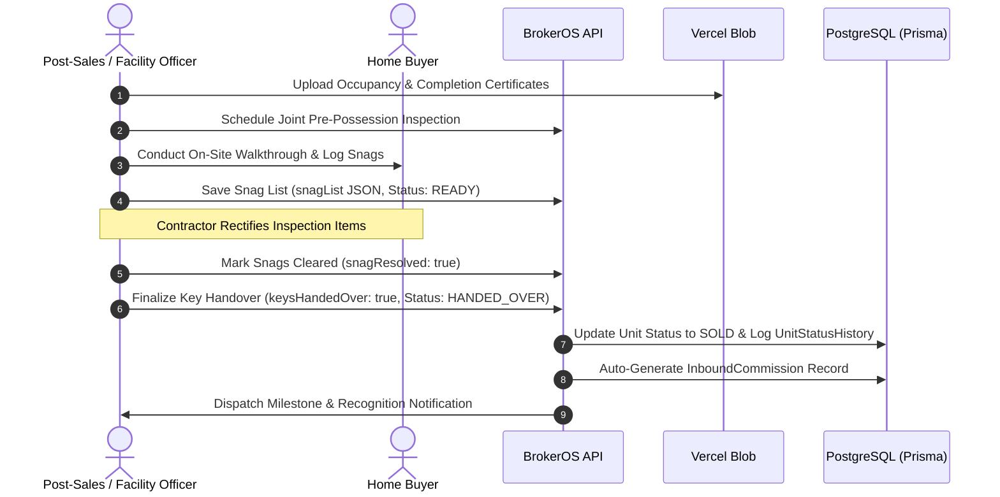

Possession is the final milestone in the real estate customer journey. When regulatory bodies grant occupancy and completion certificates, BrokerOS coordinates pre-possession inspections, tracks snag resolution, manages utility meter transfers, and records the formal key handover.

---

## The Possession & Handover Workflow

---

## Possession Handover Data Model (`PossessionHandover`)

Handover data is managed via `POST /api/leads/:id/booking/handover`:

| Field | Type | Description |
| :--- | :--- | :--- |
| **status** | PossessionStatus | Operational state: `NOT_READY`, `READY`, `SCHEDULED`, `HANDED_OVER`. |
| **expectedDate** | DateTime | Contractual estimated completion date. |
| **scheduledDate** | DateTime | Confirmed date for the joint handover walkthrough. |
| **actualDate** | DateTime | Date when physical possession took place. |
| **keysHandedOver** | Boolean | Confirmation that physical property keys were transferred. |
| **keyHandoverDate** | DateTime | Official timestamp of key transfer. |
| **handoverById** | String | User ID of the officer conducting the handover ceremony. |
| **handoverNotes** | Text | General handover remarks and documentation notes. |
| **customerFeedback** | Text | Client comments and satisfaction feedback. |

---

## Automated Side Effects on Handover Completion

When an officer marks keys as handed over (`keysHandedOver: true` or `status: 'HANDED_OVER'`), BrokerOS executes automated backend operations:

### Inventory Unit Locked to `SOLD`
The associated unit status transitions from `RESERVED` to `SOLD` (`Unit.status = 'SOLD'`), permanently removing it from available inventory.

### Status History Audit Trail
A permanent entry is written to `UnitStatusHistory`:
- `fromStatus`: `RESERVED`
- `toStatus`: `SOLD`
- `reason`: `Handover Completed`
- `changedById`: Handover officer user ID

### Inbound Commission Record Generated
If the unit has developer commission configurations (`commissionAmount` or `commissionPercentage`), the system auto-creates an `InboundCommission` record in `PENDING` status, alerting the accounts team to bill the developer.

### Officer Recognition & Milestone Achievements
BrokerOS dispatches an in-app achievement notification congratulating the officer and evaluates organizational career milestones (such as 10, 25, 50, 100, or 250 completed handovers).
