The BrokerOS In-Browser WebRTC Softphone enables pre-sales agents, sales executives, and sourcing managers to place outbound calls directly from their browser window without touching a physical phone. By integrating the Twilio Voice SDK alongside PSTN bridge carriers (Exotel, Vobiz, and Telnyx), agents can click to call leads and brokers, manage calls via a floating heads-up widget, take notes during the conversation, and have every conversation automatically recorded and transcribed by Groq Whisper.

---

## Softphone Architecture

```mermaid
sequenceDiagram
    autonumber
    actor Agent as Pre-Sales Agent (Browser)
    participant LeadHeader as Lead Profile Header ([LeadHeaderDetails.tsx](https://github.com/trybrokeros/BrokerOS/blob/main/apps/web/features/leads/components/profile/LeadHeaderDetails.tsx))
    participant Context as TelephonyContext ([TelephonyContext.tsx](https://github.com/trybrokeros/BrokerOS/blob/main/apps/web/features/telephony/context/TelephonyContext.tsx))
    participant Widget as ActiveCallWidget ([ActiveCallWidget.tsx](https://github.com/trybrokeros/BrokerOS/blob/main/apps/web/features/telephony/components/ActiveCallWidget.tsx))
    participant API as CrmTelephonyController ([crm-telephony.controller.ts](https://github.com/trybrokeros/BrokerOS/blob/main/apps/api/src/crm-telephony/crm-telephony.controller.ts))
    participant DB as PostgreSQL (Prisma)
    participant Carrier as Telecom Carrier (Twilio / Exotel / Telnyx / Vobiz)
    actor Lead as Buyer Mobile Handset
    participant Blob as Vercel Blob Storage
    participant Groq as Groq Whisper AI

    Agent->>LeadHeader: Click "Direct Call"
    LeadHeader->>Context: initiateCall({ id, name, phone, temperature })
    Context->>API: POST /api/crm/telephony/call
    API->>DB: Create CallRecord (direction: OUTBOUND, status: CONNECTED)
    API->>DB: Set User.isOnCall = true
    API-->>Context: Return { callRecordId, provider, bridgeType, tokenData }
    Context->>Widget: Mount Widget & Enter INITIALIZING / RINGING State
    Context->>Carrier: Connect In-Browser WebRTC or Bridge Outbound Call
    Carrier->>Lead: Outbound Call Rings Customer Mobile
    Lead-->>Carrier: Customer Answers
    Context->>Widget: Transition to CONNECTED (Start Elapsed Timer)
    Agent->>Widget: Type Call Notes & Save ([POST /api/leads/:id/notes](https://github.com/trybrokeros/BrokerOS/blob/main/apps/api/src/leads/leads.controller.ts))
    Agent->>Widget: Click End Call
    Widget->>API: POST /api/crm/telephony/hangup
    API->>DB: Set User.isOnCall = false & Update CallRecord.duration
    Carrier->>API: POST /api/crm/telephony/webhooks/twilio-recording (Audio File)
    API->>Blob: Stream Audio to Vercel Blob Storage
    API->>Groq: Enqueue Audio Transcription & LLM Summarization
    Groq-->>DB: Update CallRecord.aiTranscript & aiSummary (Fill Only If Empty)
```

---

## One-Click Dialing Triggers

Agents can trigger outbound softphone calls from two core CRM profile headers:

### 1. Lead Profile Header
Located in [`LeadHeaderDetails.tsx`](https://github.com/trybrokeros/BrokerOS/blob/main/apps/web/features/leads/components/profile/LeadHeaderDetails.tsx), the **Direct Call** button inspects the lead's phone number and initiates an outbound session:
- **Button State**: Displays an animated pulse icon when an outbound call is connecting or active for the lead.
- **Payload**: Passes `id`, `name`, `phone`, and `temperature` into `useTelephony().initiateCall`.
- **Keyboard & Screen Reader Accessibility**: Includes `aria-label="Call {name} directly via telephony carrier"` and `focus-visible` styling.

### 2. Broker Profile Header (CP Network)
Located in [`BrokerHeaderDetails.tsx`](https://github.com/trybrokeros/BrokerOS/blob/main/apps/web/features/brokers/components/profile/BrokerHeaderDetails.tsx), Sourcing Managers can call registered Channel Partners directly from their partner profile:
- **Button State**: Disables during active calls to prevent accidental concurrent dialing.
- **Tracking**: Links the resulting `CallRecord` directly to `brokerId`.

---

## Floating Active Call Widget

The [`ActiveCallWidget`](https://github.com/trybrokeros/BrokerOS/blob/main/apps/web/features/telephony/components/ActiveCallWidget.tsx) is rendered globally in [`apps/web/app/dashboard/layout.tsx`](https://github.com/trybrokeros/BrokerOS/blob/main/apps/web/app/dashboard/layout.tsx). When an agent initiates a call, the widget floats in the bottom-right corner of the viewport and persists across page transitions without interrupting the audio stream.

### Call States
The softphone lifecycle transitions through the following explicit states:

| Call State | Status Indicator | Audio & Visual Feedback |
| :--- | :--- | :--- |
| `IDLE` | Hidden | Widget is unmounted. |
| `INITIALIZING` | Connecting Carrier... | Amber pulsing badge. Synthetic ringback tone initialized. |
| `RINGING` | Ringing Customer... | Sky blue animated radio wave icon. Web Audio API ringing tone. |
| `CONNECTED` | Live Call: mm:ss | Emerald green pulsing badge. Real-time second counter increments. |
| `ENDED` | Call Completed | Slate badge with duration recap before dismissing. |
| `FAILED` | Connection Failed | Rose badge displaying the error message. |

### In-Call Controls
- **Mute / Unmute**: Toggles the agent's browser microphone input track using `softphoneEngine.setMuted(boolean)`.
- **End Call**: Immediately disconnects the active WebRTC session and sends `POST /api/crm/telephony/hangup` to release the agent's `isOnCall` flag.
- **Expandable Call Notes**: Agents can click **Take Call Notes** to expand an in-widget scratchpad, write key discussion points while talking to the lead, and save them directly to the lead timeline via `POST /api/leads/:id/notes`.

---

## Carrier Modes

The softphone automatically adapts based on the active company carrier configured in Admin Settings:

### 1. In-Browser WebRTC (Twilio Voice SDK)
- **Carrier**: Twilio.
- **Audio Routing**: Two-way audio runs directly through the agent's computer headset or microphone.
- **Token Minting**: The backend mints an ephemeral JWT Access Token with `VoiceGrant` via [`CrmTelephonyService.generateAgentToken`](https://github.com/trybrokeros/BrokerOS/blob/main/apps/api/src/crm-telephony/crm-telephony.service.ts).
- **Auto-Provisioning**: If Twilio credentials lack a dedicated API Key (`SK...`) or TwiML Application (`AP...`), BrokerOS auto-provisions them programmatically via the Twilio REST API.

### 2. PSTN Bridged Calling (Exotel / Vobiz / Telnyx)
- **Carriers**: Exotel (India), Vobiz (India), Telnyx (Global).
- **Audio Routing**: The carrier dials the customer's phone and simultaneously rings the agent's verified personal or office mobile number, bridging the two legs together.
- **Recording Callbacks**: The carrier records both channels and posts the audio URL to BrokerOS webhooks upon call completion.

### 3. Local Mock Mode (`CRM_MOCK_TELEPHONY=true`)
- Enables end-to-end local development and browser testing without live telecom credentials or carrier balance.
- Uses Web Audio API to synthesize ringing and connection tones, creates real `CallRecord` entries in PostgreSQL, and generates mock transcripts.

---

## Post-Call AI Processing Pipeline

When the call concludes, the carrier delivers the recording to the BrokerOS webhook:

1. **Carrier Recording Callback**: Handled by [`CrmTelephonyWebhooksController`](https://github.com/trybrokeros/BrokerOS/blob/main/apps/api/src/crm-telephony/crm-telephony-webhooks.controller.ts).
2. **Vercel Blob Upload**: The server downloads the MP3 audio buffer and streams it to Vercel Blob Storage under `calls/:targetId-:timestamp-:callRecordId.mp3`.
3. **Queue-Based Whisper Transcription**: [`CallRecordsService.enqueueAudioTranscription`](https://github.com/trybrokeros/BrokerOS/blob/main/apps/api/src/leads/call-records/call-records.service.ts) transcribes the conversation with Groq Whisper Large v3.
4. **Structured Intelligence Extraction**:
   - Call Summary: 2 to 3 sentence recap saved to `CallRecord.aiSummary`.
   - Next Step Suggestion: Saved to `Lead.aiNextStepSuggestion`.
   - Extracted Budget & Project: Filled into `lead.budget` and `lead.interestedProjectId` following the non-destructive **Fill Only If Empty** rule.
