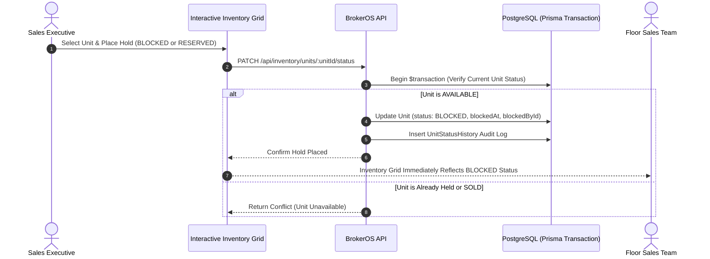

In high-demand residential developments, multiple sales executives frequently pitch premium inventory simultaneously. BrokerOS implements a transactional unit status management engine to prevent catastrophic double-bookings and maintain a complete audit trail of every status transition.

---

## Unit Status Workflow

---

## Unit Lifecycle States (`UnitStatus`)

Every unit in the BrokerOS inventory matrix transitions through four well-defined lifecycle states:

| Status | Meaning | Operational Rules |
| :--- | :--- | :--- |
| **`AVAILABLE`** | Open Inventory | Available for site visits, cost sheet generation, and immediate client pitch. |
| **`BLOCKED`** | Temporary Hold | Placed on temporary hold by an executive during active closing discussions. Displays holding user and timestamp. |
| **`RESERVED`** | Pending Booking | Reserved for a prospective customer while booking documents and token payments are verified. |
| **`SOLD`** | Confirmed Sale | Confirmed booking created and linked to unit. Unit is permanently removed from available inventory. |

---

## Transaction-Safe Double-Booking Prevention

To eliminate race conditions when multiple agents attempt to claim a unit simultaneously, BrokerOS executes status updates inside atomic database transactions (`prisma.$transaction`):

1. **Atomic Evaluation**: The system locks the unit record and checks its current status before applying modifications.
2. **Conflict Rejection**: If another agent has already transitioned the unit from `AVAILABLE` to `BLOCKED` or `SOLD`, the incoming request is immediately rejected.
3. **Real-Time Visual State**: The interactive inventory grid updates unit status markers immediately across web and mobile interfaces, alerting the entire sales floor that a unit is held.