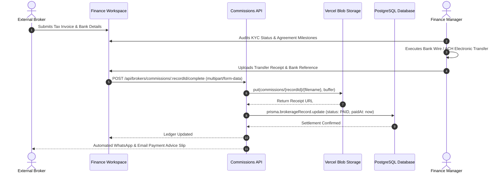

Settling commissions swiftly and transparently is the single most effective way to build loyalty among top-producing Channel Partner brokers. BrokerOS provides an audited settlement pipeline that protects corporate cash flow while eliminating payment friction.

---

## The Settlement Pipeline

Commission disbursements progress through a five-stage verification pipeline before funds are released:



---

## Pre-Settlement Verification Checklist

Before Finance can execute a settlement via `POST /api/brokers/commissions/:recordId/complete`, BrokerOS verifies five mandatory prerequisites:

| Verification Gate | Requirement | System Check |
| :--- | :--- | :--- |
| **Customer Consideration** | Buyer has cleared at least 10% of total property value. | Validated against Customer statement of accounts. |
| **Agreement for Sale** | Formal contract signed and registered with legal authorities. | Validated against Post-Sales agreement tracker. |
| **Broker KYC Standing** | Partner compliance status is strictly `VERIFIED`. | Checked against Broker KYC registry. |
| **Commercial Tax Invoice** | Broker has uploaded an itemized agency invoice. | Digital document inspected and confirmed by Accounts. |
| **Developer Inbound Status** | Builder has cleared Tranche 1 master fee to the firm. | Cross-referenced against InboundCommission ledger. |

---

## Statutory Tax Withholdings

Brokerage payments made to external real estate agents are subject to statutory withholding tax regulations:

- **Standard Withholding Rate**: 5% deducted at source for verified individual and corporate partners with active tax identification.
- **Unverified Tax Status Surcharge**: If an agency fails to provide a verified corporate tax ID, statutory regulations mandate a higher backup withholding rate (up to 20%).
- **Annual Tax Deduction Certificates**: BrokerOS aggregates quarterly tax deduction summaries, enabling finance teams to generate official withholding certificates for partner agencies.

### Payout Calculation Example

```
Agreed Gross Commission:             $25,000.00
Add: Applicable Sales Tax / VAT:      +$2,250.00
-------------------------------------------------
Total Invoice Consideration:         $27,250.00
Less: Statutory Withholding (5%):    -$1,250.00
-------------------------------------------------
Net Electronic Transfer to Broker:   $26,000.00
```

---

## Executing the Settlement

Finance users finalize the payout in the BrokerOS accounting workspace by attaching the bank transfer confirmation:

```http
POST /api/brokers/commissions/:recordId/complete
Content-Type: multipart/form-data
```

### Form Payload
- `file`: PDF or image scan of the electronic wire confirmation or bank payment slip. Saved directly to Vercel Blob under `commissions/{recordId}/{filename}`.
- `paymentReference`: Unique bank transaction reference or wire number (for example, `WIRE-20261001-928374`).
- `settledDate`: ISO date string of the executed transfer.

### Automated Broker Notification

Upon confirmation, the partner agency immediately receives an automated notification via WhatsApp and email:

> *"Dear Marcus Vance, your commission of $26,000.00 for Unit Tower B-1402 (Grand Horizon) has been transferred to your registered bank account (Reference: WIRE-20261001-928374). Click here to download your official payment advice slip."*
