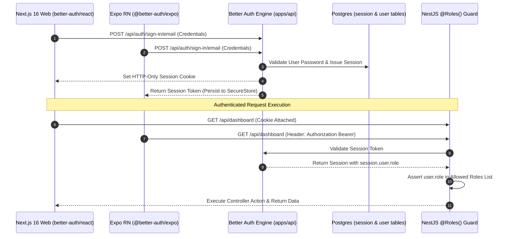

## The Auth Law

Authentication across the entire BrokerOS monorepo is powered exclusively by **Better Auth**. Custom JWT minting, custom session tables, and custom password hashing algorithms are strictly prohibited by system architecture law.

Every client (web, mobile, background workers) authenticates through the unified Better Auth server instance mounted in [`apps/api/src/auth/`](https://github.com/trybrokeros/BrokerOS/blob/main/apps/api/src/auth/).

---

## Authentication Flow



---

## 1. Backend Implementation (NestJS 11)

The backend integrates `@thallesp/nestjs-better-auth` with the Better Auth server instance in `apps/api/src/auth/`.

### Route Protection with Role Guards

Endpoints enforce role-based access control using the `@Roles()` decorator:

```typescript
import { Controller, Get, UseGuards } from '@nestjs/common';
import { AuthGuard, Roles } from '@thallesp/nestjs-better-auth';

@Controller('api/dashboard/sales')
@UseGuards(AuthGuard)
export class SalesDashboardController {
  @Get()
  @Roles(['SALES_EXECUTIVE', 'SALES_MANAGER', 'DIRECTOR', 'ADMIN'])
  getSalesData() {
    return { success: true };
  }
}
```

<Warning>
  **Role Security Invariant**: The user role is **always read server-side from `session.user.role`**. The API must never accept a `role` parameter from request bodies, headers, or query parameters.
</Warning>

### Public Endpoints

Public endpoints (such as incoming webhook receivers or public media endpoints) use the `@Public()` decorator to bypass authentication:

```typescript
import { Public } from '@thallesp/nestjs-better-auth';

@Public()
@Post('webhook')
handleIncomingWebhook() {
  // Unauthenticated access permitted
}
```

---

## 2. Frontend Implementation (Next.js 16)

The web application uses the official `better-auth/react` client configured in [`apps/web/lib/auth-client.ts`](https://github.com/trybrokeros/BrokerOS/blob/main/apps/web/lib/auth-client.ts):

```typescript
import { createAuthClient } from 'better-auth/react';

export const authClient = createAuthClient({
  baseURL: process.env.NEXT_PUBLIC_API_URL,
});

export const { signIn, signOut, useSession } = authClient;
```

### Route Protection via Next.js 16 Proxy

In accordance with Next.js 16 conventions, route protection and workspace redirects are handled in `apps/web/proxy.ts`. The proxy intercepts requests, verifies session cookies, and redirects unauthenticated users to `/login` before rendering protected `/dashboard` workspaces.

---

## 3. Mobile Implementation (Expo React Native)

The mobile application integrates `@better-auth/expo` with `expo-secure-store`:

1. **Keystore Storage**: On login, session tokens are stored inside `expo-secure-store`, protected by Android Keystore hardware-backed encryption.
2. **Authorization Headers**: The token is attached as an `Authorization: Bearer <token>` header to all API requests and WebSocket handshakes.
3. **Native Background Persistence**: The session token is copied to native `SharedPreferences` via `setAuthTokenForBackground`. This allows the Kotlin background worker (`CallUploadWorker.kt`) to upload audio files even when the React Native JavaScript thread is paused or the app is closed.

---

## Security Invariants

| Security Dimension | Enforcement Policy |
| :--- | :--- |
| **No Custom JWTs** | Custom token minting is strictly prohibited. Better Auth manages all sessions. |
| **No Passwords in Code** | Never accept, hash, or store plaintext passwords outside Better Auth workflows. |
| **Server-Side Invalidation** | Administrations can instantly terminate sessions globally from the CRM user table. |
| **Transport Security** | TLS 1.3 encryption on all public endpoints. HTTP-only flags on all session cookies. |
