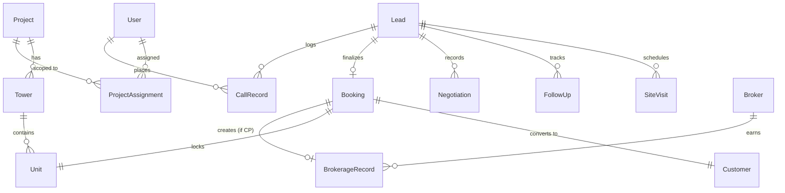

## Overview

BrokerOS relies on **PostgreSQL** managed through **Prisma 7**. The schema located at [`packages/prisma/schema.prisma`](file:///c:/Users/Sumama/Desktop/enterprise-crm-realtors/packages/prisma/schema.prisma) serves as the single source of truth for the entire database architecture.

All database queries across `apps/api` and `apps/workers` use the strongly typed Prisma client generated to `packages/prisma/generated/client` and re-exported via `@brokeros/prisma`. Raw SQL strings are strictly prohibited in application code.

---

## The Core Invariant (`Project.isCpProject`)

The BrokerOS platform hosts two completely distinct business models inside a single database instance:

1. **Internal Brokerage**: Internal sales team sells developer inventory directly to prospective homebuyers. Projects are flagged with `isCpProject = false`.
2. **Channel Partner (CP)**: External broker network recruited by Sourcing Managers and closed by Closing Managers. Projects are flagged with `isCpProject = true`.

```prisma
model Project {
  id          String   @id @default(cuid())
  name        String
  slug        String   @unique
  isCpProject Boolean  @default(false)
  // ...
}
```

<Warning>
  **The Law of Business Separation**: Exactly one boolean flag (`Project.isCpProject`) separates these two enterprise worlds. Never mix leads, units, site visits, or commission records across this boundary. All queries, listing endpoints, and role scopes must filter explicitly on `isCpProject`.
</Warning>

---

## Entity Relationship Overview



---

## Telephony & Softphone Architecture Models

The database tracks both company-wide carrier infrastructure and individual softphone call sessions:

### 1. `CrmTelephonyConfig`
Manages the organization's active carrier connection configured at `Dashboard -> Admin -> Settings -> CRM Telephony & WebRTC`:

```prisma
model CrmTelephonyConfig {
  id             String             @id @default(uuid())
  provider       VoiceTelephonyType // TWILIO, TELNYX, EXOTEL, VOBIZ
  name           String
  isActive       Boolean            @default(true)

  accountSid     String?
  authToken      String?
  apiKey         String?
  apiToken       String?
  subdomain      String? // e.g. api.exotel.com
  sipDomain      String?
  fromNumbers    String[] // Array of caller IDs / virtual numbers
  applicationSid String? // TwiML App SID or Telnyx App ID for browser WebRTC

  createdAt      DateTime           @default(now())
  updatedAt      DateTime           @updatedAt

  @@index([provider])
  @@index([isActive])
  @@map("crm_telephony_config")
}
```

<Note>
  **Single Active Carrier Rule**: Only one `CrmTelephonyConfig` record may have `isActive = true` at any given time. Connecting a new carrier automatically marks prior configurations inactive.
</Note>

### 2. `CallRecord`
Stores every inbound and outbound telecalling interaction, carrier identifiers, audio recording URLs, and AI intelligence:

```prisma
model CallRecord {
  id                    String              @id @default(uuid())
  leadId                String?
  brokerId              String?
  userId                String?
  phoneNumber           String
  direction             CallDirection       // INBOUND, OUTBOUND
  status                CallStatus          // CONNECTED, MISSED, BUSY, FAILED
  startedAt             DateTime
  endedAt               DateTime?
  duration              Int?                // Duration in seconds
  recordingUrl          String?
  recordingSize         Int?

  aiTranscript          String?
  aiSummary             String?
  aiSentiment           String?
  aiExtractedData       Json?

  provider              VoiceTelephonyType?
  providerCallId        String?             // Carrier Call SID or UUID
  agentBrowserSessionId String?

  createdAt             DateTime            @default(now())

  @@index([leadId])
  @@index([brokerId])
  @@index([userId])
  @@index([startedAt])
  @@index([direction])
  @@index([providerCallId])
  @@map("call_record")
}
```

---

## Transaction Law (`prisma.$transaction`)

Multi-model writes must always execute inside an interactive transaction (`prisma.$transaction`) to guarantee atomicity. For example, converting a lead into a confirmed booking:

```typescript
await prisma.$transaction(async (tx) => {
  // 1. Mark Unit as SOLD to prevent double-booking
  await tx.unit.update({
    where: { id: unitId },
    data: { status: 'SOLD' },
  });

  // 2. Advance Lead status to BOOKED
  await tx.lead.update({
    where: { id: leadId },
    data: { status: 'BOOKED' },
  });

  // 3. Create permanent post-sales Customer entity
  const customer = await tx.customer.create({
    data: {
      name: lead.name,
      phone: lead.phone,
      email: lead.email,
      bookingId: booking.id,
    },
  });

  // 4. Create BrokerageRecord if Channel Partner deal
  if (isCpDeal) {
    await tx.brokerageRecord.create({
      data: {
        bookingId: booking.id,
        brokerId: broker.id,
        commissionAmount: calculatedCommission,
        status: 'PENDING_VERIFICATION',
      },
    });
  }

  return customer;
});
```

If any step fails (e.g., duplicate customer constraint or broker commission calculation error), the entire transaction rolls back, leaving inventory units unlocked.

---

## Soft-Delete Pattern

To comply with real estate regulatory requirements and maintain financial audit trails, entity records are never hard-deleted from the database:

```prisma
model Lead {
  id        String    @id @default(cuid())
  name      String
  phone     String
  deletedAt DateTime?
}
```

All query services in `apps/api/` must explicitly append the filter:
```typescript
where: {
  deletedAt: null,
}
```

Records with non-null `deletedAt` timestamps are excluded from active dashboards, search indexes, and campaign recipient pools while remaining intact for historical audit reporting.

---

## Indexing & Performance Guidelines

The BrokerOS schema enforces indexes on frequently filtered fields:
- Composite index on `[projectId, status, deletedAt]` for fast lead pipeline queries
- Index on `[phoneNumberId, createdAt]` for incoming WhatsApp message lookups
- Unique index on `[email, deletedAt]` for customer deduplication
- Indexes on foreign keys (`brokerId`, `assignedUserId`, `unitId`) to optimize relational joins
- Index on `providerCallId` for fast lookup during carrier recording and status webhook callbacks

---

## Migration & Seed Workflows

Database schema changes and migrations must be managed through Turborepo from the repository root:

```bash
# 1. Update packages/prisma/schema.prisma

# 2. Re-generate Prisma Client to packages/prisma/generated/client
pnpm --filter @brokeros/prisma db:generate

# 3. Create and apply a migration in local development
pnpm --filter @brokeros/prisma db:migrate

# 4. Deploy migrations in staging or production environments
pnpm --filter @brokeros/prisma db:deploy

# 5. Populate local database with seed data (users, roles, projects)
pnpm --filter @brokeros/prisma db:seed
```

<Warning>
  Never manually edit or delete applied migration files in `packages/prisma/migrations/`. Always generate forward-only migrations.
</Warning>
