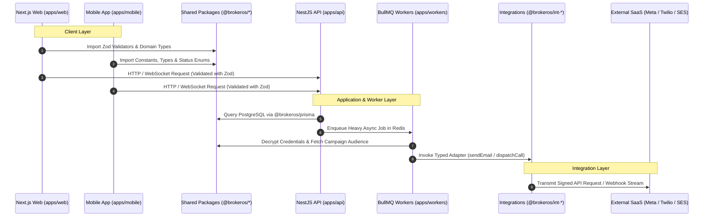

## Overview

BrokerOS organizes all services, frontends, mobile applications, shared domain packages, and third-party integrations into a single high-performance **pnpm monorepo** orchestrated by **Turborepo**.

This architecture delivers unified TypeScript type safety across backend APIs, Next.js web portals, and native Android code while enabling incremental compilation and cached test execution.

---

## Workspace Topology

The repository is structured into three primary top-level folders: `apps/`, `packages/`, and `integrations/`:

```
BrokerOS/
├── apps/
│   ├── api/          # NestJS 11 enterprise REST API and WebSocket gateways
│   ├── web/          # Next.js 16 App Router web portal (admin and sales workspaces)
│   ├── mobile/       # Expo 54 native Android app for field agents and telecallers
│   └── workers/      # BullMQ background task workers for marketing channels
│
├── packages/
│   ├── prisma/       # PostgreSQL schema, migrations, and generated client (@brokeros/prisma)
│   ├── constants/    # Pure TypeScript enums, colors, and normalizers (@brokeros/constants)
│   ├── types/        # Shared DTOs, interfaces, and event contracts (@brokeros/types)
│   ├── validators/   # Zod validation schemas for forms and payloads (@brokeros/validators)
│   └── storage/      # Centralized Vercel Blob cloud storage wrappers (@brokeros/storage)
│
├── integrations/
│   ├── voice/        # AI voice platforms and PSTN carrier adapters (@brokeros/int-voice)
│   ├── whatsapp/     # Meta WhatsApp Cloud API v22.0 adapter (@brokeros/int-whatsapp)
│   ├── mail/         # Email delivery provider adapters (SendGrid, SES, Brevo)
│   ├── sms/          # SMS gateway adapters (Twilio, Gupshup, Sinch, AWS SNS)
│   └── ads/          # Meta and Google Ads lead ingestion adapters
│
├── scripts/          # Root utility, maintenance, and mobile test automation scripts
├── package.json      # Monorepo root scripts, overrides, and devDependencies
├── pnpm-workspace.yaml # Workspace definitions (apps/*, packages/*, integrations/**)
└── turbo.json        # Turborepo task pipeline and caching rules
```

---

## Inter-Package Dependency Flow

Every application consumes domain logic and types from shared packages, while external SaaS calls route strictly through integration adapters:



---

## Turborepo Pipeline & Caching (`turbo.json`)

Turborepo orchestrates build tasks, unit tests, and code generation across the monorepo. The configuration in [`turbo.json`](file:///c:/Users/Sumama/Desktop/enterprise-crm-realtors/turbo.json) specifies:

- **Topological Task Sorting (`^build`)**: Dependent packages compile before consumer applications.
- **Cache Invalidation Inputs**: Hashes source code, dependencies, and environment variables defined in `globalEnv`.
- **Output Caching**: Caches `.next/**` bundles, `dist/**` directories, and generated Prisma artifacts.

```json
{
  "$schema": "https://turbo.build/schema.json",
  "ui": "tui",
  "globalEnv": [
    "BACKEND_URL",
    "NEXT_PUBLIC_API_URL",
    "NEXT_PUBLIC_APP_URL",
    "NEXT_PUBLIC_GOOGLE_MAPS_API_KEY",
    "NODE_ENV"
  ],
  "tasks": {
    "build": {
      "dependsOn": ["^build"],
      "inputs": ["$TURBO_DEFAULT$", ".env*"],
      "outputs": [".next/**", "!.next/cache/**", "dist/**"]
    },
    "dev": {
      "dependsOn": ["^build"],
      "cache": false,
      "persistent": true
    }
  }
}
```

---

## Environment Variable Law

BrokerOS enforces a strict split architecture to protect infrastructure secrets:

### 1. Root `.env` (Heavy Infrastructure Secrets)
Reserved exclusively for backend infrastructure, encryption keys, and third-party SaaS tokens. This file is gitignored and never distributed to client applications:
- `DATABASE_URL`: PostgreSQL connection string (direct and pooled)
- `REDIS_URL`: Redis host and port for BullMQ and WebSocket pub/sub
- `BETTER_AUTH_SECRET`: Secret key for cryptographic session tokens
- `GROQ_API_KEY`: Groq AI transcription and LLM inference key
- `BLOB_READ_WRITE_TOKEN`: Vercel Blob cloud storage credentials
- Carrier and telephony bridge keys (Vobiz, Exotel, Twilio)

### 2. App-Level `.env` Files (Client Routing & Public Keys)
Located in `apps/web/.env`, `apps/mobile/.env`, and `apps/api/.env`. These contain only public routing URLs and client keys:
- `NEXT_PUBLIC_API_URL`: Backend API endpoint for web browser fetch calls
- `EXPO_PUBLIC_API_URL`: LAN IPv4 address or emulator alias for the mobile app
- `EXPO_PUBLIC_GOOGLE_MAPS_API_KEY`: Android Maps SDK client API key

---

## Monorepo Scripts Policy

All maintenance, database migration, seeding, and testing scripts must live in the repository root inside `scripts/`:

- **Execution Engine**: We execute TypeScript scripts directly using `tsx` via `pnpm run script scripts/your-script.ts`.
- **Policy**: Never place standalone scripts inside `apps/api/scripts/` unless they are strictly bound to internal NestJS test doubles. General maintenance scripts belong at the root.

---

## Testing Architecture

BrokerOS enforces comprehensive headless and browser testing across applications:

| Test Command | Test Engine | Scope & Directory |
| :--- | :--- | :--- |
| `pnpm test:packages` | Vitest | Unit tests across `packages/` and `integrations/`. |
| `pnpm test:api:e2e` | Vitest | End-to-end integration tests in `apps/api/test/e2e/`. |
| `pnpm test:workers:e2e` | Vitest | Background processor tests in `apps/workers/test/e2e/`. |
| `pnpm test:all:e2e` | Vitest | Executes all headless unit and E2E suites in a single pass. |
| `pnpm test:web:e2e` | Playwright | Full browser automation specs in `apps/web/e2e/specs/`. |
| `pnpm test:mobile:e2e` | Maestro | Native Android UI flows in `apps/mobile/e2e/`. |

---

## Standard Monorepo Commands

Run from the repository root:

```bash
# 1. Install all dependencies across apps and packages
pnpm install

# 2. Start all applications in parallel development mode (API, Web, Workers)
pnpm dev

# 3. Compile all packages and production builds
pnpm build

# 4. Generate and run database migrations
pnpm db:generate && pnpm db:migrate

# 5. Execute all headless test suites
pnpm test:all:e2e
```
