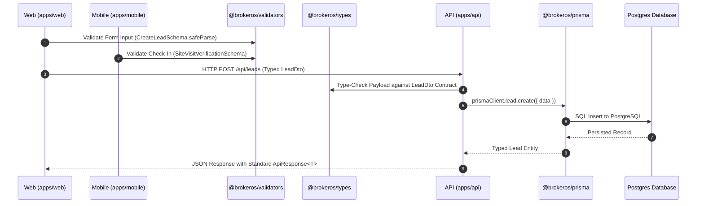

## Overview

To maintain domain type safety and eliminate duplicate code across the web application, mobile app, backend API, and worker processes, BrokerOS organizes domain logic into pure TypeScript packages under `packages/`.

These packages are consumed by applications via Turborepo workspace protocol (`"workspace:*"`), ensuring compile-time safety and instant IDE navigation across package boundaries.

---

## Package Integration Architecture



---

## The 5 Core Packages

### 1. `@brokeros/constants`
Contains pure TypeScript constants, enums, UI colors, and pure normalizer functions. It is decomposed into domain sub-modules rather than a monolithic flat file:

- **`voice/`**: Telephony carrier identifiers, AI agent platforms, voice catalog mappings, prompt templates, per-minute pricing tables, and the `normalizeVoiceLeadVariables` function.
- **`whatsapp/`**: Meta template categories, message status codes, and 24-hour customer service window thresholds.
- **`sms/`**: DLT operator entity mappings, encoding segment calculations (GSM-7 vs. UCS-2 Unicode).
- **`email/`**: SMTP provider port configurations and tracking pixel parameter keys.
- **`campaign.ts`**: Shared marketing broadcast status and channel enums.
- **`export.ts`**: RFC-4180 CSV lead formatter (`formatLeadsToCsv`) and standalone responsive HTML report generator (`generateAnalyticsHtmlReport`).

```typescript
import { LEAD_STATUS, VOICE_AGENT_PLATFORMS, normalizeVoiceLeadVariables, formatLeadsToCsv, generateAnalyticsHtmlReport } from '@brokeros/constants';
```

---

### 2. `@brokeros/types`
Central repository for shared TypeScript interfaces, DTO definitions, and event payloads:

- **`common.ts`**: Pagination queries, API response envelopes (`ApiResponse<T>`), and user session shapes.
- **`voice/`**: Telephony payloads, agent webhook bodies, carrier streaming audio buffers.
- **`whatsapp/`**: Meta Cloud API response types, interactive button tap payloads, and contact objects.
- **`email.ts` & `sms.ts`**: Recipient CSV row schemas, tracking events, and delivery receipts.
- **`export.ts`**: `ExportLeadRecord`, `AnalyticsReportPayload`, `AnalyticsSummaryCard`, `AnalyticsFunnelStage`, `AnalyticsReportSection`.

```typescript
import type { LeadDto, VoiceCampaignRecipient, ApiResponse, AnalyticsReportPayload, ExportLeadRecord } from '@brokeros/types';
```

---

### 3. `@brokeros/validators`
Shared **Zod schemas** providing runtime validation for web forms, mobile inputs, and API request bodies:

- **`PhoneSchema`**: Validates international E.164 phone formats (`/^\+?[1-9]\d{6,14}$/`).
- **`CreateLeadSchema`**: Validates prospect name, phone, budget, temperature, and assigned project ID.
- **`CreateCampaignSchema`**: Validates broadcast title, channel (EMAIL, SMS, VOICE, WHATSAPP), and audience sources.
- **`SiteVisitVerificationSchema`**: Validates latitude, longitude, and selfie URLs for mobile check-ins.

```typescript
import { CreateLeadSchema, type CreateLeadInput } from '@brokeros/validators';

// Validate form input on frontend before transmission
const validationResult = CreateLeadSchema.safeParse(formData);
if (!validationResult.success) {
  console.error(validationResult.error.format());
}
```

---

### 4. `@brokeros/prisma`
The centralized database package housing the Prisma ORM schema, migrations, and generated client:

- Schema file located at [`packages/prisma/schema.prisma`](https://github.com/trybrokeros/BrokerOS/blob/main/packages/prisma/schema.prisma).
- Prisma client generated directly to `packages/prisma/generated/client`.
- Exported via `@brokeros/prisma` for consumption by `apps/api` and `apps/workers`.
- Applications import the singleton client instance: `import { prismaClient } from '@brokeros/prisma'`.

---

### 5. `@brokeros/storage`
Centralized wrapper for cloud object storage (Vercel Blob):

- Generates pre-signed upload URLs for client uploads.
- Manages multi-part file streaming for heavy call recordings, site visit selfies, and brochures.
- Validates media MIME types (PDF, JPG, PNG, MP3) prior to storage persistence.

```typescript
import { uploadFile, deleteFile } from '@brokeros/storage';
```

---

## Package Development Laws

All code placed in `packages/` must adhere to strict architectural rules:

<Warning>
  1. **Zero Side Effects**: Packages must be **pure TypeScript**. Never import React, Next.js, or NestJS specific modules inside `packages/`.
  2. **No Circular Dependencies**: Packages must follow a strict hierarchy. For instance, `@brokeros/validators` may import `@brokeros/types`, but `@brokeros/types` must never import from `@brokeros/validators`.
  3. **No Direct External Calls**: Packages define interfaces and data shapes, not third-party SaaS HTTP callers. External network calls belong in `integrations/`.
  4. **Gradual Migration**: Migrate legacy types and constants out of `apps/web/` and `apps/mobile/` chunk by chunk into `packages/` without sweeping breakages.
</Warning>
