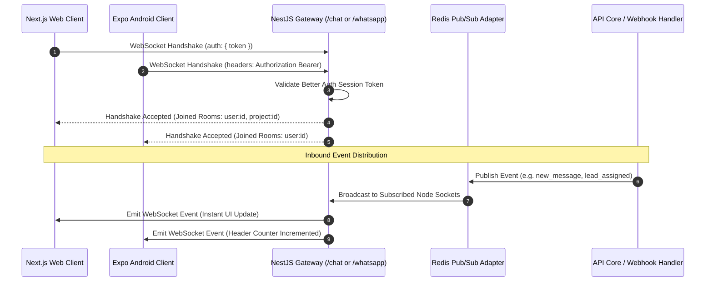

## Overview

Real estate brokerage workflows require immediate, low-latency data synchronization:
- Unit reservation locks must flash across all sales lounges instantly to prevent double-booking
- Inbound WhatsApp customer replies must appear in the team inbox without browser reloads
- Autonomous voice agents require raw bidirectional PCM audio streaming over low-latency WebSockets
- Manager employee trackers require live updates when telecallers start or end calls

BrokerOS implements a multi-gateway **WebSocket & Socket.IO** architecture powered by NestJS WebSocket gateways and Redis pub/sub adapters.

---

## Gateway Topology



---

## The 3 Dedicated Gateways

### 1. Chat & Notification Gateway (`/chat`)
Located in [`apps/api/src/chat/chat.gateway.ts`](file:///c:/Users/Sumama/Desktop/enterprise-crm-realtors/apps/api/src/chat/chat.gateway.ts):
- **Staff-to-Staff Messaging**: Real-time direct messages and project channel dialogues between field executives and managers.
- **Push Notification Broadcasts**: Transmits real-time alerts when a lead is assigned or an executive approves a discount.
- **Presence Tracking**: Displays live online/offline indicators for floor agents.

#### Room Scoping Patterns
```typescript
// Join personal notification channel
socket.join(`user:${userId}`);

// Join project lounge channel for hold announcements
socket.join(`project:${projectId}`);
```

---

### 2. WhatsApp Real-Time Gateway (`/whatsapp`)
Located in [`apps/api/src/marketing/whatsapp/gateway/whatsapp-realtime.gateway.ts`](file:///c:/Users/Sumama/Desktop/enterprise-crm-realtors/apps/api/src/marketing/whatsapp/gateway/whatsapp-realtime.gateway.ts):
- **Instant Inbound Push**: Broadcasts incoming customer text, attachments, and button taps the millisecond Meta's webhook posts an incoming reply.
- **Delivery Receipts**: Updates message ticks (sent to delivered to read) dynamically.
- **Agent Typing Indicators**: Broadcasts when a colleague or customer is actively composing a response.

---

### 3. Voice Media Stream Gateway (`/voice/stream`)
Located in [`apps/api/src/marketing/voice/gateway/voice-media-stream.gateway.ts`](file:///c:/Users/Sumama/Desktop/enterprise-crm-realtors/apps/api/src/marketing/voice/gateway/voice-media-stream.gateway.ts):
- **Low-Latency Audio Bridge**: Connects raw PSTN audio streams from telephony carriers (Telnyx TeXML or Twilio Media Streams) to LLM voice engines.
- **Audio Codec**: Streams bidirectional `audio/x-mulaw` (8kHz, 8-bit mono) or 16-bit linear PCM.
- **Barge-In Interruption Detection**: Detects user speech interruption and immediately clears the playback buffer to halt the AI agent from speaking over the prospect.

---

## WebSocket Authentication Law

All WebSocket connections must validate the Better Auth session token during the initial connection handshake. Unauthenticated connections are dropped immediately:

```typescript
@WebSocketGateway({ cors: { origin: '*' } })
export class ChatGateway implements OnGatewayConnection {
  async handleConnection(client: Socket) {
    const token =
      client.handshake.auth?.token ||
      client.handshake.headers?.authorization?.replace('Bearer ', '');

    if (!token) {
      client.disconnect(true);
      return;
    }

    const session = await validateBetterAuthSession(token);
    if (!session) {
      client.disconnect(true);
      return;
    }

    // Attach authenticated identity to socket instance
    client.data.user = session.user;
  }
}
```

---

## Horizontal Scaling with Redis Pub/Sub

In clustered production environments with multiple API instances running behind a reverse proxy, Socket.IO uses the `@socket.io/redis-adapter`. 

When an event is emitted on Server A, the Redis adapter broadcasts it across all peer nodes, ensuring messages reach the recipient regardless of which specific server node maintains their WebSocket connection.
