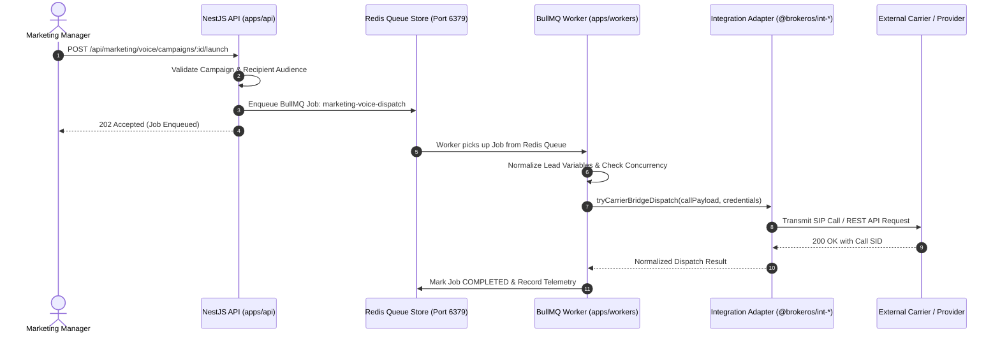

## The Workers Law

Heavy I/O operations such as dispatching 50,000 WhatsApp messages, streaming audio to telephony carriers, or parsing massive lead CSV files must **never execute inside the NestJS HTTP request cycle**.

BrokerOS enforces that all background jobs, bulk broadcasts, and external provider dispatches are enqueued via **BullMQ** backed by **Redis** and processed independently by [`apps/workers/`](https://github.com/trybrokeros/BrokerOS/blob/main/apps/workers/).

---

## BullMQ Processing Pipeline



---

## Dedicated Worker Processors

All worker processors live in [`apps/workers/src/processors/`](https://github.com/trybrokeros/BrokerOS/blob/main/apps/workers/src/processors/) and run as dedicated Node.js worker nodes:

### 1. `marketing-voice.processor.ts`
- Processes autonomous outbound AI voice campaigns.
- Integrates `normalizeVoiceLeadVariables` from `@brokeros/constants` to sanitize customer names, project titles, and phonetic pronunciations.
- Uses `tryCarrierBridgeDispatch` from `@brokeros/int-voice` to initiate calls via Vobiz, Exotel, Twilio, or Telnyx.
- Enforces strict carrier trunk concurrency limits (e.g., maximum 25 concurrent calls per trunk) to prevent SIP line exhaustion.

### 2. `marketing-whatsapp.processor.ts`
- Processes outbound Meta message template broadcasts and drip automations.
- Regulates dispatch velocity according to Meta Messaging Tiers:
  - Tier 1: 1,000 unique customers per rolling 24 hours
  - Tier 2: 10,000 unique customers per rolling 24 hours
  - Tier 3: 100,000 unique customers per rolling 24 hours
- Modular sub-runners in `processors/whatsapp/`:
  - `whatsapp-broadcast.runner.ts`: Batch broadcast distribution
  - `whatsapp-automation.runner.ts`: Conditional drip workflow execution
  - `whatsapp-template.syncer.ts`: Synchronizes approved templates from Meta

### 3. `marketing-sms.processor.ts`
- Dispatches bulk promotional and transactional SMS messages.
- Appends DLT principal entity IDs and template IDs for telecommunications compliance in India.
- Batches gateway transmissions (Gupshup, Twilio, Sinch, AWS SNS) in chunks of 100 recipients.

### 4. `marketing-email.processor.ts`
- Streams personalized HTML emails through SendGrid, Brevo, or AWS SES.
- Injects tracked short-links and transparent 1x1 tracking pixels for open and click attribution.
- Suppresses previously bounced or complained recipient addresses automatically.

---

## Job Configuration & Retry Policies

Workers configure exponential backoff retry strategies to handle temporary provider throttling or transient network errors:

```typescript
export const defaultJobOptions = {
  attempts: 3,
  backoff: {
    type: 'exponential',
    delay: 5000, // 5s, 10s, 20s
  },
  removeOnComplete: {
    age: 86400, // Retain completed job logs for 24 hours
    count: 5000,
  },
  removeOnFail: {
    age: 604800, // Retain failed jobs for 7 days for post-mortem analysis
  },
};
```

---

## Running Workers Locally

To start the worker cluster during local development:

```bash
# Starts BullMQ worker processors watching Redis on port 6379
pnpm --filter @brokeros/workers start:dev
```

To execute worker end-to-end integration test suites:

```bash
# Runs BullMQ processor E2E tests
pnpm test:workers:e2e
```
