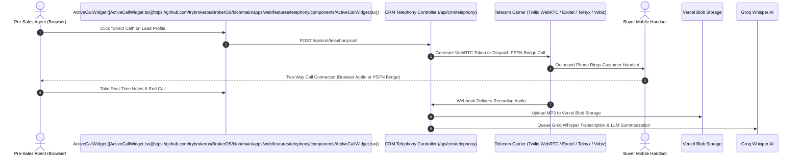
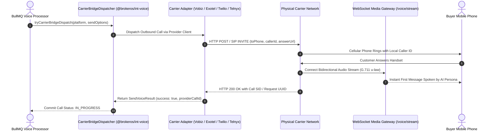

Telecom carriers connect BrokerOS to the Public Switched Telephone Network (PSTN), providing the telephone numbers, SIP trunking lines, and audio channels required to ring physical mobile handsets and landlines.

In BrokerOS, telephony serves two distinct operational channels:

1. **AI Voice Marketing Campaigns**: Automated outbound voice broadcasts executed by background BullMQ workers and AI conversational personas, configured at `Dashboard -> Marketing -> Voice -> Settings`.
2. **Company-Wide Human CRM Softphone**: In-browser WebRTC and bridged PSTN telecalling used by pre-sales agents and sales executives, configured by administrators at `Dashboard -> Admin -> Settings -> CRM Telephony & WebRTC`.

BrokerOS integrates four enterprise carriers through unified provider adapters located in [`integrations/voice/telephony/`](https://github.com/trybrokeros/BrokerOS/blob/main/integrations/voice/).

---

## Two Telephony Architectures

### 1. In-Browser CRM WebRTC Softphone
For direct human agent calling from Lead and Broker profiles, BrokerOS utilizes [`CrmTelephonyModule`](https://github.com/trybrokeros/BrokerOS/blob/main/apps/api/src/crm-telephony/crm-telephony.module.ts):



### 2. Marketing AI Voice Broadcasts
For high-volume AI voice broadcasts, BrokerOS uses the **Carrier Bridge Dispatcher** ([`tryCarrierBridgeDispatch`](https://github.com/trybrokeros/BrokerOS/blob/main/integrations/voice/bridge/carrier-bridge-dispatcher.ts)):



---

## The `IVoiceTelephonyProvider` Contract

Every carrier adapter inside [`integrations/voice/telephony/`](https://github.com/trybrokeros/BrokerOS/blob/main/integrations/voice/) implements the standard TypeScript interface defined in `@brokeros/types`:

```typescript
export interface IVoiceTelephonyProvider {
  readonly providerType: VoiceTelephonyType;
  
  // Validates API credentials and checks account status
  validateCredentials(credentials?: VoiceTelephonyCredentials): Promise<boolean>;
  
  // Initiates an immediate short verification test call
  testCarrierCall(
    toPhone: string,
    fromNumber: string,
    credentials?: VoiceTelephonyCredentials,
  ): Promise<{ success: boolean; callId?: string; error?: string }>;
}
```

---

## Supported Telephony Carriers

<CardGroup cols={2}>
  <Card title="Twilio" icon="network-wired" href="/integrations/telephony/twilio">
    **Primary Region**: Global (180+ Countries).
    
    Direct in-browser WebRTC VoIP calling via Twilio Voice SDK, TwiML call orchestration, programmable voice, and dual-channel call recording.
  </Card>

  <Card title="Telnyx" icon="satellite-dish" href="/integrations/telephony/telnyx">
    **Primary Region**: Global (Private IP Network).
    
    Carrier-grade elastic SIP trunking built on a private global IP backbone. Delivers ultra-low conversational latency, automated Outbound Voice Profiles, and TeXML media streaming.
  </Card>

  <Card title="Exotel" icon="headset" href="/integrations/telephony/exotel">
    **Primary Region**: India (Enterprise Cloud Telephony).
    
    India's leading cloud telephony platform. Provides virtual pilot numbers (ExoPhones), automated call recording, and native TRAI DND (Do Not Disturb) compliance scrubbing.
  </Card>

  <Card title="Vobiz" icon="tower-cell" href="/integrations/telephony/vobiz">
    **Primary Region**: India (Local Geographic CLI).
    
    Direct REST API and SIP trunking with Indian mobile and landline caller ID display. Delivers low domestic per-minute termination rates and dynamic XML answer callbacks.
  </Card>
</CardGroup>

---

## Carrier Feature Matrix

| Feature / Capability | Twilio | Telnyx | Exotel | Vobiz |
| :--- | :--- | :--- | :--- | :--- |
| **CRM In-Browser WebRTC** | Native (Twilio Voice SDK) | PSTN Bridge | PSTN Bridge | PSTN Bridge |
| **Primary Protocol** | REST API & TwiML | REST API v2 & TeXML | REST API & Basic Auth | REST API & XML Callback |
| **Indian CLI Presentation** | Supported (Regulatory Docs) | International E.164 | Supported (Virtual ExoPhones) | Supported (Local City Numbers) |
| **Automated DND Scrubbing** | Custom Suppression Lists | Custom Suppression Lists | Built-in TRAI Registry Scrub | Handled via API |
| **Media Stream WebSocket** | Native Twilio Media Streams | Native TeXML Media Streams | Call Routing Applet | Dynamic Answer Callback |
| **Audio Transcoding** | G.711 u-law / Linear PCM | G.711 u-law / Opus | G.711 A-law / u-law | G.711 u-law (8kHz) |
| **Multiple From Numbers** | Supported (Number Inventory) | Supported (Number Inventory) | Supported (ExoPhone Group) | Supported (Trunk Pool) |

---

## Where to Configure Telephony

Depending on the operational use case, configure your carrier in the corresponding interface:

### 1. CRM Telephony & WebRTC Softphone (Company-Wide)
- **Path**: `Dashboard -> Admin -> Settings -> CRM Telephony & WebRTC` (`/dashboard/admin/settings`).
- **Target Table**: [`CrmTelephonyConfig`](https://github.com/trybrokeros/BrokerOS/blob/main/packages/prisma/schema.prisma).
- **Scope**: Single active company-wide carrier for all browser telecalling, direct lead profile calls, and call recording uploads.
- **Verification**: Built-in test call verification modal (`POST /api/crm/telephony/verify`).

### 2. AI Voice Broadcast Platforms (Marketing Suite)
- **Path**: `Dashboard -> Marketing -> Voice -> Settings -> Gateways & Voice Platforms` (`/dashboard/marketing/voice/settings`).
- **Target Table**: `VoiceTelephonyIntegration`.
- **Scope**: Outbound voice campaign batches and conversational AI pipelines.
- **Verification**: Trunk verification and latency benchmarking (`POST /api/marketing/voice/integrations/telephony/:id/verify`).

---

## Related Guides

- [In-Browser WebRTC Softphone Guide](https://brokeros.mintlify.site//docs/brokerage/pre-sales/softphone.mdx)
- [Connect Twilio](https://brokeros.mintlify.site//docs/integrations/telephony/twilio.mdx)
- [Connect Telnyx](https://brokeros.mintlify.site//docs/integrations/telephony/telnyx.mdx)
- [Connect Exotel](https://brokeros.mintlify.site//docs/integrations/telephony/exotel.mdx)
- [Connect Vobiz](https://brokeros.mintlify.site//docs/integrations/telephony/vobiz.mdx)
- [CRM Telephony API Reference](https://brokeros.mintlify.site//docs/api-reference/crm-telephony.mdx)
