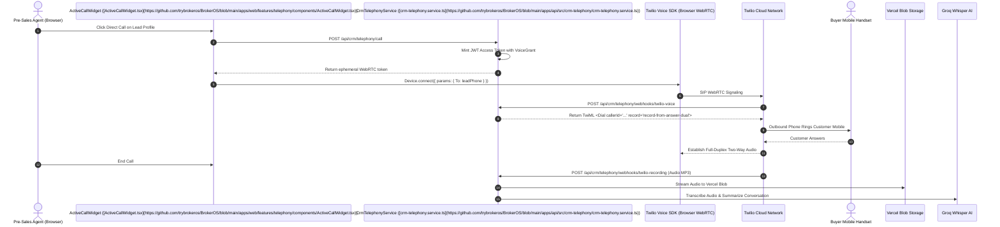

**Twilio** is the industry standard for programmable cloud communications, providing telephone termination in more than 180 countries. In BrokerOS, Twilio powers two key communication layers:

1. **In-Browser WebRTC Softphone**: Enables sales and pre-sales agents to dial leads directly from the browser with two-way headset audio via the Twilio Voice SDK.
2. **AI Voice Broadcast Campaigns**: Automated outbound voice calling driven by background BullMQ workers and AI conversational personas.

---

## 1. CRM In-Browser WebRTC Softphone Setup

To connect Twilio as the organization-wide softphone carrier:

### Navigation Path
Navigate to **Dashboard -> Admin -> Settings -> CRM Telephony & WebRTC** (`/dashboard/admin/settings`).

### Modal Form Fields

| Field Name | Status | Description & Example |
| :--- | :--- | :--- |
| **Account SID (Required)** | Required | Your Twilio Account SID starting with `AC` (e.g., `ACxxxxxxxxxxxxxxxxxxxxxxxxxxxxxxxx`). |
| **Auth Token (Required)** | Required | Primary API authentication secret (32+ characters). |
| **Registered Caller ID (From)** | Required | Verified Twilio phone number in international E.164 format (e.g., `+12025550199`). |
| **API Key SID (Optional)** | Optional | Dedicated Twilio API Key starting with `SK`. Auto-generated if left blank. |
| **API Key Secret (Optional)** | Optional | API Key secret pairing. Auto-generated if left blank. |
| **TwiML Application SID (Optional)** | Optional | TwiML Voice Application starting with `AP`. Auto-generated if left blank. |

### Zero-Config Auto-Provisioning
Twilio Voice WebRTC SDK v2 requires a dedicated API Key SID (`SK...`) and a TwiML Voice Application (`AP...`) configured with outbound voice webhook URLs.

If you leave the API Key and TwiML Application fields blank, BrokerOS automatically connects to the Twilio REST API during connection and auto-provisions:
1. **Twilio API Key**: Provisions `BrokerOS_CRM_WebRTC_Voice` and saves the secret pair.
2. **TwiML Voice Application**: Creates `BrokerOS CRM Outbound Voice App` pointing its `VoiceUrl` to `/api/crm/telephony/webhooks/twilio-voice` and its `StatusCallback` to `/api/crm/telephony/webhooks/twilio-status`.

### Verification Test Call
Once saved, click **Verify Carrier** in the admin header:
1. Enter your personal phone number in international E.164 format.
2. Click **Place Verification Call**.
3. Twilio dials your handset and speaks a verification confirmation message to ensure outbound trunk authorization.

---

## 2. Marketing AI Voice Broadcast Setup

To use Twilio for marketing AI voice campaigns:

<Steps>
  <Step title="Navigate to Voice Settings">
    In the BrokerOS sidebar, navigate to **Dashboard -> Marketing -> Voice -> Settings**.
  </Step>

  <Step title="Open Telephony Gateways Tab">
    Select the **Gateways & Voice Platforms** tab, switch to the **Telephony Gateways** sub-tab, click **Add Carrier**, and choose **TWILIO**.
  </Step>

  <Step title="Configure Trunk Parameters">
    Enter an **Engine Label / Name** (e.g., `Twilio Global Production Trunk`), fill in **Account SID**, **Auth Token**, and add your purchased number to **From Numbers**.
  </Step>

  <Step title="Verify Carrier Trunk">
    Click **Save & Verify Carrier**. BrokerOS tests credentials against `https://api.twilio.com/2010-04-01/Accounts/${accountSid}.json` and measures round-trip API network latency.
  </Step>
</Steps>

---

## WebRTC In-Browser Dialing Pipeline



---

## Twilio Media Streams (Marketing WebSocket Integration)

When running low-latency conversational AI agents (such as OpenAI Realtime or Pipecat), BrokerOS utilizes **Twilio Media Streams**:

1. Twilio executes the TwiML response returned by `/api/marketing/voice/webhooks/twilio-answer`:
   ```xml
   <?xml version="1.0" encoding="UTF-8"?>
   <Response>
     <Connect>
       <Stream url="wss://api.yourdomain.com/voice/stream">
         <Parameter name="campaignId" value="camp_luxury_launch"/>
         <Parameter name="agent" value="VAPI"/>
       </Stream>
     </Connect>
   </Response>
   ```
2. Twilio opens a WebSocket connection to BrokerOS on `/voice/stream`.
3. Audio packets are exchanged using 8-bit G.711 u-law companded frames at 8kHz, transcoded in real time.

---

## Related Guides

- [In-Browser WebRTC Softphone Guide](https://brokeros.mintlify.site//docs/brokerage/pre-sales/softphone.mdx)
- [Phone Carriers (PSTN) Overview](https://brokeros.mintlify.site//docs/integrations/telephony/overview.mdx)
- [CRM Telephony API Reference](https://brokeros.mintlify.site//docs/api-reference/crm-telephony.mdx)
