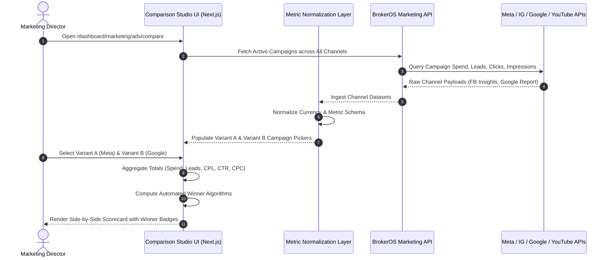

## Head-to-Head Campaign Intelligence

Digital ad budgets in real estate require continuous optimization between creative angles, audience targeting, and advertising networks. The BrokerOS **Campaign A/B Comparison Studio** (`/dashboard/marketing/ads/compare`) provides a unified benchmarking workspace to compare performance between two campaign groups (Variant A vs Variant B).

Whether comparing two competing creative variants on Meta, benchmark testing Stories against Reels on Instagram, or analyzing Meta vs Google Search return on ad spend, the comparison studio normalizes metrics across networks and computes definitive statistical winners.

---

## Comparison Studio Architecture

---

## Metric Normalization Layer

Because each advertising platform reports metrics using differing taxonomy, BrokerOS standardizes all campaign telemetry into a unified data structure (`NormalizedAdCampaign`):

| Normalized Field | Meta Facebook | Instagram | Google Search | YouTube Video |
| :--- | :--- | :--- | :--- | :--- |
| **`spend`** | Total Amount Spent | Total Amount Spent | Total Cost | Video Ad Spend |
| **`leadsCount`** | Form Submissions | Form Submissions | Conversions | View-through Leads |
| **`costPerLead`** | Cost Per Result | Cost Per Result | Cost / Conversion | Cost Per Lead / CPV |
| **`clicks`** | Link Clicks | Profile / Link Clicks | Search Clicks | CTA Clicks |
| **`ctr`** | Link Click CTR (%) | Placement CTR (%) | Search CTR (%) | View Rate / CTR (%) |
| **`cpc`** | Cost Per Click | Cost Per Click | Avg Cost Per Click | Avg CPC / CPV |
| **`impressions`** | Total Impressions | Feed/Story Impressions | Search Impressions | Video Impressions |

---

## Automated Winner Calculation Algorithms

When evaluating Variant A against Variant B, the comparison studio executes automated heuristic calculations across three primary performance dimensions:

### Cost Per Lead (CPL) Winner
Identifies which campaign group acquires CRM leads at the lowest unit cost:
- If Variant A CPL is lower than Variant B, Variant A is designated the CPL Winner.
- The efficiency savings percentage is computed as:
  $$\text{Savings \%} = \frac{\text{CPL}_{\text{higher}} - \text{CPL}_{\text{lower}}}{\text{CPL}_{\text{higher}}} \times 100$$
- Displays a prominent green trophy badge highlighting the percentage reduction in acquisition cost.

### Click-Through Rate (CTR) Winner
Evaluates creative and messaging resonance with prospective buyers:
- Compares engagement rates across total impressions.
- Calculates the engagement delta percentage between variants to confirm creative appeal.

### Total Acquisition Volume Winner
Compares absolute lead acquisition volume to balance unit economics against raw throughput, preventing tiny sample size skews from obscuring campaign scale.

---

## One-Click Comparison Presets

To accelerate routine reporting, the studio features pre-configured comparison presets:

<CardGroup cols={2}>
  <Card title="Compare Top 2 Meta" icon="object-intersect">
    Instantly selects your top two highest-spend Meta or Instagram campaigns for creative split testing. Ideal for evaluating video walkthroughs against static image carousels.
  </Card>
  <Card title="Compare Meta vs Google" icon="scale-balanced">
    Benchmarks social discovery ads (Facebook and Instagram) against high-intent search ads (Google Search and YouTube). Compares impulse lead volume against qualified search conversion rates.
  </Card>
</CardGroup>

---

## Head-to-Head Performance Scorecard

Once campaigns are selected on both sides, the studio renders an interactive side-by-side scorecard:

| Dimension | Variant A (Selected Campaigns) | Variant B (Selected Campaigns) | Automated Delta |
| :--- | :--- | :--- | :--- |
| **Total Spend** | Aggregated budget outlay | Aggregated budget outlay | Budget allocation ratio |
| **Leads Acquired** | Total CRM leads synced | Total CRM leads synced | Volume differential |
| **Cost Per Lead (CPL)** | Blended CPL | Blended CPL | Green Winner Badge (+% savings) |
| **Click-Through Rate (CTR)** | Blended CTR (%) | Blended CTR (%) | Engagement advantage (%) |
| **Cost Per Click (CPC)** | Average CPC | Average CPC | Click efficiency delta |
| **Impressions** | Total ad views delivered | Total ad views delivered | Audience reach scale |

---

## Applying Insights to CRM Operations

Comparing ad variants directly within the CRM unlocks operational advantages unavailable in standalone ad managers:

- **Lead Quality Validation**: Correlate variant winners with actual sales pipeline outcomes (such as completed site visits and booked reservation deposits).
- **Budget Reallocation**: Reallocate digital advertising capital from losing variants to winning campaigns directly based on verified closed revenue.
- **Audience Tagging**: Leads ingested from winning variants retain their creative tags, giving closing executives visibility into the exact hook that inspired the inquiry.
