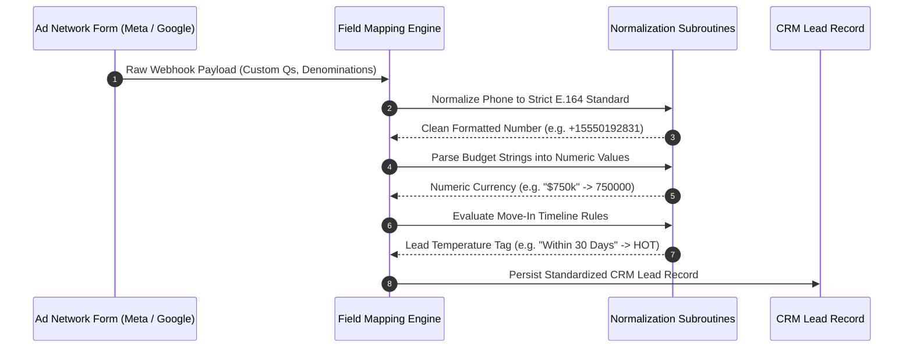

Digital ad forms vary widely across marketing networks and campaign types. Meta uses `FULL_NAME`, Google uses separate `FIRST_NAME` and `LAST_NAME` parameters, and marketing teams create custom questionnaire dropdowns like *"What is your expected move-in timeline?"*.

The BrokerOS **Field Mapping Studio** normalizes these disparate inputs into clean, standardized CRM lead attributes.

---

## Field Normalization Architecture

The mapping pipeline cleans and transforms ad payloads prior to database persistence:

---

## Standard Field Mappings

BrokerOS automatically maps standard system fields:

| Ad Platform Parameter | Normalized CRM Attribute | Transformation Applied |
| :--- | :--- | :--- |
| `FULL_NAME` | `firstName`, `lastName` | Splits on first space delimiter (for example, *"Alice Smith"* into *"Alice"* and *"Smith"*). |
| `PHONE_NUMBER` | `phone` | Strips punctuation and leading zeros, validating against global E.164 format. |
| `EMAIL` | `email` | Converts string to lowercase and validates RFC compliance. |
| `CITY` | `preferredLocation` | Trims whitespace and matches against active project target cities. |

---

## Parsing Custom Questionnaire Fields

Real estate advertisers insert custom qualification questions into lead forms to filter high-intent prospects:

### Currency and Budget Parsing
Ad forms frequently use budget dropdown selections such as *"$750k to $1.0M"* or *"$1.5M+"*:
- BrokerOS extracts numeric values and converts shorthand abbreviations into standard integer amounts:
  - `"$1.5M"` converted to `1500000`
  - `"$750k"` converted to `750000`
- The resulting numeric figure is saved to `lead.budget` for algorithmic temperature scoring and matching.

### Timeline to Lead Temperature Rules
Marketer questions regarding move-in horizons automatically set CRM qualification attributes:
- *"Immediate (within 30 days)"*: Automatically tags `temperature = 'HOT'` and sets AI priority score to 85.
- *"Within 1 to 3 months"*: Sets `temperature = 'WARM'` and score to 65.
- *"Just exploring (6+ months)"*: Sets `temperature = 'COLD'` and score to 40.

---

## Validation Safeguards and Quarantine Rules

To prevent corrupted records from impacting sales workflows:

- **Missing Phone Number Quarantine**: If an ad payload fails to contain a valid phone number, the submission is routed to an *Unresolved Submissions* queue to protect reporting metrics.
- **Default Project Assignment**: If an advertising campaign is not explicitly linked to a target project, BrokerOS assigns the inquiry to the organization flagship development in that market and alerts the Marketing Manager.
