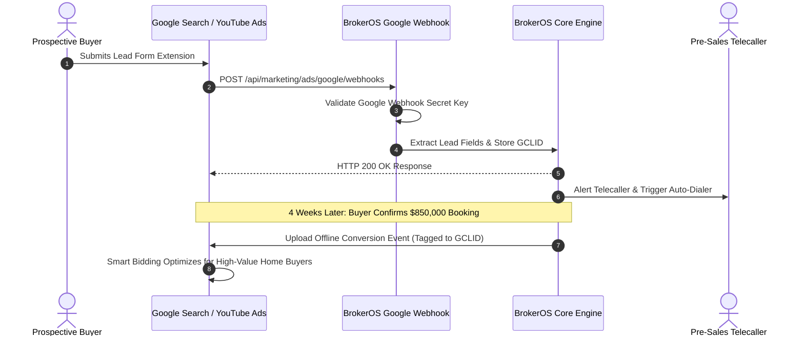

Google Ads captures high-intent property buyers actively searching for terms like *"luxury apartments downtown"* or *"3 bedroom condos with balcony"*. BrokerOS integrates directly with Google Ads Lead Form assets across Google Search, YouTube video ads, and Performance Max campaigns.

---

## Google Ads Webhook Architecture

Incoming lead submissions and offline conversion feedback follow an automated closed-loop lifecycle:



---

## Setting Up Google Ads Webhook

To connect your Google Ads account to BrokerOS:

1. In your Google Ads dashboard, navigate to **Tools & Settings -> Assets -> Lead Form**.
2. Scroll to the **Export leads from Google Ads** section.
3. Select **Other data integration (Webhook)**.
4. Enter your BrokerOS endpoint:
   ```http
   https://api.yourdomain.com/api/marketing/ads/google/webhooks
   ```
5. Enter your **Key**: Value from `GOOGLE_ADS_WEBHOOK_KEY` in the root `.env` file.
6. Click **Send Test Data** in Google Ads to verify the handshake. BrokerOS returns `200 OK` and logs a test lead in your dashboard.

---

## GCLID Capture and Offline Conversion Tracking

A major architectural advantage of Google Ads integration is **Google Click ID (GCLID)** capture:

- When a searcher submits a lead form, Google transmits the encrypted `gclid` parameter.
- BrokerOS stores this identifier permanently on the `Lead` record.

### Offline Conversion Tracking in Real Estate
High-value property purchases occur offline over multiple weeks:

1. A prospect is captured on Google Search with an encrypted `gclid`.
2. Two weeks later, the client completes an on-site, GPS-verified **Site Visit**.
3. Four weeks later, the client confirms an **$850,000 Booking**.
4. BrokerOS compiles offline conversion milestone events and transmits them back to Google Ads linked to the original `gclid`.
5. Google Smart Bidding algorithms automatically optimize future ad auctions toward users resembling high-converting property buyers.

---

## Campaign and Keyword Attribution

Leads ingested from Google Ads automatically capture granular search attribution:

- **Campaign Name**: For example, *Search_Brand_Grand_Horizon_Downtown*.
- **Ad Group Name**: For example, *High_Intent_Luxury_Penthouses*.
- **Matched Search Query**: The exact search term the user typed into Google before clicking your ad.
- **Placement**: Specifies whether the submission occurred via Google Search, YouTube TrueView, or the Google Display Network.
