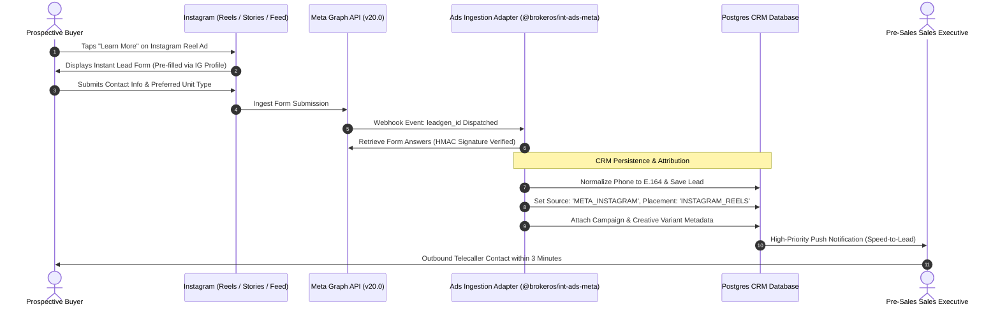

## Visual Real Estate Lead Acquisition

For luxury developments, penthouses, and gated community projects, Instagram represents the highest-converting visual channel in residential real estate. Prospective buyers engage with 9:16 vertical video tours, architectural rendering carousels, and location walkthroughs across their daily social feeds.

Through the BrokerOS Instagram Ad Engine (`/dashboard/marketing/ads/instagram`), marketing managers supervise lead generation campaigns, inspect creative assets in a dedicated gallery, and evaluate placement-level conversion metrics.

---

## Instagram Ingestion Pipeline

---

## Placement Breakdown Studio

Not all social placements perform equally for real estate. The Instagram Engine separates performance across four distinct placement environments:

| Placement Environment | Creative Format | Buyer Behavior | Strategic Real Estate Role |
| :--- | :--- | :--- | :--- |
| **Instagram Reels** | Full-screen 9:16 vertical video | High discovery, sound-on browsing | Construction update tours, drone master plan overviews, clubhouse walk-throughs. |
| **Instagram Stories** | Full-screen 9:16 vertical image/video | Fast tap navigation, ephemeral engagement | Limited phase launch countdowns, weekend open-house invites, instant VIP passes. |
| **Instagram Feed** | 1:1 square or 4:5 vertical carousel | In-depth swipe examination, caption reading | Architectural elevations, floor plan cut-sheets, payment milestone diagrams. |
| **Instagram Explore** | Dynamic thumbnail grid | Search and lifestyle intent browsing | Reaching passive property investors exploring luxury home and interior design tags. |

The **Placement Breakdown** component (`InstagramPlacementBreakdown.tsx`) reports impressions, link click CTR, total leads, and individual Cost Per Lead (CPL) per placement, enabling precise budget adjustments.

---

## In-App Creative Gallery

The **Creative Gallery** workspace (`InstagramCreativeGallery.tsx`) gives sales leaders and marketing teams visual verification of every active Instagram advertisement:

- **Visual Asset Inspection**: Preview high-resolution rendering images, carousel slides, and vertical video reels directly in the web dashboard.
- **Copy and Headline Analysis**: Review primary text hooks, headline copy, and CTA button labels (`Get Quote`, `Learn More`, `Book Now`).
- **Creative-to-Lead Correlation**: Inspect which specific image or video generated each batch of inquiries in the CRM leads list.

---

## Ad Set Audience Breakdown

The Instagram Engine tracks performance down to individual targeting clusters:

- **High-Net-Worth Lookalikes**: Audience segments modeled on verified previous booking customers and site visit attendees.
- **Micro-Market Radius**: Geospatial targeting concentrated around corporate tech parks, premium residential neighborhoods, and international airport corridors.
- **Investor Demographics**: Targeted segments filtered by luxury goods affinity, commercial property investment tags, and non-resident buyer profiles.

---

## Instant Lead Handoff and Notifications

Instagram inquiries convert at their highest rate when contacted while still actively on their devices:

1. Submissions trigger an immediate speed-to-lead push notification to the pre-sales telecalling queue.
2. The lead's source is automatically tagged as `META_INSTAGRAM` alongside the originating ad creative and ad set.
3. If an automated WhatsApp welcome drip is enabled, the prospect immediately receives the project brochure PDF on WhatsApp within 30 seconds of submitting the Instagram form.
