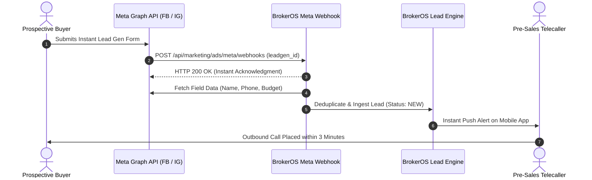

Meta (Facebook and Instagram) is the dominant digital lead acquisition channel for real estate developers. BrokerOS connects directly to Meta Graph API, streaming leads from Instant Forms directly into your CRM within seconds of form submission.

---

## Ingestion Architecture

The integration uses Meta Webhook events to trigger instant field retrieval and agent assignment:

---

## Meta Business Manager Configuration

To subscribe your Facebook Pages and Instagram Accounts to BrokerOS:

1. Navigate to **Marketing -> Ad Lead Sync -> Connect Meta**.
2. Authenticate using your Facebook Business Manager credentials.
3. Grant the required Meta application permissions:
   - `leads_retrieval`: Authorizes downloading form answers.
   - `pages_manage_ads`: Reads lead form IDs across campaigns.
   - `pages_read_engagement`: Webhook subscription rights.
4. Select the Facebook Pages representing your real estate developments.

---

## Webhook Verification Handshake

BrokerOS automatically fulfills the Meta Webhook challenge handshake:

- **Callback URL**: `https://api.yourdomain.com/api/marketing/ads/meta/webhooks`
- **Verify Token**: Configured via `META_WEBHOOK_VERIFY_TOKEN` in the root `.env` file.
- **Signature Verification**: Every incoming webhook payload is verified using the `X-Hub-Signature-256` HMAC header computed against your Meta App Secret.

Once connected, Meta streams the `leadgen` event immediately whenever a user taps "Submit" on an Instagram or Facebook ad.

---

## Real-Time Ad Campaign Attribution

Every ingested lead retains its complete digital advertising lineage:

- **Campaign Name**: For example, *Grand_Horizon_Luxury_Penthouse_Launch_2026*.
- **Ad Set ID**: Demographic targeting bracket (for example, *Age 30 to 55, Household Income > $150k*).
- **Ad Creative Name**: Image or video creative version (for example, *Drone_View_Balcony_Tour_v3*).
- **Form ID**: Specific Instant Form variant used for A/B split testing.

This granular attribution data enables marketing directors to calculate exact Customer Acquisition Cost (CAC) and Return on Ad Spend (ROAS) down to the individual creative variant.
