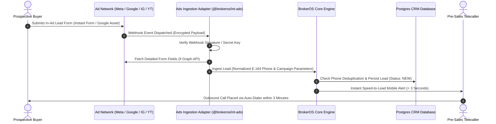

## Unified Advertising Command Center

Real estate brokerages and developers typically deploy marketing budgets across four primary advertising engines: **Meta (Facebook)**, **Instagram**, **Google Search**, and **YouTube Video**. Managing separate platforms leads to fragmented attribution, delayed speed-to-lead response times, and uncoordinated budget allocation.

The BrokerOS Advertising Command Center (`/dashboard/marketing/ads`) unifies all four digital networks into a single operational interface. Inquiries captured from in-stream lead forms stream into the CRM in sub-second real time, while a cross-platform comparison studio evaluates performance across networks.

---

## Master Performance Metrics

The top-level overview tracks blended performance across all connected ad accounts:

- **Total Digital Ad Spend**: Aggregated expenditure across Facebook, Instagram, Google, and YouTube.
- **Total CRM Leads Acquired**: Verified buyer contacts captured and synced directly into the sales pipeline.
- **Blended Cost Per Lead (CPL)**: Cross-channel average acquisition cost per inquiry.
- **Total Impressions & Reach**: Cumulative digital brand exposure across all placements and devices.
- **Active Campaigns Count**: Live campaigns actively bidding across connected platforms.

---

## Integrated Advertising Channels

BrokerOS connects directly to provider APIs and webhooks through dedicated integration packages (`@brokeros/int-ads-meta` and `@brokeros/int-ads-google`):

<CardGroup cols={2}>
  <Card title="A/B Testing & Comparison Studio" icon="scale-balanced" href="/marketing/ads/comparison-and-ab-testing">
    Head-to-head scorecard comparing campaign variants across platforms with automated Cost Per Lead and Click-Through Rate winner badges.
  </Card>
  <Card title="Meta (Facebook) Ads" icon="facebook" href="/marketing/ads/meta-lead-ads">
    Capture inquiries from Facebook Instant Lead Forms, Feed, and Messenger with Graph API webhook sync and speed-to-lead routing.
  </Card>
  <Card title="Instagram Ads" icon="instagram" href="/marketing/ads/instagram-ads">
    Inspect Stories, Reels, Feed, and Explore placements, review active assets in the Creative Gallery, and track visual lead inquiries.
  </Card>
  <Card title="Google Search & Display" icon="google" href="/marketing/ads/google-ads">
    Capture high-intent property searchers, analyze Keyword Breakdowns and Quality Scores, and track GCLID offline conversions.
  </Card>
  <Card title="YouTube Video Ads" icon="youtube" href="/marketing/ads/youtube-ads">
    Manage TrueView and Video Action campaigns, analyze audience retention curves (25%, 50%, 75%, 100%), and review video creatives.
  </Card>
  <Card title="Form Field Mapping" icon="arrows-split-up-and-left" href="/marketing/ads/field-mapping">
    Normalize custom ad questions, standardize E.164 phone formats, and map answers directly to CRM lead properties.
  </Card>
</CardGroup>

---

## Real-Time Ingestion Architecture

The digital ad ingestion pipeline delivers sub-second turnaround from form submission to outbound sales contact:

---

## Cross-Channel Source Tagging

Every lead ingested through digital advertising carries structured attribution metadata in the `Lead` record:

| Source Code | Originating Placement | Attribution Fields Captured |
| :--- | :--- | :--- |
| `META_FACEBOOK` | Facebook Feed, Marketplace, Stories, or In-Stream Form. | Campaign Name, Ad Set ID, Ad ID, Form ID |
| `META_INSTAGRAM` | Instagram Reels, Stories, Feed, or Explore Form. | Placement (`REELS`/`STORIES`/`FEED`), Creative Variant |
| `GOOGLE_ADS` | Google Search, Performance Max, or Display Lead Asset. | GCLID, Campaign Name, Search Keyword, Match Type |
| `YOUTUBE_ADS` | YouTube TrueView or In-Stream Video Action Lead Asset. | Video ID, GCLID, Viewer Retention Bracket |

Attribution data follows the prospect through their entire lifecycle, allowing financial reports to measure closed brokerage revenue against original ad spend.
