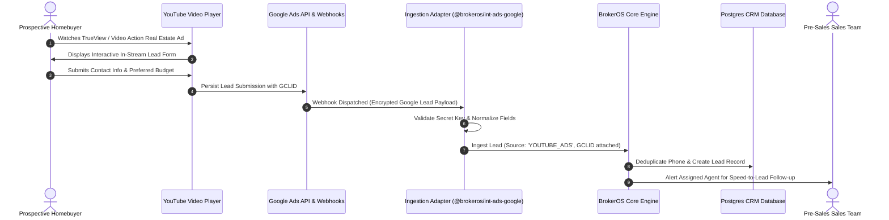

## Cinematic Real Estate Video Advertising

Property purchases are deeply emotional and experiential decisions. YouTube video advertising allows developers and brokerage firms to showcase high-production cinematic tours, drone construction fly-throughs, sample apartment walk-throughs, and architect interviews to prospective buyers on smart TVs, tablets, and mobile devices.

The BrokerOS YouTube Ad Engine (`/dashboard/marketing/ads/youtube`) monitors video ad expenditure, tracks lead form asset submissions, and analyzes audience viewer retention milestones.

---

## YouTube Video Ingestion Architecture

---

## Audience Viewer Retention Analytics

Unlike static banners, video ad effectiveness depends heavily on hook quality and storytelling. The **Audience Retention Widget** (`YouTubeAudienceRetentionWidget.tsx`) tracks how long prospects watch your property tour before dropping off:

| Retention Milestone | Industry Benchmark | Key Real Estate Content Element |
| :--- | :--- | :--- |
| **0% to 25% Completion** | 70% to 85% retention | The 5-second hook: Project name, iconic aerial rendering, landmark location highlight. |
| **50% Completion** | 45% to 60% retention | Core value proposition: Living room scale, clubhouse amenities, price starting bracket. |
| **75% Completion** | 30% to 45% retention | Floor plan layouts, interior finishes, developer track record, and delivery timeline. |
| **100% Completion** | 20% to 35% retention | Strong closing Call-to-Action: Private site visit invitation and exclusive launch pricing pass. |

A steep drop-off before 25% indicates an unengaging hook, signaling the creative team to re-edit the opening sequence.

---

## In-App Video Creative Player

The YouTube Engine includes an integrated video player preview modal (`YouTubeVideoPlayerModal.tsx`):

- **Creative Playback**: Stream and review active video advertisements without leaving the CRM dashboard.
- **Form Overlay Inspection**: Verify that lead form assets, companion banners, and call-to-action buttons render correctly across mobile and desktop viewports.
- **Copy and Messaging Audit**: Review video headlines, descriptions, and pinned comments.

---

## Key Performance Indicators

The YouTube Ads dashboard evaluates campaigns across both branding reach and direct lead acquisition:

- **Total Video Views**: Complete or 30-second impressions delivered to targeted property shoppers.
- **View Rate (%)**: Percentage of impressions that resulted in a deliberate view rather than an immediate skip.
- **Average Cost Per View (CPV)**: Cost per qualifying 30-second view, measuring brand awareness efficiency.
- **In-Stream Form Leads**: Qualified contacts captured through embedded Google lead forms during video playback.
- **Cost Per Lead (CPL)**: Direct cost of acquiring a verified CRM lead through video campaigns.

---

## Offline Conversion Attribution via GCLID

When leads submit inquiries through YouTube video campaigns, BrokerOS automatically captures the **Google Click ID (GCLID)**:

1. The GCLID is permanently stored on the `Lead` record in the CRM.
2. When the lead completes a site visit or signs a unit purchase contract, BrokerOS records the transaction value.
3. BrokerOS periodically uploads hashed offline conversion data back to Google Ads via the Conversion Upload API.
4. Google Ads Smart Bidding algorithms use these verified revenue signals to optimize targeting toward high-value luxury real estate investors.
