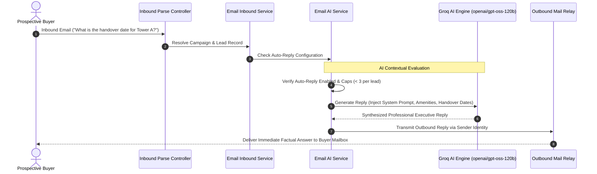

## Email Intelligence and Operational Settings

The BrokerOS Email Settings workspace (`/dashboard/marketing/email/settings`) centralizes artificial intelligence configurations, diagnostic simulation tools, and CRM taxonomy used across email broadcasts, 2-way inboxes, and automation flows.

Key subsystems configured here include:
- **Email AI Assistant & Autoreply**: Powers automated contextual replies and draft suggestions.
- **Inbound Webhook Diagnostics**: Live connection status, endpoint URLs, and simulated payload execution.
- **Email Tags Manager**: Centralized taxonomy for lead classification and automation branching.

---

## AI Assistant Architecture

---

## Email AI Configuration

Configured through the **Email AI Config Card** (`EmailAiConfigCard.tsx`):

### Model Selection and Provider
BrokerOS connects to high-speed inference engines for real-time natural language generation:
- **Groq `openai/gpt-oss-120b` (Default)**: Sub-second inference latency, ideal for immediate auto-replies with extensive context windows.
- **OpenAI `gpt-4o-mini`**: Alternative model with high conversational nuance.
- **Encrypted Key Storage**: API tokens are encrypted in the PostgreSQL database using AES-256-GCM encryption.

### System Prompt Customization
Admins can define the brokerage's persona, communication rules, and consultation booking directives:
- Ground the AI in brand identity (for example, luxury advisory vs high-volume brokerage).
- Set constraints on pricing commitments (instructing the model to share indicative price slabs while deferring custom discount negotiations to human closing managers).
- Mandate inclusion of sales desk phone numbers or digital appointment booking links.

### Autonomous Auto-Reply Safeguards
- **Activation Toggle (`autoReplyEnabled`)**: Enables autonomous outbound sending without requiring human review.
- **Loop Prevention Cap (`autoReplyMaxPerLead: 3`)**: Limits the maximum number of automated replies sent to a single lead on a thread, preventing infinite loops with customer out-of-office autoreponders.

---

## Inbound Webhook Diagnostics and Simulation

The **Email Webhook Diagnostics Card** (`EmailWebhookDiagnostics.tsx`) provides verified endpoint URLs for incoming email setup:

| Provider Inbound Protocol | BrokerOS Dedicated Endpoint | Configuration Location |
| :--- | :--- | :--- |
| **SendGrid Inbound Parse** | `/api/marketing/email/inbound/sendgrid` | SendGrid Dashboard > Settings > Inbound Parse. |
| **AWS SES SNS Notification** | `/api/marketing/email/inbound/ses` | AWS SES Receipt Rules > Action: SNS Topic (HTTP/HTTPS subscription). |
| **Brevo Inbound Webhook** | `/api/marketing/email/inbound/brevo` | Brevo Transactional > Webhooks > Inbound emails. |
| **Mailchimp / Mandrill** | `/api/marketing/email/inbound/mailchimp` | Mandrill Inbound Domains > Webhook URL. |
| **Universal Inbound API** | `/api/marketing/email/inbound` | Generic JSON payload adapter for custom SMTP relays and mail gateways. |

### Real-Time Inbound Simulation Runner
Administrators can test inbound parsing without sending real emails:
1. Select the simulated provider (for example, SendGrid or AWS SES).
2. Enter the test lead email address, campaign sender address, subject line, and inquiry text.
3. Click **Simulate Inbound Delivery**. BrokerOS simulates the webhook payload, logs thread resolution, checks automation flow triggers, and displays the AI-generated reply in real time.

---

## CRM Email Tags Manager

The **Tags Manager** (`EmailTagsManager.tsx`) allows marketing directors to curate color-coded labels used throughout email campaigns:

- **Lead Interest Tags**: `#Penthouse_Inquiry`, `#Sample_Flat_Visited`, `#Flexible_Payment_Plan`.
- **Engagement Triggers**: Tags applied automatically when a prospect clicks floor plans or replies to a launch announcement.
- **Audience Segmentation**: Use tags to build granular segments for future follow-up broadcasts.
