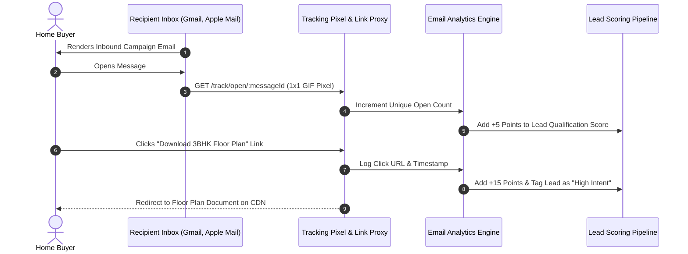

Email campaigns generate deep behavioural intelligence on prospective property buyers. By tracking which floor plans a prospect inspects, how many times they re-open a brochure, and whether they share materials with decision-makers, BrokerOS surfaces high-intent buyers for sales executives.

---

## Engagement Tracking Lifecycle

BrokerOS captures recipient interactions and updates CRM qualification scores in real time:

---

## Key Performance Indicators (KPIs)

The analytics dashboard benchmarks campaign health against real estate industry standards:

| Metric | Industry Benchmark | BrokerOS Target | Description |
| :--- | :--- | :--- | :--- |
| **Delivery Rate** | 95.0% | **$\ge$ 98.0%** | Percentage of dispatched emails accepted by recipient mail servers. |
| **Unique Open Rate** | 21.0% | **30% to 40%** | Ratio of unique recipients who opened the message. |
| **Click-To-Open (CTOR)** | 9.5% | **15% to 25%** | Percentage of openers who clicked at least one link. |
| **Bounce Rate** | 2.5% | **$< 1.5\%$** | Hard bounces (invalid addresses) vs. soft bounces (mailbox full). |
| **Unsubscribe Rate** | 0.3% | **$< 0.15\%$** | Opt-out requests processed automatically via one-click unsubscribe. |

---

## Link Click Heatmap and Content Attribution

The analytics studio breaks down user clicks by destination to reveal buyer preferences:

| Destination Link | Total Clicks | Unique Leads | Actionable Sales Insight |
| :--- | :--- | :--- | :--- |
| **Download 3BHK Cut-Sheet PDF** | 312 | 240 | Strong buyer appetite for 3BHK layouts over 2BHK units. |
| **Schedule Site Visit Button** | 148 | 122 | Imminent purchase intent; priority queue for telecallers. |
| **Virtual 360-Degree Tour** | 88 | 74 | Remote or out-of-city exploratory buyers. |
| **Price & Payment Plan Sheet** | 260 | 195 | Active commercial evaluation in progress. |

---

## Behavioral Lead Scoring Integration

Email interactions dynamically adjust lead prioritization across the CRM:

- **Email Opened**: Adds `+5 points` to the prospect's lead score.
- **Link Clicked**: Adds `+15 points` and logs the clicked asset in the activity timeline.
- **Re-Opened 3+ Times**: Tags the prospect as **Super-Engaged** on the telecaller mobile auto-dialer queue.
- **Unsubscribe**: Sets `lead.emailOptOut = true` and excludes the contact from all future marketing broadcasts.
