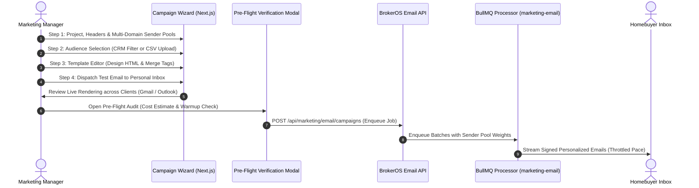

## Streamlined Campaign Creation

The BrokerOS Email Campaign Wizard (`/dashboard/marketing/email/campaigns/new`) guides marketing managers through drafting, audience segmentation, responsive template design, deliverability auditing, and dispatch scheduling.

Integrated directly with multi-domain sender pooling and background rate limiters, the wizard ensures high deliverability across large lead volumes while maintaining sender reputation.

---

## Campaign Dispatch Lifecycle

---

## The Four Wizard Configuration Steps

### Project, Sender Identity, and Sender Pools
- **Project Association**: Binds the campaign to a specific real estate development (for example, *Skyline Residences* or *Grandview Towers*).
- **Sender Pool Allocation**: Select one or multiple verified sender domains (`CampaignSenderPoolConfig`). Choose **Auto Even** distribution or specify **Custom Percentages** across domain pools to protect reputation.
- **Subject Line and Preheader**: Craft attention-grabbing subject lines with dynamic merge tags (`{{lead.firstName}}, exclusive preview: Skyline Residences Penthouse Phase`) and 80-character inbox preview snippets.
- **Provider Relay**: Select from authenticated integrations (AWS SES, SendGrid, Brevo, Mailchimp, Mailgun, Gmail, Outlook, Constant Contact).

### Target Audience and Segmentation
- **CRM Lead Filters**: Filter active prospects by assigned project, lead pipeline status (`NEW`, `CONTACTED`, `INTERESTED`), qualification temperature, or budget bracket ($\ge \$750,000$).
- **CSV List Ingest**: Upload external high-net-worth investor contact lists with automatic header column mapping.
- **Automated Scrubbing**: Automatically scrubs previously unsubscribed contacts, hard-bounced mailboxes, and duplicate addresses.

### Responsive Template Block Editor
- **Template Library**: Select from turnkey real estate HTML designs (Phase Launch, Price Revision, Weekend Open House, Channel Partner Commission Scheme).
- **Dynamic Merge Tag Chips**: Insert personalized buyer variables (`{{lead.firstName}}`, `{{project.startingPrice}}`, `{{project.brochureUrl}}`, `{{advisor.name}}`).
- **Live Device Previews**: Toggle instant viewport simulation between full desktop widescreen and mobile smartphone viewports.

### Pre-Flight Audit, Test Send, and Schedule
- **Live Test Email**: Dispatch an immediate proof to your personal inbox or management team to verify formatting in Apple Mail, Gmail, and Outlook.
- **Pre-Flight Cost Estimator**: Inspect projected dollar and local currency expenditures based on recipient volume and selected mail provider rates.
- **Domain Warmup Check**: Automatically warns if any individual domain in the pool exceeds 5,000 emails, prompting gradual volume scaling.
- **Dispatch Scheduling**: Choose between **Send Immediately** or schedule for high-engagement time windows (such as Tuesday through Thursday mornings at 10:00 AM).
