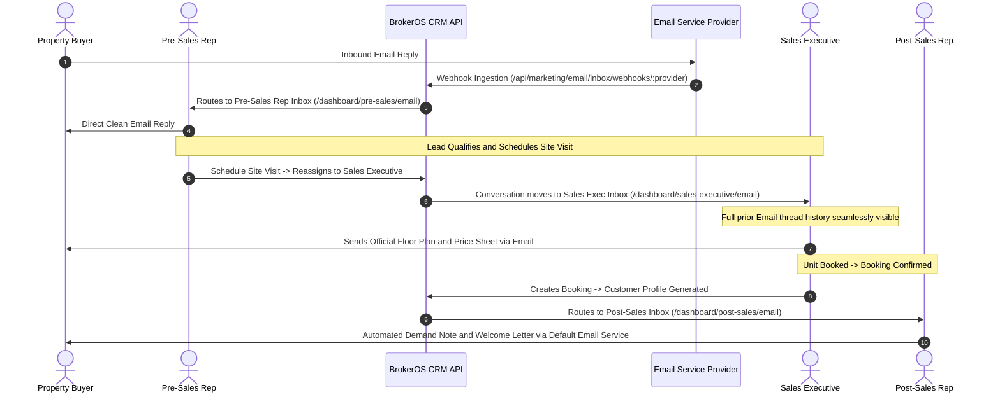

## Departmental Scoping Overview

In BrokerOS, real estate client communications are not isolated to marketing email campaigns. Every operational department requires direct, real-time Email messaging with prospects, clients, and channel partners while strictly honoring data governance boundaries.

Rather than maintaining separate email clients or permitting agents to use personal email accounts, BrokerOS implements a **Universal Engine with Role-Scoped Workspaces**:

- **Pre-Sales**: Communicates only with assigned early discovery leads (`NEW`, `CONTACTED`, `INTERESTED`) that have valid email addresses.
- **Sales Executive**: Takes over lead communication immediately upon site visit scheduling (`SITE_VISIT_SCHEDULED`, `NEGOTIATION`, `BOOKING`).
- **Post-Sales**: Direct Email correspondence with confirmed buyers for documentation, home loans, milestone billing notes, and possession handover.
- **Sourcing Manager**: Communicates strictly with assigned Channel Partner (CP) brokers regarding project inventory releases, commission statements, and agreements.
- **Closing Manager**: Stationed on-site at sales galleries, sending official quotation letters, unit booking sheets, and closing forms.
- **Finance**: Oversees formal billing notices, tax invoices, and broker brokerage settlements.
- **Managers and Directors**: Maintain team-wide oversight with interactive filters to inspect subordinate conversation velocity.

---

## Architectural Workflow: Lead Handoff and Lifecycle Continuity

When a lead transitions across departments, such as from Pre-Sales to Sales Executive upon scheduling a site visit, the Email thread history remains unified while active inbox routing shifts automatically.

---

## Role Scoping Matrix

The backend enforces data isolation through [email-inbox.service.ts](file:///c:/Users/Sumama/Desktop/enterprise-crm-realtors/apps/api/src/marketing/email/services/email-inbox.service.ts):

| Department Role | Scope Filter | Visible Entities | In-App UI Route |
| :--- | :--- | :--- | :--- |
| **Pre-Sales Executive** | `my` | Leads where `assignedUserId = currentUser.id` and status in (`NEW`, `CONTACTED`, `INTERESTED`) with valid email | `/dashboard/pre-sales/email` |
| **Pre-Sales Manager** | `team` | All leads assigned to direct subordinates, with executive dropdown filter | `/dashboard/pre-sales-manager/email` |
| **Sales Executive** | `my` | Leads where `assignedUserId = currentUser.id` and status in (`SITE_VISIT_SCHEDULED`, `NEGOTIATION`, `BOOKING`) with valid email | `/dashboard/sales-executive/email` |
| **Sales Manager** | `team` | All leads assigned to subordinate sales executives, with deal velocity tracking | `/dashboard/sales-manager/email` |
| **Post-Sales Executive** | `my` | Customers where `booking.assignedPostSalesId = currentUser.id` with valid email | `/dashboard/post-sales/email` |
| **Post-Sales Manager** | `team` | All post-booking customer threads across all team post-sales executives | `/dashboard/post-sales-manager/email` |
| **Sourcing Manager** | `my` | External CP Brokers where `broker.sourcingManagerId = currentUser.id` with valid email | `/dashboard/sourcing-manager/email` |
| **Closing Manager** | `my` | Walk-in leads created on-site or leads assigned at their project sales gallery | `/dashboard/closing-manager/email` |
| **Finance Department** | `all` | Customers with payment transactions and Brokers with commission claims | `/dashboard/finance/email` |
| **Business Manager** | `all` | Enterprise-wide operational visibility across both Brokerage and CP network | `/dashboard/business-manager/email` |
| **Director and Admin** | `all` | Full organizational oversight with real-time audit capabilities | `/dashboard/director/email` |

---

## Key Operational Features

### 1. Automated Executive Provisioning
When a manager assigns new leads or brokers to an executive, BrokerOS automatically provisions conversation records even if the contact has not sent an inbound email yet. The contact appears in the executive directory with a `"New • Uncontacted"` badge, allowing immediate outbound engagement.

### 2. Clean Outbound Email Delivery
Emails dispatched to property buyers are sent with clean professional formatting without artificial agent signature prefixes. Internal CRM attribution is recorded in message audit logs with `senderName` and `senderType: agent`.

### 3. Contact Qualification Enforcement
Operational Email inboxes enforce contact email qualification. Contacts without an email address are omitted from directory lists. In the CRM profile header toolbars, the **Email** button is automatically disabled with the tooltip `"No email address available"`.

### 4. Central Operational Email Provider Configuration
System administrators configure a single default operational email provider in the Admin Workspace:
- Navigation: `Dashboard -> Admin -> Settings -> Email`
- Providers: SendGrid, Brevo, AWS SES, Mailchimp, Custom SMTP
- Feature: 1-click active default switching with verified domain status

### 5. Deep-Linking from CRM Profiles
In both the Lead Profile and Broker Profile headers, clicking the **Email** action navigates directly to the current department Email inbox:
- `/dashboard/pre-sales/email?leadId=[id]`
- `/dashboard/sales-executive/email?leadId=[id]`
- `/dashboard/sourcing-manager/email?brokerId=[id]`
