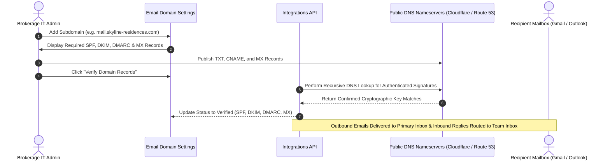

## Cryptographic Domain Verification

Under modern mailbox security protocols enforced by Google, Microsoft, and Yahoo, promotional and transactional emails dispatched without cryptographic domain authentication are routed to spam folders or rejected outright. BrokerOS provides an automated verification wizard to authenticate your corporate sending and receiving subdomains.

Authenticating a dedicated subdomain (such as `mail.skyline-residences.com`) isolates marketing broadcasts from routine corporate email correspondence while authorizing 2-way inbound thread receiving.

---

## Domain Verification Handshake

---

## Required DNS Records

Navigate to **Marketing > Settings > Email Setup** and add your dedicated sending subdomain (for example, `mail.skyline-residences.com`). Configure the following DNS records with your registrar:

| Record Type | Host / Name | Value / Destination | Operational Function |
| :--- | :--- | :--- | :--- |
| **TXT** | `mail.skyline-residences.com` | `v=spf1 include:mail.brokeros.io ~all` | **SPF Record**: Authorizes designated relay IP addresses to transmit on behalf of your domain. |
| **CNAME** | `s1._domainkey.mail` | `s1.domainkey.brokeros.io` | **DKIM Key 1**: 2048-bit cryptographic header signature verifying message integrity. |
| **CNAME** | `s2._domainkey.mail` | `s2.domainkey.brokeros.io` | **DKIM Key 2**: Automated key rotation backup. |
| **TXT** | `_dmarc.skyline-residences.com`| `v=DMARC1; p=quarantine; pct=100;` | **DMARC Policy**: Instructs recipient mailboxes to quarantine forged or unauthenticated messages. |
| **MX** | `mail.skyline-residences.com` | `10 mx.brokeros.io` (or provider MX) | **Inbound MX Record**: Routes incoming buyer replies directly to the **BrokerOS 2-Way Team Inbox**. |

---

## Automated Verification Handshake

After publishing your DNS records:

1. Click **Verify Domain Records** in the BrokerOS dashboard.
2. The server executes recursive DNS queries across global root nameservers.
3. Once confirmed, all status badges update to **Green (Verified)**:
   - `SPF Verified`
   - `DKIM Verified`
   - `DMARC Verified`
   - `MX Verified`
4. The domain is immediately authorized for outbound campaign dispatch and inbound 2-way inbox routing.

---

## Sender Reputation and Compliance Thresholds

BrokerOS actively monitors your sender health score to protect domain deliverability:

| Health Metric | Recommended Threshold | Automatic System Action |
| :--- | :--- | :--- |
| **Spam Complaint Rate** | **Must be $< 0.10\%$** | If complaint rate reaches 0.08%, automated warnings trigger to pause broadcasts. |
| **Hard Bounce Rate** | **Must be $< 2.00\%$** | Invalid addresses are purged automatically from future campaign runs. |
| **Unsubscribe Processing** | **1-Click Required** | Mandatory RFC 8058 `List-Unsubscribe` headers are injected automatically. |
