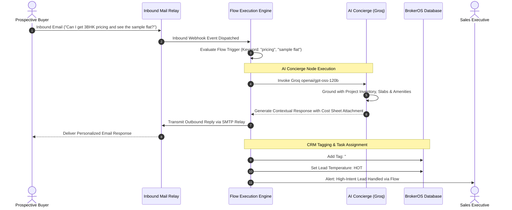

## Visual Email Workflow Canvas

Managing individual email responses to high-volume campaigns manually creates bottlenecks that reduce conversion rates. The BrokerOS Email Flow Builder (`/dashboard/marketing/email/flows`) provides a visual, drag-and-drop automation canvas with feature parity to interactive WhatsApp flows.

Marketing teams can design automated customer journeys that respond to incoming email replies, route inquiries based on question intent, deliver tailored digital floor plans, or invoke an AI agent to answer complex buyer queries.

---

## Flow Execution Architecture

---

## Trigger Types and Scope

Email flows can be configured to run globally across all broadcasts or scoped to specific marketing initiatives:

| Trigger Configuration | Operational Behavior | Ideal Use Case |
| :--- | :--- | :--- |
| **`keyword_match`** | Triggers when the buyer's reply subject or body contains specified keywords (such as *"brochure"*, *"visit"*, *"loan"*, *"price"*). Matches can be configured as *contains*, *exact*, or *starts_with*. | Targeted real estate campaigns where specific CTAs prompt specific keywords. |
| **`any_reply`** | Triggers on any incoming email response to the campaign regardless of text content. | Welcome sequences and immediate acknowledgment auto-responders. |
| **Global Scope (`isGlobal: true`)** | Evaluates inbound emails across every project and marketing campaign in the firm. | Standard brokerage-wide FAQ handling and emergency holiday auto-responders. |
| **Campaign Scoped** | Restricted to specific campaign identifiers (`campaignIds`). | Project-specific launches where pricing and brochures differ from other developments. |

---

## Visual Flow Node Types

The visual builder canvas (`EmailFlowBuilderView.tsx`) provides six specialized node types:

### Start Entry Node
The entry anchor where the incoming email triggers execution. Stores incoming email envelope metadata (`fromEmail`, `subject`, `textBody`).

### Send Email Reply Node
Dispatches an automated HTML response back to the prospect:
- Includes dynamic subject line and body copy.
- Supports CRM merge variables (such as `{{lead.firstName}}`, `{{project.name}}`, `{{project.startingPrice}}`).
- Attaches relevant digital assets (such as PDF cut-sheets and master layout plans).

### AI Concierge Autoreply Node
Invokes the integrated Groq language model (`openai/gpt-oss-120b`):
- Reads the buyer's natural language inquiry.
- Automatically accesses project amenities, location landmarks, and pricing brackets from the CRM database.
- Synthesizes a natural, helpful executive response tailored to the inquiry.

### If / Else Condition Node
Branches the conversation flow based on keyword presence, lead qualification score, or stated budget:
- **Yes Branch**: Executes if conditions are satisfied (for example, if body contains *"penthouse"* or budget exceeds $1,000,000).
- **No Branch**: Fallback path for general inquiries.

### Assign CRM Tag Node
Applies structured tags from the centralized **Tags Manager** (`EmailTagsManager.tsx`):
- Tags the prospect record with labels like `#Price_Sensitive`, `#Site_Visit_Requested`, or `#NRI_Investor`.
- Triggers downstream webhook automations and updates audience segment memberships.

### End Node
Concludes the execution sequence and records the run status in the audit logs.

---

## Real-Time Simulation and Test Runner

Before activating a flow for live customer campaigns, marketing specialists can test conversational paths using the built-in simulator (`EmailFlowRunsView.tsx`):

1. Click **Test Flow Simulation** on the canvas header.
2. Enter sample inquiry text (for example, *"What are the bank financing options available for Tower B?"*).
3. The simulator walks through each node in real time, displays evaluated branch outcomes, and previews the exact AI-generated email copy.
