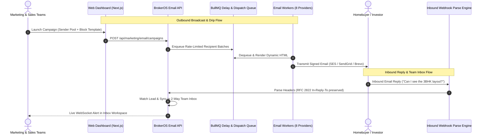

## Enterprise Real Estate Email Platform

Email represents the foundational corporate communication channel for real estate developers and brokerage firms. From high-volume launch announcements and investor newsletters to detailed contract negotiation threads, BrokerOS delivers an enterprise email platform built specifically for property sales.

Rather than relying on isolated third-party tools that disconnect email engagement from CRM lead records, BrokerOS unifies outbound broadcasts, multi-domain deliverability safeguards, visual automation flows, and a 2-way collaborative team inbox within a single platform.

---

## Unified Email Architecture

---

## Core Email Modules

<CardGroup cols={2}>
  <Card title="2-Way Team Inbox" icon="inbox" href="/marketing/email/team-inbox">
    Collaborative shared email inbox with RFC 2822 thread continuity, agent assignment, AI smart reply drafting, and Lead 360 CRM context.
  </Card>
  <Card title="Automation Flows" icon="diagram-next" href="/marketing/email/email-flows">
    Visual drag-and-drop canvas for automated email journeys, keyword triggers, Groq AI Concierge auto-replies, and branching conditions.
  </Card>
  <Card title="Campaign Wizard" icon="wand-magic-sparkles" href="/marketing/email/campaign-wizard">
    Step-by-step broadcast builder with sender pool configuration, audience segmentation, HTML block styling, and scheduling.
  </Card>
  <Card title="Sender Pools & Pre-Flight" icon="shield-halved" href="/marketing/email/preflight-and-sender-pools">
    Multi-domain sender pooling to protect domain reputation, pre-flight cost estimations, and automated warmup volume caps.
  </Card>
  <Card title="Template Block Editor" icon="pen-to-square" href="/marketing/email/template-editor">
    Visual responsive template builder, turnkey real estate templates, merge tag chips, and real-time mobile preview.
  </Card>
  <Card title="AI Assistant & Settings" icon="sparkles" href="/marketing/email/ai-assistant-and-settings">
    Configure Groq language models (`openai/gpt-oss-120b`), custom system prompts, inbound webhook diagnostics, and CRM tags.
  </Card>
  <Card title="Provider Integrations" icon="puzzle-piece" href="/marketing/email/provider-integrations">
    Direct connectors for 8 enterprise mail services: AWS SES, SendGrid, Brevo, Mailchimp, Mailgun, Gmail, Outlook, and Constant Contact.
  </Card>
  <Card title="Domain Verification" icon="globe" href="/marketing/email/domain-verification">
    Cryptographic sender authentication setup: SPF, DKIM 2048-bit, DMARC, and MX records for inbound receiving.
  </Card>
</CardGroup>

---

## Real-Time Engagement Benchmarks

Every outbound email tracks recipient interaction to compute deliverability metrics and automatically update CRM qualification scores:

| Metric | Operational Definition | Target Enterprise Benchmark |
| :--- | :--- | :--- |
| **Delivered Rate** | Percentage of sent messages accepted by recipient MX servers without bounce. | $\ge 98.5\%$ |
| **Unique Open Rate** | Proportion of delivered emails that loaded the 1x1 tracking pixel. | $28\%$ to $42\%$ |
| **Click-Through Rate (CTR)** | Proportion of openers who clicked architectural links, video tours, or brochures. | $12\%$ to $22\%$ |
| **Hard / Soft Bounce Rate** | Invalid email addresses or full mailboxes automatically excluded from future campaigns. | $< 1.0\%$ |
| **Spam Complaint Rate** | Recipient-reported spam complaints triggering immediate suppression. | $< 0.05\%$ |

---

## Multi-Channel Lead Progression

Interactions within the email module feed directly into the BrokerOS sales engine:

- **Brochure Download Bump**: Clicking a project brochure link automatically boosts the prospect's lead score by 15 points.
- **Inbound Inquiry Routing**: Replying to a campaign email routes the prospect to the pre-sales telecaller in the Team Inbox and marks the lead temperature as `HOT`.
- **Automated Fallback to WhatsApp**: If a critical contract demand letter or site visit confirmation remains unopened after 48 hours, BrokerOS can automatically trigger a companion WhatsApp message.
