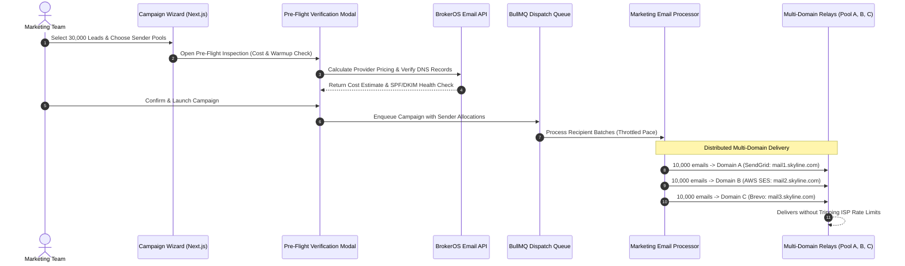

## Multi-Domain Sender Pooling for Enterprise Scale

Sending 50,000 emails from a single corporate domain risks triggering spam filters across major mailbox providers like Gmail, Yahoo, and Outlook. If recipient engagement drops or bounce rates spike, the primary domain's reputation suffers, jeopardizing routine business correspondence.

BrokerOS addresses this deliverability challenge through **Multi-Domain Sender Pooling** (`CampaignSenderPoolConfig`) and an automated **Pre-Flight Delivery Verification** engine (`EmailPreFlightModal.tsx`).

---

## Sender Pool Architecture

---

## Sender Pool Configuration Modes

When configuring an email broadcast in the Campaign Wizard, marketing managers can distribute audience volume across multiple verified sender identities:

| Distribution Mode | Configuration Behavior | Strategic Use Case |
| :--- | :--- | :--- |
| **`AUTO_EVEN`** | Evenly divides the total audience count across all selected sender domains in the pool. | Routine large-scale project announcements across balanced domains. |
| **`CUSTOM_PERCENTAGE`** | Allows assigning specific percentage weights per domain (for example, 60% on high-reputation primary domain, 40% on newly warmed domain). | Gradual domain warmup and testing secondary mail providers. |

---

## Domain Warmup Safeguards

To prevent new sending domains from suffering reputation degradation:

- **Volume Threshold Warning**: If an individual domain is allocated more than **5,000 recipients** in a single campaign, BrokerOS displays a prominent warmup advisory badge.
- **Warmup Schedule Guidance**: For newly added domains, volume should scale gradually over several weeks (Day 1: 500, Day 3: 1,500, Day 7: 3,000, Day 14: 10,000).
- **Daily Quota Enforcement**: Administrators can set hard daily sending caps per domain in **Settings > Email Integrations**. Once reached, remaining recipients queue for the next calendar day.

---

## Pre-Flight Verification Modal

Before executing a broadcast, the **Pre-Flight Modal** (`EmailPreFlightModal.tsx`) performs a mandatory delivery audit:

### Cost Estimation Breakdown
Calculates estimated financial expenditure in both USD and local currency across selected mail relays based on standard provider pricing benchmarks (`EMAIL_PROVIDER_PRICING_ESTIMATES`):

| Mail Provider | Benchmark Cost per 1,000 Emails |
| :--- | :--- |
| **Amazon SES** | ~$0.10 / 1,000 emails |
| **SendGrid** | ~$0.80 / 1,000 emails |
| **Brevo** | ~$0.65 / 1,000 emails |
| **Mailchimp** | ~$1.20 / 1,000 emails |
| **Mailgun** | ~$0.80 / 1,000 emails |

### Deliverability Checklist
- **DNS Health**: Confirms valid SPF, DKIM 2048-bit, and DMARC records for every domain in the pool.
- **Unsubscribe Link Presence**: Verifies the presence of the required `{{unsubscribe_url}}` tag in the template footer.
- **Audience Scrubbing**: Confirms that previously bounced addresses and unsubscribed contacts have been excluded from the dispatch list.

---

## Provider Rate Throttling in BullMQ Workers

The background worker (`marketing-email.processor.ts`) respects provider-specific throughput limits (`PROVIDER_THROTTLE_LIMITS`) to avoid API rate limits:

- **Amazon SES**: Paced up to 14 to 50 messages per second depending on AWS account tier.
- **SendGrid**: Paced to stay within API concurrency windows.
- **Google Workspace / Gmail**: Restricted to 1,500 messages per day per user account.
- **Microsoft 365 / Outlook**: Regulated to comply with Microsoft Graph API burst throttling rules.
- **Automatic Recovery**: Transient network errors or `429 Too Many Requests` responses are rescheduled with exponential backoff.
