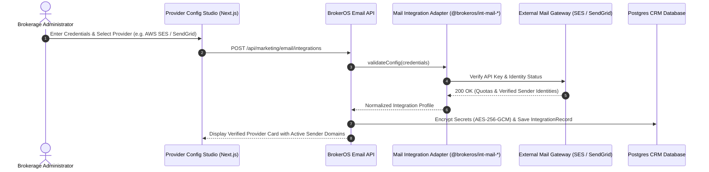

## Enterprise Mail Relays and Ingestion Adapters

BrokerOS isolates external mail transport logic within dedicated, self-contained TypeScript packages inside `integrations/mail/`. Neither `apps/api` nor `apps/workers` makes direct HTTP calls to mail providers; all transmission, signature validation, and error normalization route through these typed adapters.

Through the **Email Provider Configuration Studio** (`EmailProviderConfigCard.tsx`), administrators can connect and manage eight enterprise email services simultaneously.

---

## Provider Connection Architecture

---

## The Eight Supported Mail Providers

<CardGroup cols={2}>
  <Card title="Amazon SES" icon="aws">
    High-volume transactional and marketing relay. Connects via IAM Access Key ID, Secret Access Key, and AWS Region (`ap-south-1`, `us-east-1`). Supports Amazon SNS bounce/complaint webhooks.
  </Card>
  <Card title="Twilio SendGrid" icon="paper-plane">
    Cloud SMTP and Web API relay. Connects via SendGrid API Key. Supports Event Webhooks for live delivery receipts and Inbound Parse for team inbox replies.
  </Card>
  <Card title="Brevo (Sendinblue)" icon="envelope">
    European transactional relay with dedicated IP support. Connects via Brevo API Key. Full webhook tracking for opens, clicks, and hard bounces.
  </Card>
  <Card title="Mailchimp / Mandrill" icon="envelopes-bulk">
    Transactional email engine. Connects via Mandrill API Key and server data center prefix (`us20`). Includes inbound webhook integration.
  </Card>
  <Card title="Mailgun" icon="bullhorn">
    Developer email API with built-in email validation. Connects via Mailgun API Key, verified sending domain, and regional endpoint (US or EU).
  </Card>
  <Card title="Google Workspace / Gmail" icon="google">
    1-on-1 executive communication and small team inboxes. Connects via OAuth2 Client Credentials or secure Google App Passwords.
  </Card>
  <Card title="Microsoft 365 / Outlook" icon="microsoft">
    Corporate Microsoft Exchange integration. Connects via Microsoft Graph API using Azure AD OAuth2 Client ID, Client Secret, and Tenant ID.
  </Card>
  <Card title="Constant Contact" icon="address-book">
    Integrated email service. Connects via developer Client ID and OAuth2 Access Token for scheduled list delivery.
  </Card>
</CardGroup>

---

## Required Provider Configuration Parameters

| Provider Type | Package Identifier | Required Credentials | Webhook Protocols Supported |
| :--- | :--- | :--- | :--- |
| **AWS SES** | `@brokeros/int-mail-ses` | `awsAccessKeyId`, `awsSecretKey`, `awsRegion` | AWS SNS HTTP Subscription (Bounce, Complaint, Delivery) |
| **SendGrid** | `@brokeros/int-mail-sendgrid` | `apiKey` | SendGrid Event Webhook + Inbound Parse |
| **Brevo** | `@brokeros/int-mail-brevo` | `apiKey` | Brevo Transactional Webhooks |
| **Mailchimp** | `@brokeros/int-mail-mailchimp`| `apiKey`, `mailchimpServer` | Mandrill Inbound & Event Webhooks |
| **Mailgun** | `@brokeros/int-mail-mailgun` | `apiKey`, `mailgunDomain`, `mailgunRegion` | Mailgun Event Webhook (HMAC verified) |
| **Gmail** | `@brokeros/int-mail-gmail` | `oauthClientId`, `oauthClientSecret`, or `googleAppPassword` | Push notifications via Google Cloud Pub/Sub |
| **Outlook** | `@brokeros/int-mail-outlook` | `oauthClientId`, `oauthClientSecret`, `oauthTenantId` | Microsoft Graph Change Notifications |
| **Constant Contact** | `@brokeros/int-mail-constant-contact` | `apiKey`, `oauthAccessToken` | Event Webhooks |

---

## Managing Sender Domains and Daily Quotas

Through the Provider Configuration Studio, administrators manage sender identities across integrations:

- **Add Sender Identity**: Define the verified `fromEmail` (for example, `sales@skyline-residences.com`) and default `fromName` (for example, `Skyline Realty Sales Team`).
- **Daily Quota Enforcement**: Configure daily volume limits per provider (such as 2,000 emails/day for newly connected domains or 50,000/day for established SES relays).
- **Domain Verification Sync**: One-click action to query provider APIs and verify whether DNS records have propagated successfully.
