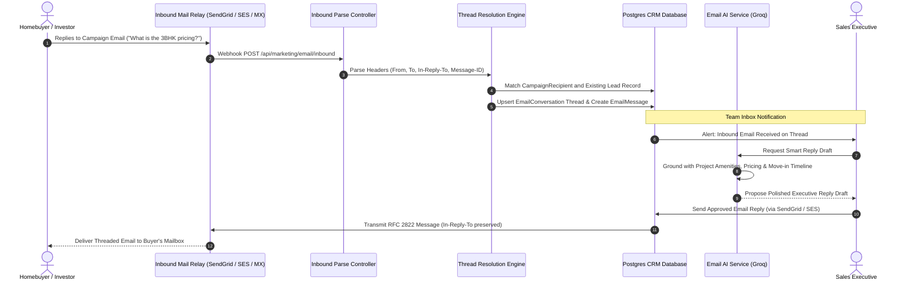
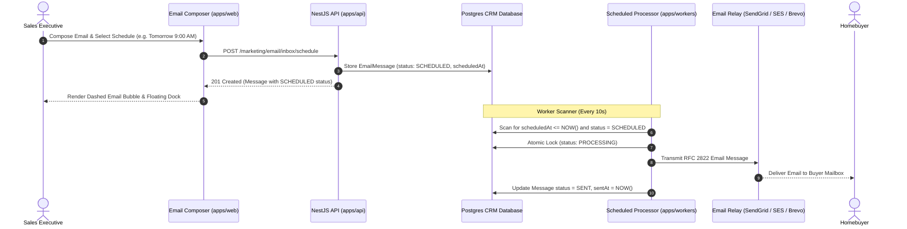

## Collaborative 2-Way Email Inbox

While bulk broadcasts deliver project announcements, high-value real estate transactions are negotiated over individual email threads. The BrokerOS Email Team Inbox (`/dashboard/marketing/email/inbox`) provides a centralized multi-agent workspace where sales executives and closing managers manage customer inquiries originating from email campaigns and direct inbound inquiries.

Key capabilities include:
- **Thread Continuity**: Preserves conversational threading across all email clients (Gmail, Apple Mail, Outlook) using RFC 2822 `Message-ID`, `In-Reply-To`, and `References` headers.
- **Inbound Message Resolution**: Automatically matches incoming emails to existing CRM leads and prior campaign recipients.
- **AI-Assisted Smart Replies**: Generates context-aware email replies using Groq `openai/gpt-oss-120b` grounded in project specifications, amenities, and pricing.
- **Lead 360 Contact Drawer**: View the prospect's real estate requirements, budget, qualification temperature, and site visit history beside the message thread.

---

## Inbound Email and Threading Architecture

---

## Workspace Layout and Navigation

The Email Team Inbox interface is organized into three operational panels:

### Conversation Directory (Left Panel)
- **Status Filter**: Toggle between **Open** (active inquiries awaiting reply), **Pending** (awaiting customer response or bank loan approval), and **Closed** (archived or converted threads).
- **Assigned Agent Filter**: Filter threads assigned to the logged-in sales executive or view department-wide conversations as a sales manager.
- **Full-Text Search**: Search instantly across contact email, lead name, subject line, or message body content.
- **Unread Counters**: Real-time badges indicating unread client messages with automatic read receipt updating.

### Conversation Stream (Center Panel)
- **Threaded Message Bubbles**: Chronological history of inbound buyer emails and outbound agent replies.
- **Header Metadata**: Displays sender email, recipient mailbox, sent timestamp, and provider delivery status.
- **Rich Message Composer**: Full rich-text formatting, document attachments (PDF brochures, floor plans), and merge variables (`{{lead.name}}`, `{{project.name}}`).
- **Quick Reply Selector**: One-click insertion of pre-saved executive reply templates (such as `/site-visit-invite`, `/cost-sheet`, `/banking-partners`).
- **AI Smart Reply Generator**: Button to draft an immediate contextual response based on the customer's question and project data.

### Lead 360 Context Drawer (Right Panel)
- **CRM Profile**: Instant access to the lead's full name, phone number, email address, and assigned development.
- **Qualification Score & Temperature**: Real-time display of lead temperature (`HOT`, `WARM`, `COLD`) and AI engagement score.
- **Budget Bracket**: Displays the buyer's declared budget range and preferred unit configuration (for example, 3-Bedroom Penthouse).
- **Stage Progression Shortcuts**: Directly advance the lead's status to `SITE_VISIT_SCHEDULED` or `NEGOTIATION` without leaving the inbox.

---

## Inbound Email Webhook Resolution

BrokerOS supports multiple inbound email protocols to route incoming messages:

| Inbound Method | Ingestion Endpoint | Supported Data Format |
| :--- | :--- | :--- |
| **SendGrid Inbound Parse** | `/api/marketing/email/inbound/sendgrid` | Multipart form-data with raw MIME headers and body extraction. |
| **AWS SES SNS Notification** | `/api/marketing/email/inbound/ses` | JSON event notification from Amazon SNS HTTP subscription containing raw email content stored in Amazon S3. |
| **Brevo Inbound Webhook** | `/api/marketing/email/inbound/brevo` | Transactional inbound JSON webhook payload. |
| **Mailchimp / Mandrill** | `/api/marketing/email/inbound/mailchimp` | Mandrill inbound domain event payload. |
| **Universal Inbound API** | `/api/marketing/email/inbound` | Standardized JSON payload for custom Postfix, Haraka, or external mail relay gateways. |

---

## Thread Continuity and Message Headers

To prevent email replies from splintering into disconnected conversations in the buyer's email client, BrokerOS manages strict standard headers:

- **`Message-ID`**: Every outbound email receives a cryptographically unique identifier (for example, `<msg_uuid@mail.yourbrokerage.com>`).
- **`In-Reply-To`**: Inbound replies inherit the parent message identifier, ensuring the response nests under the existing email thread.
- **`References`**: Maintains the complete chain of historical message IDs across long commercial negotiations.
- **`Reply-To` Routing**: Directs responses back to a monitored project subdomain (for example, `inquiries@mail.yourbrokerage.com`) mapped to the inbound parser.

---

## Scheduled Email Messaging

Sales executives and closing managers can compose rich HTML emails with attachments and schedule them to reach clients during optimal reading hours (such as 9:00 AM weekday mornings).

### Scheduling Features and Controls

1. **Triggering the Modal**: In the email composer toolbar at `Dashboard -> Marketing -> Email -> Inbox`, click the `<CalendarClock />` icon or select **Schedule Message** from the split Send button dropdown menu.
2. **Scheduling Modal Controls**:
   - **Preset Quick Picks**: Choose from **In 1 hour**, **Tomorrow 9:00 AM**, **Tomorrow 2:00 PM**, or **Monday 9:00 AM**.
   - **Custom DateTime Picker**: Select any date and time down to the exact minute.
   - **Payload Preservation**: The scheduled message safely encapsulates subject lines, HTML bodies, and file attachment URLs (such as unit floor plans or payment schedules).
3. **Pending State and Inline Bubble Controls**:
   - The scheduled email renders inside the message timeline wrapped in an amber dashed border, clock badge, and status indicator `SCHEDULED`.
   - Action controls on the bubble allow staff to:
     - **Send Now**: Immediately relay the message through the active SMTP or transactional provider (SendGrid, Brevo, AWS SES, Mailgun).
     - **Edit**: Opens the full in-place editor modal to rewrite the subject, revise the HTML message text, or adjust the scheduled delivery time.
     - **Cancel**: Cancels queued delivery and marks the message as `CANCELLED`.
4. **Floating Scheduled Messages Dock**:
   - When pending emails exist for the active contact thread, a floating dock hovers directly above the email composer.
   - Shows time remaining and provides one-click Send Now, Edit, and Cancel operations without needing to scroll through message history.
5. **Conversation List Indicator**:
   - Threads containing scheduled emails show an amber `[Scheduled: <Date>]` chip on the left conversation directory item.

