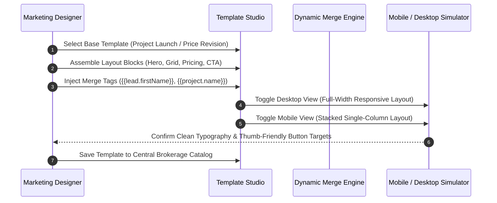

## Visual Real Estate Email Design

Real estate email marketing demands high visual polish: crisp architectural renderings, clear floor plan cut-sheets, transparent pricing tables, and prominent call-to-action buttons. The BrokerOS **Template Editor** empowers marketing teams to construct responsive emails and newsletters without writing raw HTML.

Integrated with a turnkey real estate template library and dynamic CRM merge variables, emails automatically adapt to recipient preferences and screen dimensions.

---

## Template Composition Pipeline

---

## Turnkey Real Estate Template Catalog

BrokerOS includes production-ready HTML templates designed for property sales workflows:

| Template Name | Design Architecture | Primary Marketing Objective |
| :--- | :--- | :--- |
| **Project Launch** | Full-bleed hero banner, amenities grid, unit typology table, and VIP RSVP button. | Introducing brand-new developments or phase openings to investor databases. |
| **Price Drop & Payment Plan** | High-contrast callout box displaying pre-launch savings and construction-linked payment milestones. | Decision acceleration for warm leads and previous site visit attendees. |
| **Site Visit Invitation** | Integrated map card, sales lounge address, GPS directions shortcut, and calendar invite. | Converting online inquiries into physical property tours. |
| **Channel Partner Scheme** | Commission slabs (for example, 2.5% to 4.0%), broker contest incentives, and sourcing manager contacts. | Broadcasting B2B broker incentives across external CP networks. |

---

## Modular Real Estate Content Blocks

The editor provides modular blocks tailored to luxury and commercial real estate presentations:

<CardGroup cols={2}>
  <Card title="Hero Render Banner" icon="image">
    Full-width architectural rendering banner featuring the development title, neighborhood, and starting price.
  </Card>
  <Card title="Two-Column Amenities Grid" icon="grid-2">
    Highlights clubhouses, fitness pavilions, swimming pools, co-working lounges, and private green parks.
  </Card>
  <Card title="Floor Plan Showcase" icon="compass-drafting">
    Side-by-side comparison of 2-bedroom vs 3-bedroom unit typologies with expandable cut-sheet downloads.
  </Card>
  <Card title="Price & Subvention Badge" icon="tag">
    High-contrast callout box displaying pre-launch pricing advantages and milestone payment schemes.
  </Card>
  <Card title="Primary Action Button" icon="square-check">
    Large, thumb-friendly call-to-action button: `[ Schedule Private Site Visit ]`.
  </Card>
  <Card title="Compliance Footer" icon="shield">
    Statutory regulatory registration number, official project website link, and mandatory unsubscribe controls.
  </Card>
</CardGroup>

---

## Dynamic CRM Merge Tags

Personalize email copy using double curly braces to tailor content for each individual recipient:

| Merge Tag | Populated Value | Example Output |
| :--- | :--- | :--- |
| `{{lead.firstName}}` | Lead First Name | *"Alice"* |
| `{{project.name}}` | Property Title | *"Skyline Residences"* |
| `{{project.locality}}` | City & Neighborhood | *"Downtown Financial District"* |
| `{{project.startingPrice}}` | Base Starting Price | *"$750,000"* |
| `{{advisor.name}}` | Dedicated Sales Executive | *"John Doe"* |
| `{{advisor.phone}}` | Representative Direct Number | *"+1 555-019-2831"* |
| `{{unsubscribe_url}}` | One-Click Unsubscribe Link | *Required compliance link* |

---

## Responsive Mobile-First Rendering

Because the majority of homebuyers review promotional emails on mobile devices:

- All generated HTML employs fluid tables and CSS media queries.
- Multi-column desktop grids stack into a clean single-column sequence on mobile viewports.
- Call-to-action buttons span full width on small screens for easy single-thumb interaction.
- The editor includes an interactive **Mobile Simulator** to test readability and visual hierarchy before launching.
