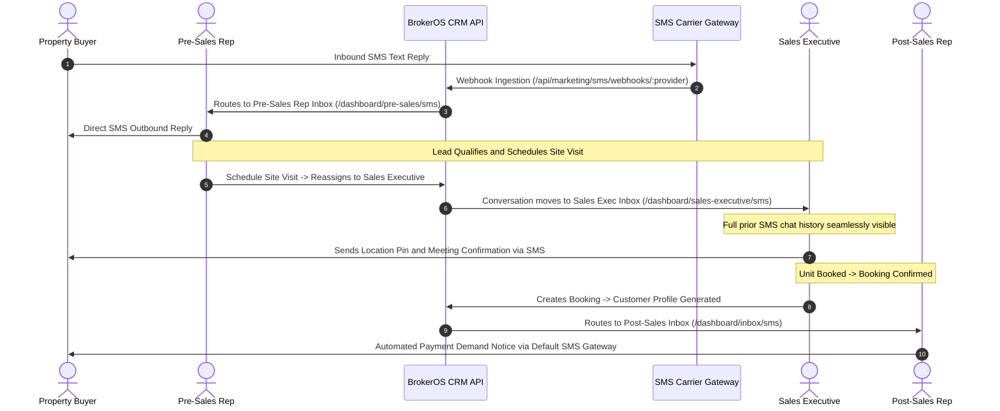

## Departmental Scoping Overview

In BrokerOS, real estate client communications are not isolated to marketing broadcasts. Every operational department requires direct, real-time SMS messaging with prospects, clients, and channel partners while strictly honoring data governance boundaries.

Rather than maintaining separate chat applications or permitting agents to use unmonitored personal phones, BrokerOS implements a **Universal Engine with Role-Scoped Workspaces**:

- **Pre-Sales**: Communicates only with assigned early discovery leads (`NEW`, `CONTACTED`, `INTERESTED`) that have valid phone numbers.
- **Sales Executive**: Takes over lead communication immediately upon site visit scheduling (`SITE_VISIT_SCHEDULED`, `NEGOTIATION`, `BOOKING`).
- **Post-Sales**: Direct SMS engagement with confirmed buyers for documentation, home loans, milestone billing, and possession handover.
- **Sourcing Manager**: Communicates strictly with assigned Channel Partner (CP) brokers regarding inventory availability, site visits, and commission settlements.
- **Closing Manager**: Stationed on-site at sales galleries, managing walk-in leads and on-site negotiation prospects.
- **Finance**: Oversees payment collections, demand notices, receipts, and CP commission disbursements.
- **Managers and Directors**: Maintain team-wide oversight with interactive filters to inspect subordinate conversation velocity.

---

## Architectural Workflow: Lead Handoff and Lifecycle Continuity

When a lead transitions across departments, such as from Pre-Sales to Sales Executive upon scheduling a site visit, the SMS thread history remains unified while active inbox routing shifts automatically.

---

## Role Scoping Matrix

The backend enforces data isolation through [sms-inbox.service.ts](file:///c:/Users/Sumama/Desktop/enterprise-crm-realtors/apps/api/src/marketing/sms/services/sms-inbox.service.ts):

| Department Role | Scope Filter | Visible Entities | In-App UI Route |
| :--- | :--- | :--- | :--- |
| **Pre-Sales Executive** | `my` | Leads where `assignedUserId = currentUser.id` and status in (`NEW`, `CONTACTED`, `INTERESTED`) with valid phone | `/dashboard/inbox/sms` |
| **Pre-Sales Manager** | `team` | All leads assigned to direct subordinates, with executive dropdown filter | `/dashboard/inbox/sms` |
| **Sales Executive** | `my` | Leads where `assignedUserId = currentUser.id` and status in (`SITE_VISIT_SCHEDULED`, `NEGOTIATION`, `BOOKING`) with valid phone | `/dashboard/inbox/sms` |
| **Sales Manager** | `team` | All leads assigned to subordinate sales executives, with deal velocity tracking | `/dashboard/inbox/sms` |
| **Post-Sales Executive** | `my` | Customers where `booking.assignedPostSalesId = currentUser.id` with valid phone | `/dashboard/inbox/sms` |
| **Post-Sales Manager** | `team` | All post-booking customer threads across all team post-sales executives | `/dashboard/inbox/sms` |
| **Sourcing Manager** | `my` | External CP Brokers where `broker.sourcingManagerId = currentUser.id` with valid phone | `/dashboard/inbox/sms` |
| **Closing Manager** | `my` | Walk-in leads created on-site or leads assigned at their project sales gallery | `/dashboard/inbox/sms` |
| **Finance Department** | `all` | Customers with payment transactions and Brokers with commission claims | `/dashboard/inbox/sms` |
| **Business Manager** | `all` | Enterprise-wide operational visibility across both Brokerage and CP network | `/dashboard/inbox/sms` |
| **Director and Admin** | `all` | Full organizational oversight with real-time audit capabilities | `/dashboard/inbox/sms` |

> [!NOTE]
> All roles access the unified route `/dashboard/inbox/sms`. The page dynamically resolves department scope from the user authenticated session. Legacy role-specific URLs (such as `/dashboard/sales-manager/sms`) automatically redirect to `/dashboard/inbox/sms`.

---

## Key Operational Features

### 1. Automated Executive Provisioning
When a manager assigns new leads or brokers to an executive, BrokerOS automatically provisions conversation records even if the contact has not sent an inbound text yet. The contact appears in the executive directory with a `"New • Uncontacted"` badge, allowing immediate outbound engagement.

### 2. Clean Outbound Delivery
Outbound text messages sent to property buyers are dispatched cleanly without artificial agent signature prefixes. Internal CRM attribution is recorded in message audit logs with `senderName` and `senderType: agent`.

### 3. Contact Qualification Enforcement
Operational SMS inboxes enforce contact phone qualification. Contacts without a telephone number are omitted from directory lists. In the CRM profile header toolbars, the **SMS** button is automatically disabled with the tooltip `"No phone number available"`.

### 4. Default Operational Gateway Configuration
System administrators configure a single default SMS gateway for operational messaging in the Admin Workspace:
- Navigation: `Dashboard -> Admin -> Settings -> SMS`
- Providers: Twilio, AWS SNS, Sinch, Gupshup, Infobip, Vonage, Telnyx, Plivo, Bird
- Feature: 1-click active default switching with visual badge indicator

### 5. Deep-Linking from CRM Profiles
In both the Lead Profile and Broker Profile headers, clicking the **SMS** action navigates directly to the current department SMS inbox:
- `/dashboard/pre-sales/sms?leadId=[id]`
- `/dashboard/sales-executive/sms?leadId=[id]`
- `/dashboard/sourcing-manager/sms?brokerId=[id]`
