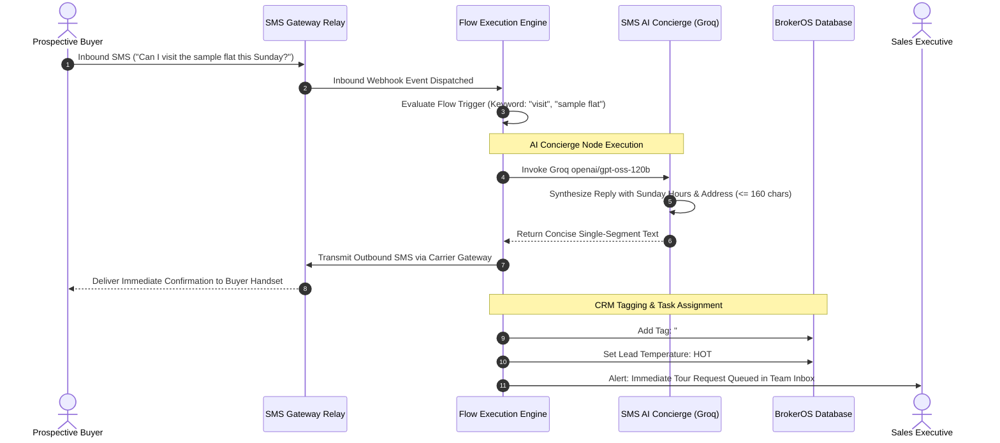

## Visual SMS Workflow Canvas

Handling individual SMS replies manually during high-volume property launches creates response delays that hurt conversion rates. The BrokerOS SMS Flow Builder (`/dashboard/marketing/sms/flows`) provides a visual, drag-and-drop automation canvas with feature parity to email and WhatsApp workflows.

Marketing and sales teams can build automated real estate workflows that respond immediately to inbound keyword inquiries (such as *"YES"*, *"PRICE"*, *"VISIT"*), route leads through qualification branches, deliver digital short links, or deploy an AI concierge to answer buyer questions.

---

## Flow Execution Architecture

---

## Trigger Types and Scope

SMS flows can be configured to run globally across all broadcasts or scoped to specific marketing campaigns:

| Trigger Configuration | Operational Behavior | Ideal Use Case |
| :--- | :--- | :--- |
| **`keyword_match`** | Triggers when the buyer's incoming text contains specified keywords (such as *"PRICE"*, *"VISIT"*, *"FLOORPLAN"*, *"YES"*). Matches can be configured as *contains*, *exact*, or *starts_with*. | Targeted real estate campaigns where call-to-action copy prompts specific reply keywords. |
| **`any_reply`** | Triggers on any incoming text received on the gateway number regardless of keyword content. | Universal welcome acknowledgments and emergency off-hours auto-replies. |
| **`campaign_reply`** | Restricted to replies received on active broadcast campaigns within a 72-hour window. | Specific phase launches or flash weekend price discounts. |
| **Global Scope (`isGlobal: true`)** | Evaluates inbound SMS across every project and telecalling number in the firm. | Central brokerage auto-responders and statutory opt-out processing. |

---

## Visual Flow Node Types

The visual builder canvas (`SmsFlowBuilderView.tsx`) provides six specialized node types:

### Start Entry Node
The entry anchor where the incoming text triggers execution. Captures incoming carrier envelope data (`senderPhone`, `textBody`, `gatewayId`).

### Send SMS Reply Node
Dispatches an automated text response back to the prospect:
- Enforces character optimization to prevent unexpected multi-segment billing.
- Supports dynamic CRM merge variables (such as `{{lead.firstName}}`, `{{project.name}}`, `{{project.startingPrice}}`).
- Embeds trackable short links (`https://brk.os/s/{token}`) for brochure downloads.

### Groq AI SMS Concierge Node
Invokes the integrated Groq language model (`openai/gpt-oss-120b`):
- Reads the buyer's natural language inquiry.
- Automatically accesses project amenities, sales gallery hours, and base pricing from the CRM database.
- Synthesizes an executive answer strictly constrained to **160 characters or fewer** to prevent multi-segment credit consumption.

### If / Else Condition Node
Branches the conversation flow based on keyword presence, question intent, or customer qualification tags:
- **Yes Branch**: Executes if conditions are satisfied (for example, if text contains *"3BHK"* or *"Penthouse"*).
- **No Branch**: Fallback path for general inquiries.

### Assign CRM Tag Node
Applies structured tags from the centralized **Tags Manager** (`SmsTagsAndQuickReplies.tsx`):
- Tags the prospect record with labels like `#Site_Visit_Requested`, `#Price_Sensitive`, or `#Weekend_Buyer`.
- Triggers downstream webhook automations and updates audience segment memberships.

### End Node
Concludes the execution sequence and records the run status in the audit logs.

---

## Real-Time Simulation and Test Runner

Before activating a flow for live customer campaigns, marketing specialists can test conversational paths using the built-in simulator (`SmsFlowRunsView.tsx`):

1. Click **Test Flow Simulation** on the canvas header.
2. Enter sample inquiry text (for example, *"What is the starting price for 2BHK units?"*).
3. The simulator evaluates triggers and conditions in real time, displays evaluated branch outcomes, and previews the exact AI-generated SMS copy with segment count.
