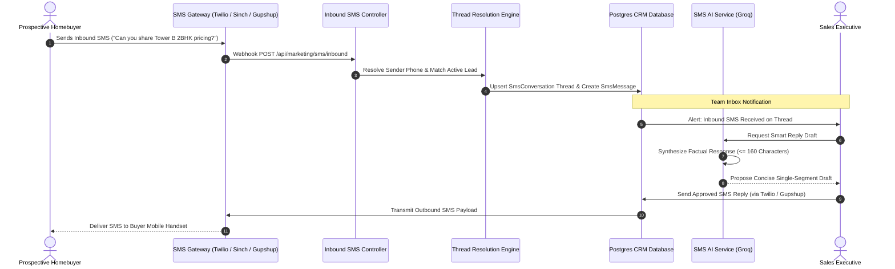
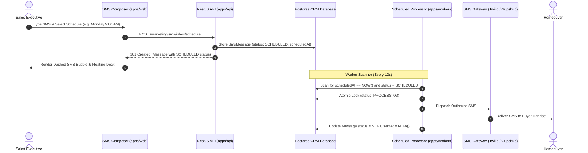

## Collaborative 2-Way SMS Messaging

While mass SMS broadcasts broadcast urgent project updates, high-value real estate buyers frequently text back asking for payment schedules, floor plans, or consultation appointments. The BrokerOS SMS Team Inbox (`/dashboard/marketing/sms/inbox`) provides a centralized multi-agent workspace where sales teams manage conversational SMS threads without relying on individual personal mobile phones.

Key operational capabilities include:
- **Centralized Virtual Long Numbers (VLN)**: Route all incoming customer texts to a unified corporate inbox accessible by the entire sales team.
- **Real-Time Thread Continuity**: Chronological history of inbound buyer texts and outbound agent replies tied to the CRM lead record.
- **Live Character and Segment Meter**: Monitors GSM-7 vs Unicode character counts in real time, calculating billable segments and credit usage before dispatch.
- **AI-Assisted Smart Replies**: Groq `openai/gpt-oss-120b` generates succinct responses ($\le 160$ characters) grounded in project inventory, amenities, and pricing.
- **Lead 360 Contact Drawer**: View the prospect's real estate requirements, budget, qualification temperature, and site visit history directly beside the conversation.

---

## 2-Way SMS Architecture

---

## Workspace Layout and Controls

The SMS Team Inbox interface is organized into three operational panels:

### Conversation Directory (Left Panel)
- **Status Filter**: Toggle between **Open** (active customer inquiries awaiting reply), **Pending** (awaiting customer response or loan verification), and **Closed** (archived or booked threads).
- **Assigned Agent Filter**: Filter threads assigned to the logged-in sales executive or supervise department-wide conversations as a sales manager.
- **Full-Text Search**: Search instantly across contact phone number, lead name, or message text content.
- **Unread Badges**: Real-time counters indicating unread client messages with automatic read status updates.
- **Conversation Chips**: Compact semantic pills distinguish new contacts, lead temperature, broker or customer records, and scheduled messages.

### Conversation Stream (Center Panel)
- **Chronological Message Thread**: Clean timeline distinguishing between inbound buyer texts and outbound agent responses.
- **Message Envelope Details**: Displays carrier timestamp, sender phone number, delivery status, and segment count.
- **Smart Message Composer**: Real-time character counter showing remaining characters in the current segment and flagging accidental Unicode characters (emojis, smart quotes).
- **Quick Reply Selector**: One-click insertion of pre-saved executive text snippets (such as `/site-visit-directions`, `/price-sheet`, `/agent-callback`).
- **AI Smart Reply Generator**: Button to draft an immediate contextual response optimized to stay within a single 160-character segment.

### Lead 360 Context Drawer (Right Panel)
- **CRM Contact Profile**: Immediate access to the prospect's full name, phone number, email address, and assigned development.
- **Qualification Score & Temperature**: Live display of lead temperature (`HOT`, `WARM`, `COLD`) and AI engagement score.
- **Budget Bracket**: Displays the buyer's declared budget range and preferred unit typology (for example, 2-Bedroom Condo).
- **Stage Progression Shortcuts**: Directly advance the lead's status to `SITE_VISIT_SCHEDULED` or `NEGOTIATION` without leaving the inbox.

---

## Inbound SMS Webhook Integration

BrokerOS ingests incoming text messages across major telecom aggregators:

| Gateway Inbound Protocol | BrokerOS Dedicated Endpoint | Configuration Location |
| :--- | :--- | :--- |
| **Twilio Programmable SMS** | `/api/marketing/sms/inbound/twilio` | Twilio Console > Phone Numbers > Configure > A Message Comes In. |
| **AWS SNS / Pinpoint** | `/api/marketing/sms/inbound/aws-sns` | AWS SNS Topic HTTPS subscription receiving inbound SMS notifications. |
| **Sinch SMS Inbound** | `/api/marketing/sms/inbound/sinch` | Sinch Dashboard > Numbers > Delivery & Inbound SMS Callbacks. |
| **Gupshup Enterprise** | `/api/marketing/sms/inbound/gupshup` | Gupshup Enterprise SMS Callback URL for 2-way long-code traffic. |
| **Universal Inbound API** | `/api/marketing/sms/inbound` | Standardized JSON payload adapter for custom SMPP gateways and aggregators. |

---

## Character Encoding and Segment Calculations

The message composer enforces strict transparency regarding segment costs:

- **GSM-7 Standard Encoding**: Supports up to **160 characters** in the first segment. Multi-part messages use 153 characters per segment due to concatenation headers.
- **Unicode Encoding**: Triggered automatically if emojis, accented characters, or non-Latin scripts are typed, reducing capacity to **70 characters** for the first segment and 67 characters per subsequent segment.
- **Segment Warning Alert**: Highlights when an agent's text crosses into a second billable segment, helping sales teams control telecom credit expenditures.

---

## Scheduled SMS Messaging

Sales executives can schedule 1-on-1 SMS replies to prospects at specific dates and times directly from the SMS team inbox (`Dashboard -> Marketing -> SMS -> Inbox`).

### Scheduling Features and Controls

1. **Triggering the Modal**: In the SMS composer toolbar, click the `<CalendarClock />` icon or open the split Send button dropdown menu and select **Schedule Message**.
2. **Scheduling Modal Controls**:
   - **Preset Quick Picks**: Choose from **In 1 hour**, **Tomorrow 9:00 AM**, **Tomorrow 2:00 PM**, or **Monday 9:00 AM**.
   - **Custom DateTime Picker**: Specify exact date and minute values for future transmission.
   - **Live Segment Recalculation**: The modal displays real-time character counters and billable segment breakdowns, preventing unintended SMS cost overruns.
3. **Pending State and Inline Bubble Controls**:
   - The scheduled text appears in the conversation stream with an amber dashed border, clock indicator, and status badge `SCHEDULED`.
   - Dedicated action buttons on the bubble allow agents to:
     - **Send Now**: Immediately push the text through the active SMS provider (Twilio, Gupshup, Sinch, AWS SNS).
     - **Edit**: Modify message body copy, recalculate segment limits, or update the scheduled execution time.
     - **Cancel**: Abort transmission and mark the message status as `CANCELLED`.
4. **Floating Scheduled Messages Dock**:
   - A persistent floating notification dock sits above the message composer whenever one or more messages are queued for the selected contact.
   - Provides instant visibility into upcoming scheduled follow-ups without needing to hunt through historical transcripts.
5. **Conversation List Indicator**:
   - Conversations with pending scheduled dispatches display an amber `[Scheduled: <Date>]` chip next to the buyer's name in the left directory.

