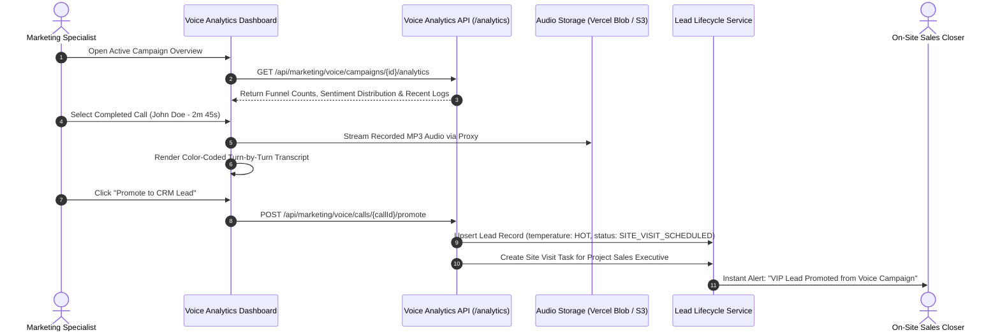

Once an outbound AI voice campaign is launched, marketing managers and sales executives track conversational outcomes in real time. The **Voice Analytics & Call Logs** suite (`VoiceCallLogsTable.tsx`, `VoiceCampaignFunnel.tsx`) provides complete visibility into connection rates, duration metrics, recorded audio, transcripts, and customer sentiment.

---

## Live Call Audit & Lead Promotion Pipeline

Marketing specialists can audit completed calls, listen to conversations, and promote high-intent prospects directly into active sales pipelines:

---

## Voice Campaign Conversion Funnel (`VoiceCampaignFunnel.tsx`)

The campaign overview tracks prospective buyer drop-off across five conversion stages:

| Funnel Stage | Operational Metric | Target Benchmark | Business Significance |
| :--- | :--- | :--- | :--- |
| **Total Dialed** | All numbers queued and initiated. | 100% of target list | Baseline audience volume. |
| **Connected** | Answered by a human or voicemail. | 65% to 75% | Indicates phone number accuracy and caller ID reputation. |
| **Completed** | Full conversation that reached the closing objective. | 40% to 50% | Demonstrates script resonance and agent engagement. |
| **Positive Sentiment** | Buyers expressing genuine purchase intent. | 25% to 35% | Direct qualification of budget, space, and timeline. |
| **Site Visits Booked** | In-person weekend lounge tour confirmed. | 5% to 10% | Primary revenue-generating milestone for the brokerage. |

---

## Sentiment Classification & Lead Temperature Mapping

During and immediately following each telephone conversation, the voice AI extracts customer sentiment and maps it directly to CRM lead attributes using `mapVoiceSentimentToTemperature` from `@brokeros/constants`:

| AI Extracted Sentiment | Customer Behavior During Call | Automatic CRM Temperature | Next Workflow Action |
| :--- | :--- | :--- | :--- |
| 🟢 **`POSITIVE`** | Asked about price slabs, requested floor plans, or confirmed a tour slot. | 🔥 **`HOT`** | Immediate alert dispatched to sales executives; site visit task created. |
| 🟡 **`NEUTRAL`** | Listened to the pitch, asked to receive a brochure via WhatsApp, or requested a callback next week. | 🌤️ **`WARM`** | Automatically enrolled in WhatsApp or Email nurturing drip sequence. |
| 🔴 **`NEGATIVE`** | Expressed disinterest, budget mismatch, or stated they already purchased elsewhere. | ❄️ **`COLD`** | Marked as unsubscribed or suppressed from future telecalling broadcasts. |

---

## Recipient Call Logs Table (`VoiceCallLogsTable.tsx`)

The interactive call logs table displays granular details for every single dialed contact:

- **Full-Text Search & Filters**: Search instantly by prospect name or phone number. Filter by call status (`COMPLETED`, `BUSY`, `NO_ANSWER`, `FAILED`) and sentiment.
- **Inline Audio Player**: Listen to recorded `.mp3` audio calls with play, pause, seek, and variable speed toggles (1x, 1.25x, 1.5x).
- **Single & Bulk Selection**: Select multiple qualified records simultaneously to perform bulk sales assignments.
- **CSV Data Export**: Export full call logs with durations, disposition statuses, and recording links for offline reporting.

---

## Interactive Transcript & Investigation Drawer

Clicking on any completed call row opens the **Call Investigation Drawer**:

<CardGroup cols={2}>
  <Card title="Synchronized Audio Playback" icon="headphones">
    Listen to the call recording with progress scrubber and waveform visualization.
  </Card>
  <Card title="Color-Coded Speaker Bubbles" icon="comments">
    Turn-by-turn dialogue display with AI agent utterances in blue and customer responses in green.
  </Card>
  <Card title="Extracted Deal Criteria" icon="bullseye">
    AI-extracted buyer insights: stated budget, desired configuration (e.g., 3BHK), and requested tour times.
  </Card>
  <Card title="Call Duration & Provider Details" icon="clock">
    Exact talk time in seconds, carrier SIP disconnect codes, and telephony provider call IDs.
  </Card>
</CardGroup>

---

## Direct Lead Promotion Engine (`/promote`)

When high-volume campaigns dial external CSV lead lists, contacts are initially stored as `VoiceRecipient` records rather than polluting the core CRM lead database.

When an external contact demonstrates purchase intent during an AI conversation:
1. The marketing manager clicks **Promote to CRM Lead** (or selects multiple contacts and clicks **Bulk Promote**).
2. BrokerOS executes `POST /api/marketing/voice/calls/:callId/promote`.
3. The contact is upgraded to a full record in the `Lead` table.
4. The system assigns the lead to an on-site sales executive, attaches the call transcript and audio recording to the lead profile, and sets status to `SITE_VISIT_SCHEDULED`.
5. The sales closer receives an immediate high-priority notification to follow up before the customer visits the project lounge.
