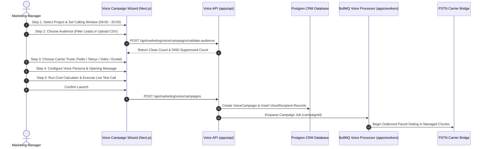

The **Voice Campaign Wizard** (`apps/web/features/marketing/voice/wizard/`) provides an audited 5-step launch flow for mass outbound telecalling campaigns. It prevents accidental launches, scrubs telephone numbers against compliance databases, calculates estimated telephone and AI compute budgets, and allows marketers to execute dual-mode test calls before reaching out to prospective buyers.

---

## 5-Step Campaign Lifecycle Pipeline

The wizard guides marketing managers through five structured preparation stages:

---

## Step 1: Project Identity & Calling Window (`VoiceStep1ProjectSchedule.tsx`)

In the opening step, marketers establish the commercial and regulatory scope of the outreach:

- **Campaign Title**: Descriptive internal name (for example, *Skyline Tower B: Penthouse Priority Broadcast*).
- **Project Association**: Binds the campaign to a specific development from active inventory. Unit layouts, address details, and price slabs are automatically attached to the agent context.
- **Line of Business Boundary (`isCpCampaign`)**:
  - `false` (Brokerage): Internal sales team outreach to direct prospective buyers.
  - `true` (Channel Partner): Network broadcast targeting external real estate brokers and channel partners.
- **Statutory Calling Window**: Configures permitted dialing hours (`callingWindowStart` and `callingWindowEnd`, default 09:00 to 20:00). Calls are prevented from dialing outside these hours, protecting the brokerage from telecom regulatory penalties.
- **Scheduled Dispatch**: Choose immediate launch upon confirmation or schedule for a future date and time.

---

## Step 2: Target Audience & Compliance Scrubbing (`VoiceStep2Audience.tsx`)

Marketers can populate the campaign audience through two distinct pipelines:

### Pipeline A: Active CRM Leads
Filter existing prospects directly from the BrokerOS database:
- **Lead Status**: Target prospects in `NEW`, `CONTACTED`, or `SITE_VISIT_SCHEDULED` statuses.
- **Temperature**: Focus exclusively on `HOT`, `WARM`, or re-engage `COLD` leads.
- **Budget Range**: Target buyers who expressed interest matching project unit slabs.

### Pipeline B: High-Volume CSV Lead Upload
Upload an external spreadsheet containing up to 50,000 recipient records:
- **Automatic Column Detection**: Maps phone numbers, recipient names, emails, and custom variables.
- **E.164 Normalization**: Cleanses raw phone inputs (stripping parentheses, spaces, and dashes) and adds default international dial codes.
- **Do-Not-Call (DND) Scrubbing**: Checks numbers against national telemarketing suppression registries, automatically filtering out opted-out contacts.

---

## Step 3: Telephony Carrier & Concurrency (`VoiceStep3TelephonyCarrier.tsx`)

Outbound voice requires reliable telecom infrastructure to present valid caller IDs and handle concurrent voice channels:

- **Carrier Trunk Selection**: Choose from configured PSTN adapters:
  - **Twilio**: Global enterprise calling with international caller ID presentation.
  - **Telnyx**: High-throughput private IP SIP trunking with low per-minute termination rates.
  - **Vobiz**: Optimized Indian domestic PSTN routing with local CLI display.
  - **Exotel**: Regional virtual numbers with built-in call recording.
- **Caller ID Number**: Select verified company telephone numbers to display on the recipient handset.
- **Concurrency Cap**: Restrict simultaneous active calls (typically between 5 and 30 channels) to ensure incoming callbacks and sales transfers do not overwhelm your floor staff.

---

## Step 4: Agent Composer Studio (`VoiceStep4AgentComposer.tsx`)

Marketers configure the conversational persona, choosing from:
- **Platform Selection**: Select the voice engine (**Vapi**, **Retell**, **ElevenLabs**, or **Sarvam**).
- **First Message**: The opening sentence spoken the instant the buyer answers (e.g., *"Hello {{firstName}}! This is Rahul from Skyline Realty..."*).
- **System Prompt**: System instructions detailing property amenities, pricing, payment schedules, and site visit booking goals.
- **Voice Trait Customization**: Select voice personas, adjust speech speed, and configure silence timeouts.

---

## Step 5: Review, Budget Simulation & Test Call (`VoiceStep5ReviewLaunch.tsx`)

Before any real prospects are dialed, Step 5 performs comprehensive pre-flight verification:

### 1. Cost & Budget Estimation (`calculateVapiCallMetrics`)
Calculates the projected campaign expenditure across two cost centers:
- **Carrier Telephony Fees**: Estimated based on carrier per-minute rates (e.g., ~$0.008/min on Telnyx, ~$0.014/min on Twilio) multiplied by expected average talk duration (typically 90 seconds).
- **AI Compute Inference**: Combined cost of LLM tokens, TTS audio synthesis, and STT transcription per minute.
- **Total Blended Budget**: Displays maximum projected spend with safety cap warnings.

### 2. Dual-Mode Test Calling
Marketers can verify the conversation on demand:
- **In-Browser Audio Simulation**: Speak to the agent using computer microphone and speakers via WebRTC.
- **Live Cellular Phone Call**: Enter your mobile number to receive an immediate test phone call from the configured PSTN carrier trunk.

### 3. Launch Execution
Clicking **Dispatch Campaign** transitions the campaign to `PROCESSING` status and alerts the BullMQ background worker (`marketing-voice.processor.ts`) to commence paced dialing.
