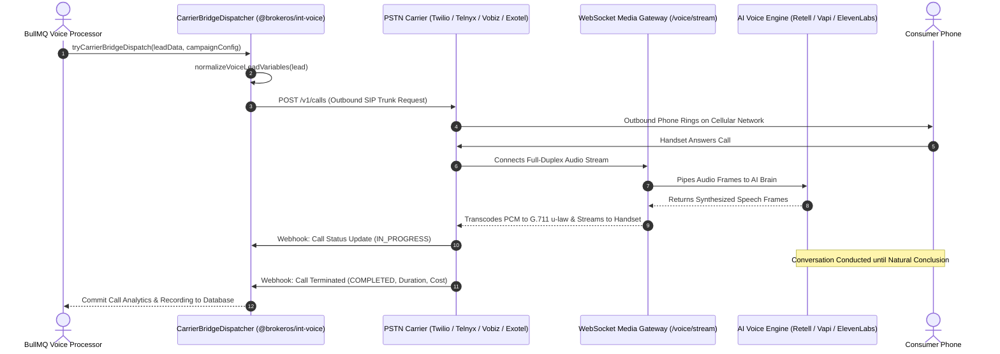

While conversational AI engines handle natural language reasoning and speech synthesis, outbound phone calls must physically travel across Public Switched Telephone Networks (PSTN). BrokerOS provides a dedicated **Carrier Telephony Bridge** layer (`@brokeros/int-voice`) that connects cloud AI voice agents to enterprise telecom carriers.

This separation ensures your brokerage maintains full ownership of its telephone numbers, caller ID reputation, and telecom contract pricing without being locked into a single AI SaaS vendor.

---

## Carrier Bridge Dispatcher Architecture

The `CarrierBridgeDispatcher` (`integrations/voice/bridge/carrier-bridge-dispatcher.ts`) abstracts carrier-specific telecom APIs into a unified dispatch pipeline:

---

## Supported Telephony Carrier Adapters

BrokerOS maintains self-contained, typed telecom adapters inside `integrations/voice/telephony/`:

| Carrier Adapter | Protocol & Mechanism | Regional Advantage | Target Real Estate Use Case |
| :--- | :--- | :--- | :--- |
| **Twilio** | REST API & Programmable Voice SIP | Global enterprise presence | International buyer campaigns with localized caller ID presentation in 180+ countries. |
| **Telnyx** | Global Private IP Network SIP Trunking | Ultra-low latency termination | High-concurrency domestic and international broadcasting with wholesale per-minute pricing. |
| **Vobiz** | Indian Domestic PSTN Interconnect | Local Indian CLI presentation | High-volume domestic campaigns across Mumbai, Delhi NCR, Bangalore, and Hyderabad with low termination fees. |
| **Exotel** | Regional Virtual Telephony Lines | Indian enterprise telephony | Automated dual-channel call recording and parallel virtual long number pools. |

---

## Carrier Verification & Latency Health Check

Through the **Telephony Carriers Settings Tab** (`TelephonyCarriersTab.tsx`), administrators can configure and verify carrier credentials:

- **Credential Fields**: Configure Provider, Account SID, Auth Token, API Key, API Token, Subdomain, and SIP Domain.
- **Multiple Virtual Caller IDs**: Bind pools of verified phone numbers to a single carrier trunk, enabling round-robin caller ID rotation.
- **Live Connection Ping (`/verify`)**: Administrators can click **Verify Carrier** to dispatch an immediate diagnostic ping (`POST /api/marketing/voice/integrations/telephony/:id/verify`). The system tests API authentication and measures round-trip network latency, rendering a green verification badge and latency readout (e.g., *Valid - 84ms*).

---

## Dynamic Variable Normalization Engine

Before transmitting lead data to the carrier and voice engine, BrokerOS passes parameters through `normalizeVoiceLeadVariables` from `@brokeros/constants`:

### 1. E.164 Phone Normalization
Strips formatting characters, spaces, and brackets. Validates length and prepends international country codes:
- Indian mobile: `98765 43210` becomes `+919876543210`.
- US mobile: `(415) 555-0199` becomes `+14155550199`.

### 2. Phonetic Currency & Budget Expansion
Text-to-speech engines often fail when reading raw currency numbers. The normalizer transforms numbers into natural spoken words:
- Indian Real Estate: `15000000` is pronounced as *"One Crore Fifty Lakh Rupees"*.
- International Real Estate: `750000` is pronounced as *"Seven Hundred and Fifty Thousand Dollars"*.

### 3. Conversational Date & Time Formatting
Converts ISO timestamp strings into friendly conversational phrasing (for example, converting `2026-10-18T11:00:00Z` to *"this Saturday morning at eleven o'clock"*).

---

## Concurrency Throttling & Calling Window Enforcement

High-volume campaigns can easily saturate carrier SIP channel capacities or overwhelm brokerage sales teams if not carefully regulated:

- **Concurrency Caps**: Campaigns enforce strict concurrency limits (typically 5 to 20 concurrent channels per trunk). The worker dequeues calls in chunks and only initiates new dials as previous conversations terminate.
- **Pacing Delays**: To respect telecom carrier Calls-Per-Second (CPS) thresholds and avoid network rate-limiting, the background processor injects a 600ms pacing pause between consecutive batch chunks.
- **Calling Window Enforcement**: Outbound calling automatically observes statutory legal hours (`callingWindowStart` and `callingWindowEnd`, default 09:00 to 20:00). If a campaign is actively dialing when the evening cutoff arrives, it automatically halts dispatch and resumes the following morning.
- **Failover Routing**: If a primary carrier encounters circuit congestion (HTTP 503), the `CarrierBridgeDispatcher` can fall back to a secondary configured carrier trunk.
