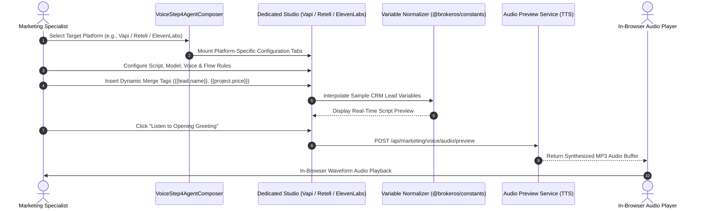

The **Agent Composer Studio** is the central creative environment where marketing specialists design outbound telecalling personas. In real estate sales, an effective voice agent must balance prompt clarity, realistic breathing pauses, instant objection handling, and respectful call exit conditions.

The studio coordinates dedicated visual editors tailored to specific AI platforms while providing unified script editing, variable interpolation previewing, and audio simulation.

---

## Composer Studio Architecture

The studio pipeline resolves project inventory parameters, injects customer context, and provisions live agent instances across underlying AI platforms:

---

## The Three Dedicated Assistant Studios

Rather than forcing a generic, one-size-fits-all form, BrokerOS provides dedicated deep configuration studios for the leading conversational AI platforms:

### 1. Vapi Assistant Studio (`VapiAssistantStudio.tsx`)
A 5-tab visual configuration studio designed for the [Vapi](https://vapi.ai) voice orchestration platform:

- **Script & Prompts**: Configure First Message (immediate greeting upon answer), System Prompt, and variable chips.
- **Intelligence**: Select from OpenAI (GPT-4o, GPT-4o-mini), Anthropic (Claude 3.5 Sonnet), Groq (Llama-3.3-70b), Anyscale, and OpenRouter with temperature and max token limits.
- **Voice Synthesis**: Browse voices across 7 providers (**ElevenLabs**, **Cartesia**, **Deepgram Aura**, **Azure Speech**, **PlayHT**, **OpenAI**, and **LMNT**). Fine-tune speed, stability, similarity boost, and filler injection.
- **Speech-to-Text (STT)**: Configure Deepgram Nova-2, Talkscriber, or Whisper transcribers with custom keyword vocabulary boosting (e.g., *RERA*, *carpet area*, *penthouse*, *bhk*).
- **Conversational Flow**: Set silence timeouts, interruption thresholds, voicemail detection (AMD), and background sound ambience (office chatter, quiet room, or coffee shop).

### 2. Retell Assistant Studio (`RetellAssistantStudio.tsx`)
A 4-tab studio engineered for [Retell AI](https://retellai.com) low-latency agents:

- **Prompt & Knowledge**: Configure the agent role, property FAQs, and objection handling guidelines.
- **Model Selection**: Switch between GPT-4o, Claude 3.5 Sonnet, and Gemini 1.5 Pro with low-latency streaming endpoints.
- **Voice Persona Catalog**: Select from high-fidelity Retell voices, Deepgram Aura models (Asteria, Orion), or ElevenLabs Indic voices (Viraj, Rachel).
- **Call Dynamics**: Configure backchanneling ("uh-huh", "got it"), ambient noise levels, reminder trigger delays, and interruption sensitivity.

### 3. ElevenLabs Conversational Studio (`ElevenLabsAssistantStudio.tsx`)
A studio engineered for [ElevenLabs](https://elevenlabs.io) Conversational AI models:

- **Model Hierarchy**: Access GPT-5 series, GPT-4.1 series, Claude series, and Gemini 3.x series LLM backbones.
- **TTS Engine**: Switch between **Eleven Flash v2.5** (75ms response latency), **Eleven Turbo v2.5**, **Eleven Multilingual v2** (29 languages), and **Eleven v3 Conversational**.
- **Multilingual Support**: Configure native Indic English, Hindi, Arabic, Spanish, French, and Portuguese scripts with localized pronunciation models.

---

## Dynamic Lead & Project Variable Interpolation

BrokerOS automatically populates merge tags at runtime using `normalizeVoiceLeadVariables` and `interpolateVoiceTemplate` from `@brokeros/constants`:

| Variable Tag | Data Source | Formatted Spoken Output |
| :--- | :--- | :--- |
| `{{firstName}}` | Recipient / Lead Profile | *"Rahul"* |
| `{{lead.phone}}` | Recipient Phone | Normalized E.164 phone string |
| `{{project.name}}` | Selected Project Record | *"Skyline Luxuria"* |
| `{{project.city}}` | Project Location | *"Gurugram, Haryana"* |
| `{{project.startingPrice}}` | Inventory Price Slab | *"two crore forty lakh rupees"* (phonetically expanded) |
| `{{assignedAgent}}` | Sales Representative | *"Priya Sharma"* |

### Phonetic Currency & Date Normalization
Standard TTS engines frequently mispronounce numeric prices (e.g., reading `15000000` as individual digits). The BrokerOS `normalizeVoiceLeadVariables` engine automatically expands monetary quantities into phonetically natural language based on project region:
- Indian Real Estate: `₹1,50,00,000` is automatically normalized to *"One Crore Fifty Lakh Rupees"*.
- International Real Estate: `$750,000` is normalized to *"Seven Hundred and Fifty Thousand Dollars"*.

---

## In-Browser Audio Preview Studio

Before saving an agent or initiating a test call, marketers can preview the selected voice persona directly in the browser via `InBrowserAudioPlayer.tsx`:

- **Instant Speech Synthesis**: Calls the backend TTS engine (`/api/marketing/voice/audio/preview`) to synthesize the configured opening pitch.
- **Waveform Visualizer**: Real-time visual audio waveform representation with play, pause, seek, and loop controls.
- **Variable Playback Speed**: Preview speech cadence at 0.75x, 1x, 1.25x, 1.5x, and 2x speeds.
- **Multi-TTS Engine Comparison**: Toggle between Cartesia Sonic, ElevenLabs, Deepgram Aura, MiniMax, OpenAI, and Sarvam to evaluate the best latency and tonal quality.
